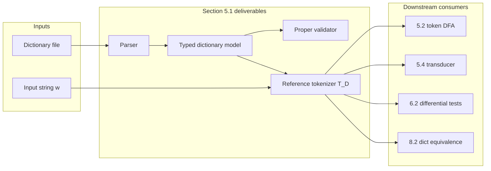

# Section 5.1 — Dictionary model and reference tokenizer

Planning document for the first compulsory implementation milestone.

## Metadata

| Field | Value |
|---|---|
| **Status** | `approved` — blocking decisions D1–D7 decided 2026-09-11 |
| **Spec section** | [5.1 Formal dictionary model and independent reference tokenizer](../../research/markdown/cs345-project-specification/index.md) |
| **Primary sources** | Berglund & van der Merwe [6] (*Formalizing BPE Tokenization*); spec §4.3 internal representations |
| **Related plans** | [`approved-extensions-2026-09.md`](approved-extensions-2026-09.md) (8.2, 8.11) |
| **Implementation ticket** | [`../tickets/TICKET-001-dictionary-and-reference-tokenizer.md`](../tickets/TICKET-001-dictionary-and-reference-tokenizer.md) — ready for implementation |
| **Assessable promotion** | Concise summary → `26455900-CS345/docs/` when implementation starts |

### Source pointers

| Source | Agent path | Use for |
|---|---|---|
| Project spec §5.1 | [`../specs/cs345-project-specification.md`](../specs/cs345-project-specification.md) | Requirements, marking context |
| Paper [6] Markdown | [`../../research/markdown/formalizing-bpe-tokenization/index.md`](../../research/markdown/formalizing-bpe-tokenization/index.md) | Definitions 1–5, Examples 1–3, Lemma 1 |
| Paper [6] PDF | `research/sources/formalizing-bpe-tokenization.pdf` | Verify Def. 3, Def. 5 before locking semantics |

---

## What Section 5.1 requires

Section 5.1 is the **foundation correctness oracle** for the project. It is not a separately marked criterion, but weak work here directly reduces evidence for the baseline token DFA (5.2) and tokenizer transducer (5.4).

### Required deliverables

| ID | Deliverable | Spec / paper basis |
|---|---|---|
| **A** | **Formal dictionary model** — typed base symbols, tokens, ordered merge rules, dictionary as sequence (not set) | Spec §4.3; [6] Def. 1 |
| **B** | **Dictionary parser** — read on-disk format; preserve order; diagnose duplicates, malformed, unreachable, unsupported entries | Spec §5.1 |
| **C** | **Proper-dictionary validator** — every non-base token in a rule must be constructible from a higher-priority rule | [6] Def. 5; spec §5.1 |
| **D** | **Independent reference tokenizer** — slow, transparent canonical BPE; oracle for differential tests | Spec §5.1; [6] Def. 3 (`T^D`) |

### Explicit non-goals (defer to later sections)

- Baseline token DFA / successive-merge construction (Section 5.2)
- String-to-tokenization transducer (Section 5.4)
- minbpe or other external tokenizer comparison (Section 5.4)
- Performance optimisation of tokenization
- Compact automaton, experiments, extensions

### Downstream consumers



---

## Formal background (paper [6])

Read these before locking semantics. Markdown is for search; verify fidelity-sensitive wording in the PDF.

### Definition 1 — Dictionary and rule priority

A BPE dictionary `D = [u₁ ⫽ v₁, …, uₙ ⫽ vₙ]` is an **ordered sequence** of merge rules. Rule index `i` has **higher priority** than rule `j` when `i < j`.

Merge notation: `τ ⇒ τ'` when adjacent tokens `u` and `v` in tokenization `τ` are replaced by single token `uv` using rule `u ⫽ v ∈ D`.

### Definition 2 — Base tokenizations

`T^D_base(w)` is the set of tokenizations reachable from the initial tokenization `T_∅(w)` (one token per base symbol) by applying rules from `D` in any order until no rule applies.

### Definition 3 — Canonical tokenization (SentencePiece semantics)

`T^D(w)` — the **correct tokenization** — is obtained by:

1. Start at `τ₀ = T_∅(w)`.
2. Repeatedly: among all applicable rules, pick the **highest-priority** rule; among occurrences of that rule, pick the **leftmost**; merge.
3. Stop when no rule applies.

**Intuition:** at every step, highest priority wins; ties broken left-to-right.

### Definition 4 — HuggingFace semantics (for reference only)

`T^D_hf(w)` picks the highest-priority applicable rule, then applies it **left-to-right until it no longer applies**, before reconsidering priority.

**Lemma 1:** If `D` is **proper**, then `T^D(w) = T^D_hf(w)` for all `w`. The spec states that for proper dictionaries we need only one canonical semantics.

### Definition 5 — Proper dictionary

`D` is **proper** if for each rule `uⱼ ⫽ vⱼ` at position `j`:

- If `|uⱼ| > 1`, there exists `i < j` with `uⱼ = uᵢ vᵢ`.
- If `|vⱼ| > 1`, there exists `i < j` with `vⱼ = uᵢ vᵢ`.

Improper example ([6] Example 3): `D = [ab⫽a, a⫽b]` — token `ab` appears before any rule produces it.

### Useful vs useless rules

A rule is **useful** if it is applied when tokenizing some string; for proper dictionaries, Corollary 1: a rule is useful iff it is applied when tokenizing `uᵢ vᵢ`. A dictionary can be **proper** yet contain **useless** rules (spec §6.1 expects both cases).

---

## What we will build

### Components

| Component | Responsibility | Likely GitLab path |
|---|---|---|
| `Symbol` / `Token` | Distinct types; equality, hashing, serialisation | `src/bpe_token_automata/tokens.py` |
| `MergeRule`, `Dictionary` | Ordered rules; priority by index; `uv` concatenation | `src/bpe_token_automata/dictionary/model.py` |
| Parse errors / validation results | Structured diagnostics (rule index, kind, message) | `src/bpe_token_automata/dictionary/errors.py` |
| `parse_dictionary(...)` | Path or text → `Dictionary` | `src/bpe_token_automata/dictionary/parser.py` |
| `validate_proper(...)` | Def. 5 check | `src/bpe_token_automata/dictionary/validator.py` |
| `tokenize_reference(...)` | `T^D(w)` → token sequence | `src/bpe_token_automata/reference_tokenizer.py` |
| `detokenize(...)` | Token sequence → string (π in paper) | shared utility |
| Fixtures | Paper examples, proper/improper dicts | `data/dictionaries/`, `tests/` |
| Design record (later) | Locked decisions promoted to assessable docs | `26455900-CS345/docs/` |

### Reference tokenizer algorithm (to implement after decisions)

Given proper dictionary `D` and input string `w`:

1. `τ ← T_∅(w)` — split `w` into one token per base symbol.
2. Loop until no merge applies:
   - Find all adjacent pairs `(tᵢ, tᵢ₊₁)` in `τ` that match some rule `u ⫽ v` in `D` (i.e. `tᵢ = u` and `tᵢ₊₁ = v`).
   - Among matching rules, select the one with **smallest index** (highest priority).
   - If several positions match that rule, merge at the **leftmost** position.
   - Replace `(u, v)` by single token `uv`.
3. Return final token sequence.

**Independence requirement:** this module must not import or share merge logic with future DFA/transducer code beyond shared **data types** (`Dictionary`, `Token`, `TokenSequence`).

---

## Decision register

Update **Status**, **Decision**, and **Rationale** as humans resolve each item. Implementation must not begin while any **blocking** row remains `open`.

### Summary table

| # | Decision | Blocking? | Status | Decision | Rationale |
|---|---|---|---|---|---|
| D1 | Alphabet / Unicode representation | yes | `decided` | UTF-8 **bytes** (0–255) | Matches GPT-2/tiktoken/minbpe and §5.6 realistic dictionaries |
| D2 | Canonical tokenizer semantics | yes | `decided` | SentencePiece **`T^D`** only (Def. 3) | Spec canonical semantics; equals HF on proper dicts (Lemma 1) |
| D3 | Dictionary file format | yes | `decided` | **Merge list + YAML** adapters | Merge list for realistic prefixes; YAML for compact test fixtures |
| D4 | Rule/token syntax in files | yes | `decided` | Space-separated tokens; `\xHH` byte escapes; `\u` not required; duplicates/empty rejected at parse; self-merge allowed | Readable fixtures; explicit byte encoding for §5.6 path |
| D5 | Base alphabet Σ | yes | `decided` | **Fixed byte alphabet 0–255** | Consistent with D1; base DFA (5.2) uses full byte range |
| D6 | Error handling policy | yes | `decided` | Structured parse/validation results; tokenizer **rejects improper** dicts | Spec §6.1 improper handling; collect diagnostics where cheap |
| D7 | Public API shape | yes | `decided` | **`@dataclass(frozen=True)`**; dedicated **`TokenSequence`** type | Extension 8.11 and §6.2 token-level comparisons |
| D8 | Useful-rule analysis timing | no | `open` | | |
| D9 | Pre-tokenization | no | `decided` | **None** — start from `T_∅(w)` | Paper [6]; spec pre-tokenization only in §5.4 comparisons |
| D10 | Test serialisation format | no | `decided` | **`⫽` separator** in test helpers (e.g. `abc⫽bc⫽ab`) | Matches paper notation in assertions |
| D11 | CLI entry points | no | `decided` | **Defer** until README pass | Tests sufficient for 5.1 |
| D12 | Assessable doc promotion | no | `decided` | **`26455900-CS345/docs/design-decisions.md`** | Promoted summary of D1–D7 |

---

### D1 — Alphabet / Unicode representation

**Question:** What is a base symbol in the implementation?

| Option | Pros | Cons |
|---|---|---|
| **UTF-8 bytes** (0–255) | Matches GPT-2/tiktoken/minbpe; realistic §5.6 dicts | Paper character examples need encoding; emoji is multi-byte |
| **Unicode code points** | Clean paper examples; §5.3 non-ASCII/emoji examples | Differs from byte-level real dicts unless wrapped |
| **Grapheme clusters** | Linguistically natural | Heavy dependency; rarely used in BPE literature |

**Constraints:** Spec §5.3 requires a project-wide statement; choices are not interchangeable.

**Recommendation:** Prefer **UTF-8 bytes** if §5.6 experiments target GPT-2-style merge lists; prefer **code points** if early milestones prioritise reproducing paper examples literally. Consider a thin **Symbol** abstraction so representation can be documented without scattering encoding logic.

**Status:** `decided`

**Decision:** UTF-8 **bytes** (0–255). Base symbols are single bytes; strings and tokens are `bytes`.

**Rationale:** Matches GPT-2/tiktoken/minbpe and planned §5.6 dictionary experiments; emoji and non-ASCII are multi-byte sequences under this model.

---

### D2 — Canonical tokenizer semantics

**Question:** Which tokenization function does the reference tokenizer implement?

| Option | Notes |
|---|---|
| **SentencePiece `T^D` only** (recommended) | Matches [6] “correct tokenization”; spec “canonical BPE semantics” |
| **HuggingFace `T^D_hf` only** | Differs on improper dicts only |
| **Both, selectable** | Extra scope; useful for one improper regression test |

**Constraints:** For proper `D`, all coincide (Lemma 1). Spec: implement canonical semantics directly; need not differentiate SP vs HF for proper dicts.

**Recommendation:** Implement **`T^D` (Definition 3)** only. Optional later test: Example 3 improper dict shows HF ≠ SP if we add HF for education.

**Status:** `decided`

**Decision:** SentencePiece **`T^D`** (Definition 3) only.

**Rationale:** Spec canonical semantics; for proper dictionaries coincides with HuggingFace (Lemma 1).

---

### D3 — Dictionary file format

**Question:** How are dictionaries stored in the repository?

| Option | Notes |
|---|---|
| **Line-oriented merge list** | One rule per line; priority = line order; GPT-2/tiktoken compatible |
| **YAML fixtures** | Convenient for tests; not standard for large dicts |
| **Both** | Parser adapter per format |

**Constraints:** Tracked fixtures in GitLab; §5.6 needs realistic merge-list prefixes.

**Recommendation:** Primary format = **merge list** (`u v` or `u⫽v` per line). YAML optional for small test fixtures.

**Status:** `decided`

**Decision:** **Merge list** (primary) + **YAML** adapter for test fixtures.

**Rationale:** Realistic §5.6 prefixes use merge lists; YAML keeps small test dicts readable in repo.

---

### D4 — Rule/token syntax in files

**Question:** How are tokens encoded in dictionary files?

Sub-questions:

- Merge operator: space-separated pair, literal `⫽`, or tab?
- Multi-byte tokens: raw UTF-8 in file, `\xHH` escapes, quoted strings?
- Where are **duplicate rules**, **empty tokens**, **self-merge** `u⫽u` caught — parse time vs validation time?

**Recommendation:** Space-separated UTF-8 literals for paper-style fixtures; `\xHH` for byte-level fixtures; duplicates and empty tokens = **parse/validation errors** with rule line number; self-merge allowed if syntactically valid (needed for §5.2).

**Status:** `decided`

**Decision:** Space-separated token pair per line; optional `⫽` in line; `\xHH` byte escapes; reject duplicates and empty tokens at parse; allow self-merge.

**Rationale:** Readable ASCII fixtures; explicit bytes for general inputs; self-merge needed for §5.2.

---

### D5 — Base alphabet Σ

**Question:** How is the base alphabet determined for `T_∅(w)`?

| Option | Notes |
|---|---|
| **Infer from input** | Only symbols appearing in `w` are tokens |
| **Infer from dictionary + input** | Include symbols appearing in rule tokens |
| **Fixed byte alphabet 0–255** | Natural for byte-level BPE |
| **Explicit declaration in dictionary file** | Extra syntax |

**Recommendation:** Tie to D1 — if bytes, base tokens are individual bytes; alphabet for base DFA (5.2) may be larger than any single input string.

**Status:** `decided`

**Decision:** Fixed byte alphabet **0–255**; `T_∅(w)` splits `w` into length-1 byte tokens.

**Rationale:** Consistent with D1; supports universal base DFA over all bytes in §5.2.

---

### D6 — Error handling policy

**Question:** How do parser, validator, and tokenizer report failures?

| Component | Options |
|---|---|
| Parser | fail-fast vs collect-all diagnostics |
| Validator | exception vs `ValidationResult` with issue list |
| Tokenizer on improper `D` | reject with clear error vs undefined (spec §6.1 expects explicit improper behaviour) |

**Recommendation:** Parser and validator return **structured results** (issues with line index / rule index). Tokenizer **refuses improper dictionaries** with explicit error; useless-but-proper dictionaries are allowed.

**Status:** `decided`

**Decision:** Parser/validator return structured issue lists; tokenizer raises on improper dictionary.

**Rationale:** Spec §6.1; enables rich test assertions without silent fixes.

---

### D7 — Public API shape

**Question:** Python types and module layout?

| Topic | Options |
|---|---|
| Modelling | `@dataclass(frozen=True)` vs TypedDict vs custom classes |
| `Dictionary` | immutable ordered sequence; `rule.priority == index` |
| Tokenizer output | `tuple[Token, ...]` vs dedicated `TokenSequence` type |

**Recommendation:** Frozen dataclasses; dedicated **`TokenSequence`** (supports extensions 8.11 and §6.2 token-level comparisons); keep package flat initially (`dictionary/` subpackage).

**Status:** `decided`

**Decision:** Frozen dataclasses; `dictionary/` subpackage; dedicated `TokenSequence` type.

**Rationale:** Supports extensions 8.11 and token-level differential tests in §6.2.

---

### D8 — Useful-rule analysis (deferrable)

**Question:** Implement `is_useful(rule)` in 5.1 or defer?

**Paper:** Corollary 1 — rule `uⱼ⫽vⱼ` is useful iff applied when tokenizing `uⱼ vⱼ`.

**Recommendation:** Defer dedicated API to testing phase; optional helper once reference tokenizer exists.

**Status:** `open`

**Decision:**

**Rationale:**

---

### D9 — Pre-tokenization (deferrable)

**Question:** Apply whitespace or other pre-tokenizers before BPE?

**Paper [6]:** starts from `T_∅(w)` without pre-tokenizer.

**Spec §5.4:** mentions pre-tokenization in performance comparisons only.

**Recommendation:** **No pre-tokenizer** in 5.1 reference implementation; document as project invariant unless explicitly added later.

**Status:** `decided`

**Decision:** **None** — no pre-tokenizer; always start from `T_∅(w)`.

**Rationale:** Paper [6] default; avoids semantic drift before §5.4 comparisons.

---

### D10 — Test serialisation format (deferrable)

**Question:** How do tests assert expected token sequences?

**Recommendation:** Human-readable separator matching paper, e.g. `abc⫽bc⫽ab`, plus round-trip equality on `TokenSequence` objects.

**Status:** `decided`

**Decision:** Test helpers use **`⫽` separator** for expected token strings.

**Rationale:** Matches paper notation; keeps assertions readable in tests.

---

### D11 — CLI entry points (deferrable)

**Question:** Add `python -m bpe_token_automata.tokenize` during 5.1?

**Recommendation:** Defer CLI until README pass; tests and pytest are sufficient for 5.1.

**Status:** `decided`

**Decision:** **Defer** CLI to README pass.

**Rationale:** Pytest coverage sufficient for 5.1 milestone.

---

### D12 — Assessable doc promotion (deferrable)

**Question:** When and what to copy to `26455900-CS345/docs/`?

**Recommendation:** After D1–D7 are `decided`, promote a one-page **`design-decisions.md`** with Unicode choice, semantics, file format, error policy — no private agent paths or chat content.

**Status:** `open`

**Decision:**

**Rationale:**

---

### Decisions already made elsewhere

From [`approved-extensions-2026-09.md`](approved-extensions-2026-09.md):

- Token sequences must be **first-class** (supports 8.11).
- Dictionary **pairs** and recorded **seeds** will matter for 8.2 — fixtures should not assume a single dictionary only.
- Do **not** delay 5.1 to build extension-only frameworks.

---

## Recommended reading before deciding

| Order | Material | Focus |
|---|---|---|
| 1 | [6] Def. 1, 3, 5 | Dictionary, canonical tokenization, properness |
| 2 | [6] Examples 1–3 | Expected behaviour; improper dict |
| 3 | [6] Lemma 1 | Why one semantics suffices for proper dicts |
| 4 | Spec §4.3 | Required internal representations |
| 5 | Spec §6.1 | Improper vs useless rules |
| 6 | Spec §6.2 | Oracle role of reference tokenizer |

---

## Test strategy preview (for TICKET-001)

Planning only — implement with the ticket.

### Unit tests

- Parse valid merge list; preserve order
- Reject malformed lines, duplicates, empty tokens
- `validate_proper` accepts paper Example 1 dictionary
- `validate_proper` rejects Example 3 improper dictionary `[ab⫽a, a⫽b]`
- Proper dictionary with useless rule (paper remark after Def. 5) still validates

### Reference tokenizer regression

- Empty dictionary: `T^D(w)` = `T_∅(w)` (spec §6.1)
- Paper Example 1: `w = abcbcab` → `abc⫽bc⫽ab` (under chosen encoding)
- `detokenize(tokenize(w)) == w` for fixture strings
- Tokenizer rejects improper dictionary with explicit error

### Negative cases

- Unsupported encodings reported, not silently coerced
- Improper dictionary never produces silent “best effort” tokenization

---

## Human review checklist

Work through blocking decisions **D1–D7** with your partner. For each:

1. Read the cited spec/paper section (verify Def. 3 and Def. 5 in PDF if unsure).
2. Fill **Decision** and **Rationale** in the register above.
3. Set **Status** to `decided`.
4. When all blocking rows are `decided`, update this document **Status** to `approved` and unblock TICKET-001.

### Quick decision worksheet (recorded 2026-09-11)

```text
D1 Alphabet:        UTF-8 bytes (0–255)
D2 Semantics:       SentencePiece T^D (Definition 3)
D3 File format:     Merge list + YAML adapters
D4 Token syntax:    Space-separated; \xHH escapes; no duplicates/empty
D5 Base alphabet:   Fixed bytes 0–255
D6 Errors:          Structured results; reject improper at tokenize
D7 API shape:       Frozen dataclasses + TokenSequence
```

---

## Revision history

| Date | Change |
|---|---|
| 2026-09-11 | Initial planning document created |
| 2026-09-11 | Blocking decisions D1–D7 decided (bytes, SentencePiece, merge list + YAML) |
| 2026-09-11 | Example 1 fixture uses proper rule order (`b⫽c` before `a⫽bc`; paper lists a pedagogical non-proper order) |
