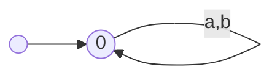
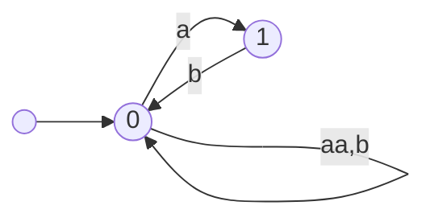
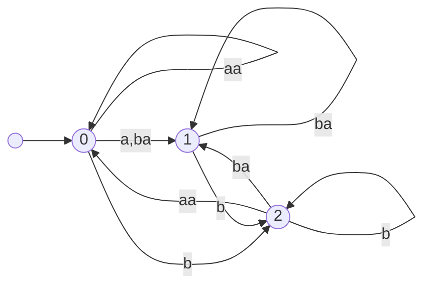
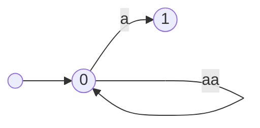
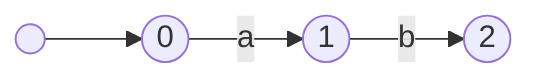
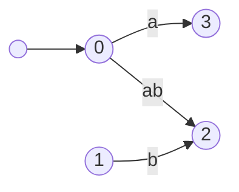
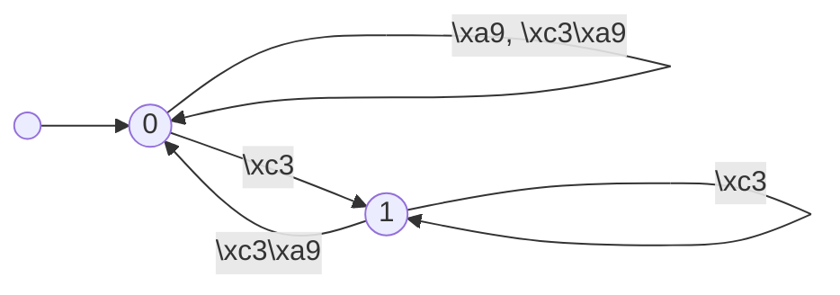

# Token DFA worked examples (Section 5.3)

This note reproduces the principal small examples of Berglund, Martens and van der Merwe [5] and three original constructions. For every merge it records the Algorithm 2 triples $S$, the fresh states, the transitions that are added, omitted, or redirected, and the canonical tokenizations of a stated finite bound.

The automata below are the untrimmed output of `construct_token_dfa`. State identifiers are the integers used by the implementation ($0,1,2,\ldots$); they correspond to the paper’s $q_0,q_1,q_2,\ldots$. DOT can be regenerated with `to_dot` (Graphviz PNG/SVG is not part of CI).

## Symbol model (D1)

**Symbols are UTF-8 bytes** (integer values $0$–$255$). They are not Unicode code points and not grapheme clusters. Those three choices are not interchangeable.

- Base tokenization $T_\emptyset(w)$ splits `w: bytes` into length-1 tokens.
- A dictionary literal `é` is the two-byte token `C3 A9` (U+00E9 as UTF-8). It is **not** a base-alphabet symbol: `universal_token_dfa` requires length-1 tokens.
- Precomposed NFC `é` (`C3 A9`) and NFD `e` + U+0301 (`65 CC 81`) are different byte strings and therefore different tokenizations, even though they are the same grapheme.
- U+1F600 GRINNING FACE is encoded as four bytes `F0 9F 98 80`. Under D1 it is a string over a four-symbol alphabet, and it is not one alphabet symbol.

Paper figures use tiny alphabets such as $\{a,b\}$. The Unicode examples below likewise restrict $\Sigma$ to the relevant bytes so that diagrams stay readable. The construction is the same as for the full byte alphabet.

Display of non-ASCII tokens uses `\xHH` (see `format_token_label`). Incomplete UTF-8 sequences such as `\xf0` are valid tokens.

## Paper Example 2: $u=v$ then $u\neq v$

Source: [5] Example 2 and Figs. 3–4 (PDF pp. 4–5), Algorithm 2 (PDF p. 4). Fixture: [`data/dictionaries/example2.merges`](../data/dictionaries/example2.merges).

$$
D=[a⫽a,\ b⫽a],\qquad \Sigma=\{a,b\},\qquad L=\Sigma^*.
$$

$A_0$ is the universal one-state token DFA. Tests lock the edges against Fig. 3 and the triples against the paper’s walkthrough. Example 2’s sentence that $q_2$ “gets all non-$ba$ transitions” contradicts Algorithm 2 line 14 and both figures; this project follows the algorithm and the figures (decision D22). $ba$ **is** copied onto the fresh state.

### $A_0$

One accepting state with self-loops on $a$ and $b$. Accepted tokenizations of $\Sigma^{\le 3}$ are exactly the base tokenizations (see the table below).



### Merge $a⫽a$ ($u=v$): $A_0\to A_1$

- **Triples.** $\delta(0,a)=0$ and $\delta(0,a)=0$, so $S=\{(0,0,0)\}$ and $S_2=\{0\}$.
- **Add $uv$.** Line 5 adds $0\xrightarrow{aa}0$. $\Gamma=\{a,b,aa\}$.
- **Fresh state.** `fresh(0)=1`, accepting because $0$ is accepting.
- **Inherit.** $u=v$, so line 16 copies $\Gamma\setminus\{v,uv\}=\Gamma\setminus\{a,aa\}$. Only $b$ is copied: $1\xrightarrow{b}0$. There is **no** $aa$ on state $1$.
- **Redirect.** Every current $a$-edge into $S_2$ is retargeted: $0\xrightarrow{a}0$ becomes $0\xrightarrow{a}1$. State $1$ has no $a$-edge (it was omitted), so Remark 3 does not create an $a$-loop on the fresh state.



Strings whose base tokenization contained $a⫽a$ now use the token $aa$. The leftover odd $a$ still exists as a token, which is why the fresh state is needed: $0\xrightarrow{a}1$ must be able to accept without then reading another $a$.

### Merge $b⫽a$ ($u\neq v$): $A_1\to A_2$

- **Triples.** $\delta(0,b)=0,\delta(0,a)=1$ and $\delta(1,b)=0,\delta(0,a)=1$, so $S=\{(0,0,1),(1,0,1)\}$ and $S_2=\{0\}$.
- **Add $uv$.** Line 5 (Fig. 4, left) adds $0\xrightarrow{ba}1$ and $1\xrightarrow{ba}1$. $\Gamma=\{a,b,aa,ba\}$.
- **Fresh state.** `fresh(0)=2`, accepting.
- **Inherit.** $u\neq v$, so line 14 copies $\Gamma\setminus\{a\}$, **including** $ba$: $2\xrightarrow{b}0$, $2\xrightarrow{aa}0$, $2\xrightarrow{ba}1$. (This is the D22 correction: $ba$ is copied.)
- **Redirect.** Every current $b$-edge into $S_2=\{0\}$ is retargeted, including the edge just copied onto $2$ (Remark 3): $0\xrightarrow{b}2$, $1\xrightarrow{b}2$, and $2\xrightarrow{b}2$.



### Tokenizations of $\Sigma^{\le 3}$

$\mathbb{T}^{D_i}$ is the independent reference tokenizer on the dictionary prefix of length $i$. Tests also check every string of length at most $4$. $\varepsilon$ is accepted throughout because the initial state is accepting.

| $w$ | $A_0$ / $D_0=[]$ | $A_1$ / $D_1=[a⫽a]$ | $A_2$ / $D_2=D$ |
|---|---|---|---|
| $\varepsilon$ | $\varepsilon$ | $\varepsilon$ | $\varepsilon$ |
| `a` | `a` | `a` | `a` |
| `b` | `b` | `b` | `b` |
| `aa` | `a⫽a` | `aa` | `aa` |
| `ab` | `a⫽b` | `a⫽b` | `a⫽b` |
| `ba` | `b⫽a` | `b⫽a` | `ba` |
| `bb` | `b⫽b` | `b⫽b` | `b⫽b` |
| `aaa` | `a⫽a⫽a` | `aa⫽a` | `aa⫽a` |
| `aab` | `a⫽a⫽b` | `aa⫽b` | `aa⫽b` |
| `aba` | `a⫽b⫽a` | `a⫽b⫽a` | `a⫽ba` |
| `abb` | `a⫽b⫽b` | `a⫽b⫽b` | `a⫽b⫽b` |
| `baa` | `b⫽a⫽a` | `b⫽aa` | `b⫽aa` |
| `bab` | `b⫽a⫽b` | `b⫽a⫽b` | `ba⫽b` |
| `bba` | `b⫽b⫽a` | `b⫽b⫽a` | `b⫽ba` |
| `bbb` | `b⫽b⫽b` | `b⫽b⫽b` | `b⫽b⫽b` |

After $a⫽a$, the sequence `a⫽a` is no longer canonical for `aa` and is rejected by $A_1$. After $b⫽a$, `b⫽a` is rejected by $A_2$ for `ba`. Note `baa`: the higher-priority self-merge consumes `aa` first, so $b⫽a$ never fires and the tokenization stays `b⫽aa`.

## Unary self-merge chain

[5] has no unary figure. The project fixture is [`data/dictionaries/unary_self_merge.merges`](../data/dictionaries/unary_self_merge.merges):

$$
D=[a⫽a,\ aa⫽a],\qquad \Sigma=\{a\}.
$$

Expected traces are from hand-applied Algorithm 2.

### Merge $a⫽a$: $A_0\to A_1$

Same as Example 2’s first merge, without $b$.

- $S=\{(0,0,0)\}$, `fresh(0)=1`.
- Add $0\xrightarrow{aa}0$.
- Omitted labels $\{a,aa\}$, so the fresh state inherits **nothing**.
- Redirect $0\xrightarrow{a}1$.



State $1$ is accepting but has no outgoing transitions: it is the “odd $a$ leftover” after pairing from the left.

### Merge $aa⫽a$: $A_1\to A_2$

- $\delta(0,aa)=0$ and $\delta(0,a)=1$, so $S=\{(0,0,1)\}$. State $1$ has no $aa$-edge.
- Add $0\xrightarrow{aaa}1$. Omitted label $\{a\}$ because $u\neq v$.
- Inherit onto `fresh(0)=2`: $2\xrightarrow{aa}0$ and $2\xrightarrow{aaa}1$ (the new $uv$ is copied).
- Redirect every $aa$-edge into $S_2=\{0\}$, including the copy on $2$: $0\xrightarrow{aa}2$ and $2\xrightarrow{aa}2$.

$A_2$ accepts `aaa` as the single token `aaa` and rejects `aa⫽a`.

| $w$ | $D_0$ | $D_1=[a⫽a]$ | $D_2=D$ |
|---|---|---|---|
| $\varepsilon$ | $\varepsilon$ | $\varepsilon$ | $\varepsilon$ |
| `a` | `a` | `a` | `a` |
| `aa` | `a⫽a` | `aa` | `aa` |
| `aaa` | `a⫽a⫽a` | `aa⫽a` | `aaa` |
| `aaaa` | `a⫽a⫽a⫽a` | `aa⫽aa` | `aa⫽aa` |
| `aaaaa` | `a⫽a⫽a⫽a⫽a` | `aa⫽aa⫽a` | `aa⫽aaa` |
| `aaaaaa` | `a⫽a⫽a⫽a⫽a⫽a` | `aa⫽aa⫽aa` | `aa⫽aa⫽aa` |

The second merge is not “merge as much as possible into one token”: `aaaa` is two `aa` tokens, and `aa⫽a` does not apply to `aa⫽aa`.

## Original example 1: finite language $L=\{ab\}$

Fixture: [`data/automata/finite_ab.yaml`](../data/automata/finite_ab.yaml) and [`data/dictionaries/original_finite_ab.merges`](../data/dictionaries/original_finite_ab.merges). $D=[a⫽b]$. This is Algorithm 2 on a **non-universal** string DFA whose middle state is not accepting.

### $A_0$



The only accepted tokenization is `a⫽b`.

### Merge $a⫽b$

- $S=\{(0,1,2)\}$, $S_2=\{1\}$, `fresh(1)=3`.
- Add $0\xrightarrow{ab}2$.
- $u\neq v$, omitted $\{b\}$. State $1$ has only a $b$-edge, so **no** transitions are inherited onto $3$.
- Redirect $0\xrightarrow{a}1$ to $0\xrightarrow{a}3$.
- State $3$ is not accepting ($1$ was not).



State $1$ is now unreachable from the initial state (Remark 2: Algorithm 2 does not trim). After the merge the unique accepted tokenization of `ab` is the token `ab`; `a⫽b` is rejected because $3$ has no $b$-edge.

| $w$ | before ($D_0$) | after ($D_1$) |
|---|---|---|
| `ab` | `a⫽b` (accepted) | `ab` (accepted); `a⫽b` rejected |

## Original example 2: non-ASCII `é` as two bytes

U+00E9 LATIN SMALL LETTER E WITH ACUTE is UTF-8 `C3 A9`. Fixture: [`data/dictionaries/original_eacute.merges`](../data/dictionaries/original_eacute.merges).

$$
D=[\mathtt{\backslash xc3}⫽\mathtt{\backslash xa9}],\qquad \Sigma=\{\mathtt{C3},\mathtt{A9}\}.
$$

If symbols were Unicode code points, `é` would be a single letter and this dictionary would not even type-check as a pair of base symbols. Under D1 it is an ordinary $u\neq v$ merge of two bytes.

- $S=\{(0,0,0)\}$, `fresh(0)=1`.
- Add $0\xrightarrow{\mathtt{C3A9}}0$.
- Omitted $\{\mathtt{A9}\}$. Inherit $1\xrightarrow{\mathtt{C3}}0$ and $1\xrightarrow{\mathtt{C3A9}}0$.
- Redirect $\mathtt{C3}$-edges into $S_2=\{0\}$, including the copy: $0\xrightarrow{\mathtt{C3}}1$ and $1\xrightarrow{\mathtt{C3}}1$.



| Input bytes | What it is | $T^D$ |
|---|---|---|
| `C3 A9` | NFC `é` | one token `\xc3\xa9` |
| `C3` | first UTF-8 byte only | `\xc3` |
| `A9` | second UTF-8 byte only | `\xa9` |
| `65 CC 81` | NFD `e` + U+0301 | `e⫽\xcc⫽\x81` |

NFC `é` and NFD `é` are the same grapheme and the same Unicode character after normalisation, but they are **different** byte strings. The DFA over $\{\mathtt{C3},\mathtt{A9}\}$ accepts the NFC merged token and cannot even read the NFD string. A code-point or grapheme-cluster alphabet would have identified them.

A merge-file line `é é` would parse as two **length-2** tokens and is improper as a first rule. The fixtures write `\xc3 \xa9` so that the base symbols stay length 1.

## Original example 3: U+1F600 as four bytes

U+1F600 GRINNING FACE is UTF-8 `F0 9F 98 80`. Fixture: [`data/dictionaries/original_emoji.merges`](../data/dictionaries/original_emoji.merges).

$$
D=[\mathtt{F0}⫽\mathtt{9F},\ \mathtt{F09F}⫽\mathtt{98},\ \mathtt{F09F98}⫽\mathtt{80}],\qquad
\Sigma=\{\mathtt{F0},\mathtt{9F},\mathtt{98},\mathtt{80}\}.
$$

The dictionary is proper: each non-base left token is the product of the previous rule. Treating U+1F600 as one alphabet symbol is rejected by `universal_token_dfa`.

### Merge 1: `\xf0 ⫽ \x9f`

- $S=\{(0,0,0)\}$, `fresh(0)=1`.
- Add $0\xrightarrow{\mathtt{F09F}}0$. Omitted $\{\mathtt{9F}\}$.
- Inherit onto $1$: `\x80`, `\x98`, `\xf0`, `\xf0\x9f` (not `\x9f`).
- Redirect `\xf0`-edges, including the copy: $0\to 1$ and a loop at $1$.

After this merge the first two bytes of the emoji are one token; the last two remain separate.

### Merge 2: `\xf0\x9f ⫽ \x98`

- $S=\{(0,0,0),(1,0,0)\}$, `fresh(0)=2`.
- Add `\xf0\x9f\x98` from both $0$ and $1$ to $0$. Omitted $\{\mathtt{98}\}$.
- Inherit onto $2$ from $0$ except `\x98`, including the new three-byte token.
- Redirect every `\xf0\x9f`-edge into $\{0\}$, including the copy on $2$ (Remark 3 loop).

### Merge 3: `\xf0\x9f\x98 ⫽ \x80`

- $S=\{(0,0,0),(1,0,0),(2,0,0)\}$, `fresh(0)=3`.
- Add the four-byte token from $0,1,2$ to $0$. Omitted $\{\mathtt{80}\}$.
- Inherit onto $3$ except `\x80`, including the emoji token.
- Redirect every `\xf0\x9f\x98`-edge into $\{0\}$, including the copy on $3$.

$A_3$ accepts the grinning face as the single token `\xf0\x9f\x98\x80` and rejects the four-byte base tokenization. Tests check every string of length at most $3$ over this four-byte alphabet against `tokenize_reference` after each prefix.

| Input | $D_0$ | $D_1$ | $D_2$ | $D_3$ |
|---|---|---|---|---|
| `F0 9F 98 80` (U+1F600) | `\xf0⫽\x9f⫽\x98⫽\x80` | `\xf0\x9f⫽\x98⫽\x80` | `\xf0\x9f\x98⫽\x80` | `\xf0\x9f\x98\x80` |

## Regenerating diagrams

```python
from bpe_token_automata.automaton import (
    construct_token_dfa,
    to_dot,
    universal_token_dfa,
)

dot = to_dot(construct_token_dfa(dictionary, base).final)
```

`MergeTrace` on `ConstructionResult.traces` lists `triples`, `s2_to_fresh`, `added_uv`, `inherited` (copies **before** line 19), `omitted_labels`, and `redirected`. The Example 2 and unary expected traces in the test suite come from the paper text and from hand-applied Algorithm 2, not from reading `apply_merge` back into the oracle.

## References

- CS345 project specification, Section 5.3.
- Martin Berglund, Willeke Martens, and Brink van der Merwe. Constructing a BPE tokenization DFA. *Theoretical Computer Science*, 1083:116131, 2026. Algorithm 2, Example 2, Figs. 3–4, Remarks 2–3.
- Martin Berglund and Brink van der Merwe. Formalizing BPE tokenization. *EPTCS* 388:16–27, 2023. Definition 3 ($T^D$).
