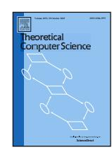
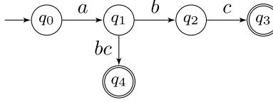
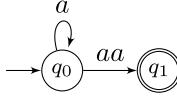
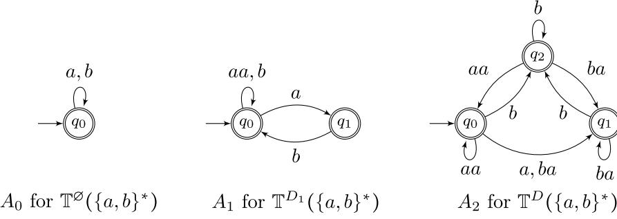
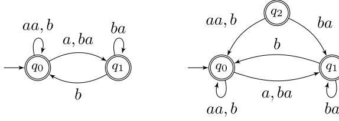
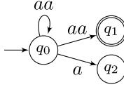
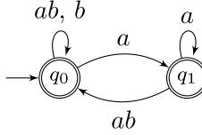
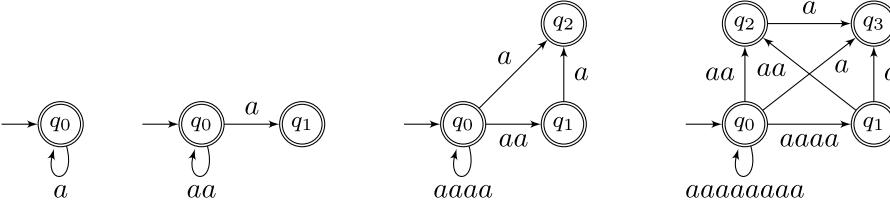
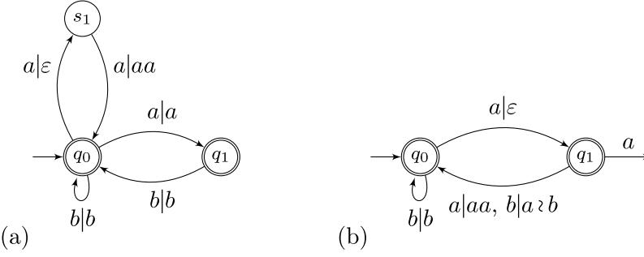

# Constructing <sup>a</sup> BPE tokenization DFA *[<sup>⋆</sup>](#page-0-0)*

Martin Berglun[d](https://orcid.org/0000-0002-3692-6994) [a,](#page-0-1)[<sup>∗</sup>](#page-0-2) , Willeke Martens [<sup>a</sup>](#page-0-1) , Brink van der Merwe [b](#page-0-3)[,c](#page-0-4)

<sup>a</sup> *Department of Computing Science, Umeå University, Umeå, 90187, Sweden*

<span id="page-0-1"></span><sup>b</sup> *Department of Computer Science, Stellenbosch University, Stellenbosch, 7600, South Africa*

<span id="page-0-4"></span><span id="page-0-3"></span><sup>c</sup> *National Institute for Theoretical and Computational Sciences, Stellenbosch, 7600, South Africa*

### a r t i c l e i n f o

### Section Editor: Seth Pettie

Handling Editor: Katie Harris

### *Keywords:*

Tokenization

Byte pair encoding

Automata theory

### a b s t r a c t

Many natural language processing systems operate over *tokenizations* of text to address the openvocabulary problem. In this paper, we give and analyze an algorithm for the efficient construction of deterministic finite automata (DFA) designed to operate directly on tokenizations produced by the popular byte pair encoding (BPE) technique. This makes it possible to apply many existing techniques and algorithms to the tokenized case, such as pattern matching, equivalence checking of tokenization dictionaries, and composing tokenized languages in various ways. The construction preserves some key properties of the automaton, and we use this to establish asymptotic bounds on the state complexity of the automata that result. Finally, we demonstrate how to construct an input-deterministic (subsequential) string-to-string transducer which precisely describes the relationship between strings and their correct tokenizations.

# **1. Introduction**

Subword tokenization, which decomposes <sup>a</sup> string into smaller textual units, is <sup>a</sup> key strategy for handling the open-vocabulary problem in modern large language models. Notably, byte pair encoding (BPE) tokenization [\[2\]](#page-11-0), grounded in data compression, is used in the context of prominent models like OpenAI's GPT series [\[3\]](#page-11-1) (underpinning ChatGPT [\[4\]](#page-11-2)) and Meta's LLaMA series. The algorithm successively merges adjacent tokens according to <sup>a</sup> dictionary of rules, typically built based on token pair frequencies in <sup>a</sup> training corpus.

For example, the GPT-2 tokenization of this string CIA A 2024 in Ak ita , Japan is indicated by the boxes. Common substrings like '2024', 'in' and 'Japan' are treated as single tokens, while 'CIAA' and 'Akita' are split into more common substrings, such as the well-known acronym 'CIA'. The GPT-2 dictionary can also generate the tokens CI, AA, Aki, and ta , which potentially form alternative tokenizations like CI AA for 'CIAA' and Aki ta for 'Akita'. However, merge rules in token dictionaries have distinct priorities, ensuring that the BPE algorithm, given in [Algorithm](#page-2-0) 1, maps every string to precisely one tokenization. In this case, the correct tokenization, is the one introduced earlier: CIA A and Ak ita .

While every string is mapped to <sup>a</sup> unique tokenization, the tokenization of <sup>a</sup> particular substring depends on its surrounding context. For example, kit is <sup>a</sup> single token when appearing on its own, but in Ak ita , the same substring is split across two tokens. This complicates traditional string processing tasks, such as pattern matching, typically concerned with strings over <sup>a</sup> fixed alphabet of symbols, where every string is denoted by precisely one sequence of symbols (i.e. it is based on the free monoid). As pointed out, distinct sequences of tokens can contain the same substring. Searching for <sup>a</sup> pattern in the underlying string of <sup>a</sup> tokenization




0304-3975/© 2026 The Author(s). Published by Elsevier B.V. This is an open access article under the CC BY license ([http://creativecommons.org/licenses/by/4.0/](http://creativecommons.org/licenses/by/4.0/)).

*<sup>⋆</sup>* This is <sup>a</sup> revised and extended version of [\[1\]](#page-11-3)

<span id="page-0-0"></span><sup>∗</sup> Corresponding author.

<span id="page-0-2"></span>*E-mail addresses:* [mbe@cs.umu.se](mailto:mbe@cs.umu.se) (M. Berglund), [wms@cs.umu.se](mailto:wms@cs.umu.se) (W. Martens), [abvdm@cs.sun.ac.za](mailto:abvdm@cs.sun.ac.za) (B. van der Merwe).



<span id="page-1-0"></span>

Fig. 1. A token DFA for the language  $\{a \wr b \wr c, a \wr bc\}$  which indicates the existence of two distinct tokenizations of the string  $abc$ .

requires accounting for multiple possible tokenizations. Luckily, the language of correct tokenizations (i.e. the string language where token boundaries are marked) is regular [5], and here we consider practical algorithms for constructing finite automata which operate on correct tokenizations.

Such automata are of great practical importance. Token sequences are already common in communication with language services, and if such services keep getting more popular, more and more texts may be encoded in such a way. Specific use cases may include pattern matching for filtering (e.g., on the network or for safety systems), validating the correctness of tokenizations (incorrect tokenizations can severely confuse models, similarly to occurrences of extremely rare tokens [6]), and *performing* tokenizations or rewrite tokenized texts directly. However, for practical applications it is important that we can obtain automata which are not excessively large. In Section 5 we demonstrate that the algorithm producing the automata preserves a certain measure of *locality*, and that this measure also bounds the number of states the procedure can create, ensuring that the resulting automata are of modest size.

Often the representation of the correct tokenizations is not the primary interest, but rather the *relation* between strings and their tokenization is. This too can be efficiently represented, i.e. in Section 6 we demonstrate how to obtain a string-to-string (or rather, string-to-tokenization) transducer which represents this relation. It is further demonstrated that this transducer can be made subsequential (i.e. deterministic in its input), meaning it can be used to efficiently tokenize text.

## 2. Notation and basic definitions

An *alphabet*  $\Sigma$  is a finite set of symbols. As we also consider alphabets of strings (or ‘tokens’), we consistently refer to a normal alphabet consisting of ‘indivisible’ symbols as a *base alphabet*. Let  $\Sigma^*$  denote the set of all strings (including the empty string  $\varepsilon$ ) over the base alphabet  $\Sigma$  and let  $\Sigma^+ = \Sigma^* \setminus \{\varepsilon\}$ , where  $\varepsilon$  denotes the empty word.

A *token alphabet*  $\Gamma$  over the base alphabet  $\Sigma$  is a finite subset  $\Gamma \subset \Sigma^+$  where  $\Sigma \subseteq \Gamma$  and for all  $w \in \Gamma$  with  $|w| > 1$  there are some  $u, v \in \Gamma$  such that  $w = uv$ . We refer to the elements of such  $\Gamma$  as *tokens*. A sequence of tokens  $u_1, \dots, u_n \in \Gamma$  is denoted  $u_1 \wr \dots \wr u_n$  and called a *tokenization*. The set of all sequences of tokens over  $\Gamma$  is denoted  $\Gamma^{\varsigma}$ . For any arbitrary token alphabet  $\Gamma$  and corresponding base alphabet  $\Sigma$ , we define  $\pi : \Gamma^{\varsigma} \rightarrow \Sigma^*$  as  $\pi(u_1 \wr \dots \wr u_n) = u_1 \dots u_n$ , i.e. the concatenation of the tokens. For a tokenization  $\tau$ , let  $|\tau|$  denote the number of tokens in  $\tau$ , i.e.  $|u_1 \wr \dots \wr u_n| = n$  for  $u_1, \dots, u_n \in \Gamma$ .

Observe that while both tokenizations and strings are sequences, they are different *kinds* of sequences even when they contain the same elements. E.g., the tokenization  $\alpha_1 \wr \dots \wr \alpha_n \in \Gamma^{\varsigma}$  is distinct from the string  $\alpha_1 \dots \alpha_n$  despite  $\alpha_1, \dots, \alpha_n \in \Sigma$ . That is, they are both obtained by using the same sequence of elements from  $\Sigma$ , but are combined with the concatenation and tokenization operators, respectively. The tokenization  $\alpha_1 \wr \dots \wr \alpha_n \in \Gamma^{\varsigma}$  with  $\alpha_i \in \Sigma \subseteq \Gamma$ , is called the *base tokenization* of the string  $\alpha_1 \dots \alpha_n$ .

To keep our exposition clear, we adopt some conventions. We let  $\Sigma$  denote some base alphabet, and  $\Gamma$  a token alphabet over  $\Sigma$ . When giving examples, we use  $\Sigma = \{\alpha, \beta, \gamma, \dots\}$ . Furthermore, we let  $\alpha, \beta, \gamma$  be variables denoting symbols (so elements from the base alphabet), let  $u, v, w$  be strings or tokens, and  $\tau, \phi$  tokenizations. In each case, we also reserve all sub-/super-scripted variants of these symbols for those same purposes. As such we have, for example,  $\alpha_3 \in \Sigma$  and  $\hat{\tau} \in \Gamma^{\varsigma}$ . When writing  $\phi = u \wr \tau \wr v$ , we have that  $\phi$  is a tokenization where the first token is  $u$ , the last token is  $v$ , and the intervening tokens form the tokenization  $\tau$ , so  $|\phi| = |\tau| + 2$ .

<span id="page-1-1"></span>**Definition 1.** A token deterministic finite automaton (DFA) is a tuple  $A = (Q, \Gamma, q_0, \delta, F)$  where:

- •  $Q$  is the finite set of *states*,
- •  $\Gamma$  is the *token alphabet*,
- •  $q_0 \in Q$  is the *initial state*,
- •  $\delta : Q \times \Gamma \rightarrow Q$  is the *transition function*, which may be partial,
- •  $F \subseteq Q$  is the set of *final states*.

A *run* of  $A$  is a sequence  $q_1, u_1, q_2, u_2, q_3, \dots, u_{n-1}, q_n$  for some  $n \geq 0$ ,  $q_1, \dots, q_n \in Q$ ,  $u_1, \dots, u_{n-1} \in \Gamma$ , such that  $\delta(q_i, u_i) = q_{i+1}$  for all  $1 \leq i < n$ . We denote such a run as  $q_1 \xrightarrow{u_1} q_2 \xrightarrow{u_2} \dots \xrightarrow{u_{n-1}} q_n$ , or with the shorthand  $q_1 \xrightarrow{u_1 \wr \dots \wr u_{n-1}} q_n$  if the intermediate states are not of interest. We say that such a run *reads the string*  $\pi(u_1 \wr \dots \wr u_{n-1})$  or *tokenization*  $u_1 \wr \dots \wr u_n$ .

The run is *accepting* iff  $q_1 = q_0$  and  $q_n \in F$ . The *language accepted by  $A$* , denoted  $\mathcal{L}(A) \subseteq \Gamma^{\varsigma}$  is the set of all tokenizations  $\tau$  for which there exists an accepting run  $q_0 \xrightarrow{\tau} q_n$ .

Token DFAs give rise to some additional questions about determinism. Consider the automaton for the (finite) language  $\{a \wr bc, a \wr b \wr c\}$ , as shown in Fig. 1.

This automaton is deterministic in the classical sense, but there are two distinct accepting runs which read  $abc$  (i.e.  $\pi(a \wr b \wr c) = \pi(a \wr bc)$ ). As the goal is to use token DFAs to represent only correct BPE tokenizations of strings, where (as we will see later) this situation cannot occur, we introduce a stronger condition which precludes such situations.



<span id="page-2-2"></span>

**Fig. 2.** A token DFA which has unique tokenizations  $\{aa, a \lambda aa, a \lambda a \lambda a \lambda aa, \dots\}$  but is not context-invariant, with runs such as  $q_0 \xrightarrow{aaa} q_1$  and  $q_0 \xrightarrow{aaa} q_0$  violating the property.

<span id="page-2-1"></span>**Definition 2.** A token DFA  $A = (Q, \Gamma, q_0, \delta, F)$  is *context-invariant* if for runs  $q_1 \xrightarrow{\varphi} q_n$  and  $q'_1 \xrightarrow{\varphi'} q'_m$  in  $A$  for which  $\pi(\varphi) = \pi(\varphi')$  (with  $q_1$  or  $q'_1$  not necessarily being equal to  $q_0$ ), we have  $\varphi = \varphi'$ .

**Remark 1.** Context-invariance ensures that every string has a unique tokenization, e.g., the token DFA in Fig. 1 is not context-invariant, as its two runs  $q_0 \xrightarrow{abc} q_3$  and  $q_0 \xrightarrow{abc} q_4$  violate Definition 2. Context-invariance is a stronger property than simply requiring the uniqueness of tokenizations; consider the automaton in Fig. 2. Uniqueness is the special case of Definition 2 where we only consider runs where  $q_1 = q'_1$  is the initial state, and both runs are accepting. However, as we will see, BPE tokenization does fulfill context-invariance, so we demonstrate this stronger property for the automata our algorithm produces.

Next, we define BPE tokenization as defined by [2], using the formal structure introduced in [5].

**Definition 3.** A *byte pair dictionary*  $D$  over  $\Sigma$  is a sequence of pairs of tokens over  $\Sigma$ , denoted  $D = [u_1 \lambda v_1, \dots, u_n \lambda v_n]$ . We call each  $u_i \lambda v_i$  a *rule*, and say that  $u_i \lambda v_i$  has *higher priority* than  $u_j \lambda v_j$  if  $i < j$ .

A dictionary is *proper* if for each  $j$  with  $|u_j| > 1$  there exists some  $i < j$  such that  $u_j = u_i v_i$ , and, symmetrically, for each  $j$  with  $|v_j| > 1$  there exists some  $i < j$  such that  $v_j = u_i v_i$ .

Observe that when  $D$  is proper this makes  $\Sigma \cup \{u_1 v_1, \dots, u_n v_n\}$  a valid token alphabet, which we call the *token alphabet of  $D$* .

Unless otherwise stated, we assume that all dictionaries are proper. We adopt the convention that  $D$  and all its sub-/superscripted variants, always refer to some (proper) dictionary. In [5], both SentencePiece [7] and HuggingFace [8] BPE tokenization semantics are described, but the semantics are demonstrated to coincide for proper dictionaries. Some of the later arguments are clearer for HuggingFace semantics, so we choose to use those in Algorithm 1. SentencePiece semantics are arguably *more natural* however (in [5] we term them “correct”), as they simply amount to picking the highest-priority applicable rule after each time two tokens are merged. That is, to obtain the SentencePiece BPE tokenization algorithm, lines 3 and 8 in Algorithm 1 are removed, and line 5 is replaced by the following: “Let  $u_i \lambda v_i$  be the highest priority rule in  $D$  for which a decomposition, as specified in line 4, exists. Then, among the remaining decompositions, pick the unique one which minimizes  $|\phi|$ .”

<span id="page-2-0"></span>

---

**Algorithm 1** HuggingFace BPE tokenization.

---

1. 1: **Input:** a string  $\alpha_1 \cdots \alpha_n \in \Sigma^*$ , a proper dictionary  $D = [u_1 \lambda v_1, \dots, u_m \lambda v_m]$
2. 2: initialize  $\tau = \alpha_1 \lambda \cdots \lambda \alpha_n$
3. 3: **for** each rule  $u_i \lambda v_i$  in  $D$  in order of decreasing priority: **do**
4. 4:   **while** there are  $\phi$  and  $\phi'$  such that  $\phi \lambda u_i \lambda v_i \lambda \phi' = \tau$  **do**
5. 5:     choose such  $\phi$  and  $\phi'$  minimizing  $|\phi|$
6. 6:     update  $\tau = \phi \lambda u_i v_i \lambda \phi'$
7. 7:   **end while**
8. 8: **end for**
9. 9: **Output:** the HuggingFace tokenization  $\tau$ .

---

We denote the (HuggingFace) BPE tokenization of a string  $w$  according to the dictionary  $D$  as  $\mathbb{T}^D(w)$ . Note that  $\mathbb{T}^D(\alpha_1 \cdots \alpha_n)$  yields  $\alpha_1 \lambda \cdots \lambda \alpha_n$ , the so-called *base tokenization* of  $\alpha_1 \cdots \alpha_n$ . The definition of  $\mathbb{T}^D$  is naturally extended to sets so that  $\mathbb{T}^D(L) = \{\mathbb{T}^D(w) \mid w \in L\}$  for a language  $L \subseteq \Sigma^*$ . In particular,  $\mathbb{T}^D(\Sigma^+)$  is the set of all BPE tokenizations over  $\Sigma^+$  according to dictionary  $D$ .

**Example 1.** Let  $D = [a \lambda a, a \lambda b, b \lambda c, ab \lambda c, bc \lambda ab]$  and  $w = aaaaacbcabc$ . Then Algorithm 1 proceeds with the following steps:

$$\begin{aligned}
 a \lambda a & \lambda a \lambda a \lambda c \lambda b \lambda c \lambda a \lambda b \lambda c \Rightarrow aa \lambda a \lambda a \lambda c \lambda b \lambda c \lambda a \lambda b \lambda c \Rightarrow \\
 aa \lambda aa \lambda a \lambda c \lambda b \lambda c & \lambda a \lambda b \lambda c \Rightarrow aa \lambda aa \lambda a \lambda c \lambda b \lambda c \lambda ab \lambda c \Rightarrow \\
 aa \lambda aa \lambda a \lambda c \lambda b c & \lambda ab \lambda c \Rightarrow aa \lambda aa \lambda a \lambda c \lambda bc \lambda abc
 \end{aligned}$$

The first two rule applications in this example happen in the inner loop of Algorithm 1 (in two places  $a \lambda a$  can be applied). Note also that  $w$  has two substrings  $bc$ , but only one use of  $b \lambda c$  is possible since the second  $b$  is used by the higher-priority rule  $a \lambda b$ . Finally, the rule  $bc \lambda ab$  would be applicable after the fourth step, but  $ab \lambda c$  has higher priority and uses the  $bc$  token. As such we have  $\mathbb{T}^D(w) = aa \lambda aa \lambda a \lambda c \lambda bc \lambda abc$ .

<span id="page-2-3"></span>We now give a procedure for building a token DFA  $A$  for a given regular language  $L$  and dictionary  $D$  over  $\Sigma$  such that  $\mathcal{L}(A) = \mathbb{T}^D(L)$ .

For  $D = [u_1 \wr v_1, \dots, u_n \wr v_n]$  and  $0 \leq i \leq n$ , define the dictionary  $D_i$  as  $[u_1 \wr v_1, \dots, u_i \wr v_i]$  so that  $D_0 = []$  and  $D_n = D$ . We inductively construct a sequence of DFAs  $A_i$  satisfying  $\mathcal{L}(A_i) = \mathbb{T}^D(L)$ , for a regular language  $L$ . The base token DFA  $A_0$  (accepting  $\mathbb{T}^D(L)$ ) is trivially obtained from the string DFA for  $L$  by changing all symbols in  $\Sigma$  into their corresponding tokens in  $\Gamma$ . For  $1 \leq i \leq n$  we construct  $A_i$  by merging the rule  $u_i \wr v_i$  into  $A_{i-1}$  as described in [Algorithm 2](#). Observe that whenever a new transition is created by [Algorithm 2](#), we update the (partial) transition function of the input token DFA, thus yielding a new token DFA.

[Algorithm 2](#) merges the rule  $u \wr v$  into  $A = (Q, \Gamma, q_0, \delta, F)$  by considering each  $(s_1, s_2, s_3) \in Q^3$  where  $\delta(s_1, u) = s_2$  and  $\delta(s_2, v) = s_3$ . These runs reading  $u \wr v$  are replaced with ones reading  $uv$  instead, by adding the transition  $\delta(s_1, uv) = s_3$  (line 5) and removing the transition  $\delta(s_1, u) = s_2$  (line 20). However, this might inadvertently eliminate runs not containing the sequence  $u \wr v$ , i.e. runs that read a  $u$  to transition to  $s_2$ , but then continue using a different transition from the one on  $v$ , or simply accept at  $s_2$ . This is remedied by adding a new state  $\text{fresh}(s_2)$  in line 10, which inherits all outgoing transitions from  $s_2$  except the ones on  $v$  and potentially  $uv$  in lines 13–17. In particular, if  $u = v$ , a transition on  $uv$  from  $s_2$  should *not* be copied to  $\text{fresh}(s_2)$ , as this would create the run  $s_1 \xrightarrow{uv} \text{fresh}(s_2) \xrightarrow{uv} q$ , which should never be part of a run in the DFA produced by [Algorithm 2](#). This can most easily be seen by inspecting [Algorithm 1](#), the only way a token  $uu$  can be created is by the rule  $u \wr u$  being applied, and it is then applied first on the left, producing  $uu \wr u$ . Formal correctness proofs follow in [Section 4. Example 2](#) illustrates both the case where  $u = v$  and the transition is *not* copied from  $s_2$  to  $\text{fresh}(s_2)$  (the step from  $A_0$  to  $A_1$ ), and the case where  $u \neq v$  and the transition is copied (the step from  $A_1$  to  $A_2$ , observe that the token  $ba$  occurs on two transitions in  $A_2$ ).

**Remark 2.** [Algorithm 2](#) will at times produce useless states, which might simply be trimmed afterwards. This does not happen, for example, in the case where [Algorithm 2](#) is applied to a token DFA with all states being accepting. Notably, this is the case when [Algorithm 2](#) is applied to the universal token DFA (i.e. the one-state base token DFA which accepts  $\mathbb{T}^D(\Sigma^*)$ , for example,  $A_0$  in [Fig. 3](#)); or more generally, on token DFA obtained from repeatedly applying [Algorithm 2](#) (zero or more times), starting with the universal token DFA.

---

**Algorithm 2** Applying a merge.

---

<span id="page-3-0"></span>

```
1: Input: a context-invariant DFA  $A = (Q, \Gamma, q_0, \delta, F)$ , and a rule  $u \wr v$ 
2: let  $S = \{(s_1, s_2, s_3) \in Q^3 \mid \delta(s_1, u) = s_2, \delta(s_2, v) = s_3\}$ 
3: let  $S_2 = \{s_2 \mid (s_1, s_2, s_3) \in S\}$ 
4: for  $(s_1, s_2, s_3) \in S$  do
5:   add new transition by defining  $\delta(s_1, uv) = s_3$ 
6: end for
7: add  $uv$  to  $\Gamma$ 
8: for  $s_2 \in S_2$  do
9:   create a fresh state from  $s_2$ , denote it  $\text{fresh}(s_2)$ 
10:   add  $\text{fresh}(s_2)$  to  $Q$ , and if  $s_2 \in F$  add  $\text{fresh}(s_2)$  to  $F$  as well
11: end for
12: for every  $s_2 \in S_2$  do
13:   if  $u \neq v$  then
14:     add new trans. by defining  $\delta(\text{fresh}(s_2), \alpha) = \delta(s_2, \alpha)$  for all  $\alpha \in \Gamma \setminus \{v\}$ 
15:   else
16:     add new trans. by def.  $\delta(\text{fresh}(s_2), \alpha) = \delta(s_2, \alpha)$  for all  $\alpha \in \Gamma \setminus \{v, uv\}$ 
17:   end if
18: end for
19: for  $q \in Q$  with  $\delta(q, u) \in S_2$  do
20:   replace the transition by defining  $\delta(q, u) = \text{fresh}(\delta(q, u))$ 
21: end for
22: output the resulting DFA
```

---

<span id="page-3-1"></span>**Example 2.** For the byte pair dictionary  $D = [a \wr a, b \wr a]$  over  $\Sigma = \{a, b\}$ , constructing the token DFA  $A$  that accepts  $\mathbb{T}^D(\Sigma^*)$ , requires two iterations. Starting from the universal base token DFA  $A_0$  in [Fig. 3](#), [Algorithm 2](#) is first applied with the merge  $a \wr a$ , yielding the depicted token DFA  $A_1$ . Next, [Algorithm 2](#) is applied to  $A_1$  with the merge  $b \wr a$ , generating the token DFA  $A_2$  which accepts  $\mathbb{T}^D(\Sigma^*)$ . Going step by step, merging  $a \wr a$  to  $A_0$  constructs  $S = \{(q_0, q_0, q_0)\}$ , line 5 adds self loop transition on  $aa$  to  $q_0$ ,  $q_1$  is  $\text{fresh}(q_0)$ , it gets its transition on  $b$  on line 16, and finally the transition from  $q_0$  to  $q_1$  on line 20. Next, merging  $b \wr a$  to  $A_1$  has  $S = \{(q_0, q_0, q_1), (q_1, q_0, q_1)\}$ , in both triples  $q_0$  is the  $s_2$ , and a single fresh state,  $q_2$ , is created. Both  $q_0$  and  $q_1$  gain a transition on  $ba$  to  $q_1$  on line 5, the fresh state  $q_2$  gets all non- $ba$  transitions from  $q_0$  on line 14, and finally both  $q_0$  and  $q_1$  get a transition on  $b$  to the fresh state  $q_2$  on line 20. [Fig. 4](#) shows (some of) the intermediate steps in going from  $A_1$  to  $A_2$ .

**Remark 3.** It is interesting to note when and how we obtain loops at  $\text{fresh}(s_2)$  when applying [Algorithm 2](#). This happens when we have a loop on  $u$  (in the case where  $u \neq v$ ). Two transitions on  $u$  replace this loop, one going from  $s_2$  to  $\text{fresh}(s_2)$  and the other being a loop on  $\text{fresh}(s_2)$ . This happens by first in line 12 adding a transition from  $\text{fresh}(s_2)$  to  $s_2$  (on  $u$ ), and then in line 19, changing the target of this (newly added) transition to be  $\text{fresh}(s_2)$  rather than  $s_2$ , but also adding a transition from  $s_2$  to  $\text{fresh}(s_2)$  on  $u$  (in line 19).



<span id="page-4-1"></span>

**Fig. 3.** The three token DFAs constructed in [Example 2](#),  $A_0$  is the initial universal base token DFA,  $A_1$  is  $A_0$  with the rule  $a \wr a$  merged, and  $A_2$  is  $A_1$  with the rule  $b \wr a$  merged.



<span id="page-4-2"></span>

**Fig. 4.** Intermediate stages in the construction of  $A_2$  from  $A_1$  in [Example 2](#). On the left, showing the effect of lines 4–6 of [Algorithm 2](#), where the transitions on the new token  $ba$  are added. On the right, showing the effect of lines 13–14, where the fresh state  $q_2 = \text{fresh}(q_0)$  is introduced that inherits the outgoing transitions of  $q_0$  except those on  $a$ .



<span id="page-4-4"></span>

**Fig. 5.** Misusing [Algorithm 2](#) to merge the rule  $a \wr a$  to the non-context-invariant automaton in [Fig. 2](#) produces a strange nondeterministic automaton.

An example of this can be seen in [Fig. 3](#)  $A_1$  to  $A_2$ , with the loop on  $b$  at  $q_0$  in  $A_1$  being replaced by a transition from  $q_0$  to  $q_2$  and a loop at state  $q_2$  (both on  $b$ ) in  $A_2$ . Contrast this with what happens when  $u = v$ , by considering the loop on  $a$  at  $q_0$  in  $A_0$ , and  $\text{fresh}(q_0)$  being  $q_1$  in  $A_1$ .

<span id="page-4-0"></span>

#### 4. Proof of correctness

This section sets out to demonstrate that the procedure in [Section 3](#) yields the token DFA for the BPE tokenizations of the given language  $L$  and dictionary  $D$ .

In the remainder of this section, we assume that the input DFA in [Algorithm 2](#) is context-invariant. The following examples illustrate why this assumption is necessary.

**Example 3.** Applying [Algorithm 2](#) to the non-context-invariant token DFA in [Fig. 1](#) with rule  $b \wr c$ , results in a *nondeterministic* automaton because state  $q_1$  gains a second transition on the token  $bc$  (that is, we have  $(q_1, q_2, q_3) \in S$  in the application of [Algorithm 2](#)). Some results hold in this situation as well, for example, [Lemma 1](#), but it seems mostly nonsensical in practice.

**Example 4.** Similarly, merging the rule  $a \wr a$  to the non-context-invariant token DFA  $A$  in [Fig. 2](#) we obtain the automaton  $A'$  shown in [Fig. 5](#).  $A'$  is again nondeterministic, and despite  $a \wr aa \in \mathcal{L}(A)$  the constructed  $A'$  accepts *no* tokenization of the string  $aaa$ .

As it turns out [Algorithm 2](#) preserves context-invariance. However, before proving this, we first consider the following useful lemma that gets us most of the way in terms of the correctness of [Algorithm 2](#).

<span id="page-4-3"></span>**Lemma 1.** For any rule  $u \wr v$  and context-invariant DFA  $A = (Q, \Gamma, q_0, \delta, F)$  applying [Algorithm 2](#) produces a DFA  $A' = (Q', \Gamma', q'_0, \delta', F')$  such that there is a run  $q'_1 \xrightarrow{L'} q'_m$  in  $A'$  if and only if there is a run  $q_1 \xrightarrow{L} q_n$  in  $A$  (with  $q'_1$  and  $q_1$  any state in  $Q'$  and  $Q$  respectively) where  $\pi(\tau') = \pi(\tau)$ . Moreover,  $q_1 = q_0 \Leftrightarrow q'_1 = q'_0$  and  $q_n \in F \Leftrightarrow q'_m \in F'$ , that is, either both runs start from an initial state or neither does, and either both ends in an accepting state or neither does.

**Proof.** The lemma trivially holds when in  $A$  we have no run of the form  $s_1 \xrightarrow{u} s_2 \xrightarrow{v} s_3$ , since then  $S = \emptyset$  in [Algorithm 2](#), producing an unchanged  $A' = A$ . Observe that the lemma therefore especially holds when  $A$  contains a transition on  $uv$  due to its presupposed context-invariance.

To relate the runs of the automata, we relate their states. Observe that  $Q'$  contains either one or two copies of each state from  $Q$ . Define  $\gamma : Q' \rightarrow Q$  to recover the state in  $A$  from which a state in  $A'$  was created, so  $\gamma(q) = q$  for  $q \in Q$ , and  $\gamma(\text{fresh}(q)) = q$  for all  $\text{fresh}(q) \in Q' \setminus Q$  produced by line 10.

To find a run in  $A$  corresponding to the run  $q'_1 \xrightarrow{u_1 \wr \dots \wr u_{m-1}} q'_m$  in  $A'$ , note that the run  $\gamma(q'_1) \xrightarrow{u_1 \wr \dots \wr u_{m-1}} \gamma(q'_m)$  in  $A$  is well-defined unless the original run in  $A'$  contains a step of the form  $q \xrightarrow{uv} q'$  since this, by [Algorithm 2](#), is the only transition not directly inherited from  $\gamma(q)$ . If such a step of the form  $q \xrightarrow{uv} q'$  exists, then  $(\gamma(q), s, \gamma(q')) \in S$  for some  $s \in Q$ , and can be replaced by the two steps  $\gamma(q) \xrightarrow{u} s \xrightarrow{v} \gamma(q')$  instead. Repeating this procedure for all steps of the form  $q \xrightarrow{uv} q'$  produces a run in  $A$ . Given that  $\gamma(q'_0) = q_0$  and that  $q' \in F'$  if and only if  $\gamma(q') \in F$ , it follows trivially that the runs agree on accepting (or not accepting).

In the other direction, we proceed by induction on the length of runs to demonstrate that for all runs  $q_1 \xrightarrow{\sim} q_n$  in  $A$ , there exists a run  $q'_1 \xrightarrow{\sim'} q'_m$  such that  $q_n = \gamma(q'_m)$  and  $\pi(\tau) = \pi(\tau')$ . The base case is trivial since a zero-length run has  $\pi(\tau) = \pi(\tau') = \varepsilon$  and  $q_1 = \gamma(q'_1)$  for some  $q'_1 \in Q'$ . As the inductive step, extend an arbitrary run  $r$  of length  $n - 1$  in  $A$  with a transition  $q_n \xrightarrow{uv} q_{n+1}$  (remember that  $w \neq uv$  as  $A$  is free of transitions on  $uv$ ). This changes the corresponding run of  $r$  in  $A'$  according to the following three cases depending on how  $w$  relates to the rule  $u \wr v$  being merged.

1. 1. If  $w \neq v$ : the corresponding run is extended with a transition on  $w$  to  $\delta'(q'_m, w)$ , which respects the required relationship between the two runs given that  $\delta(\gamma(q'), w) = \gamma(\delta'(q', w))$  for all  $q' \in Q$  when  $w \neq v$ .
2. 2. If  $w = v$  and  $q'_m$  is a fresh state: by construction  $\delta'(q'_m, v)$  is undefined. However, observe that then the *previous* step in the corresponding run *must* be  $\delta'(q'_{m-1}, u) = q'_m$  (the only way to reach a fresh state). Hence,  $(\gamma(q'_{m-1}), \gamma(q'_m), q) \in S$  in [Algorithm 2](#) for some  $q \in Q$ . Therefore, replace that previous step with  $q'_{m-1} \xrightarrow{uv} q$ . Note that when  $u = v$  fresh states do not get transitions on  $uv$  (see line 16), but in such a case  $q'_{m-1}$  cannot be fresh, as fresh states never have outgoing transitions on  $v$ .
3. 3. If  $w = v$  and  $q'_m$  is *not* a fresh state: just like in case 1 then  $\delta'(q'_m, w)$  is defined and can be used.

By the same argument as above, straightforward inspection of  $\gamma$  establishes that either both runs or neither are accepting.  $\square$ 

We now have the necessary tools to prove that [Algorithm 2](#) preserves context-invariance.

<span id="page-5-0"></span>**Lemma 2.** *For any rule  $u \wr v$  and context-invariant DFA  $A$ , applying [Algorithm 2](#) produces a context-invariant DFA  $A'$ .*

**Proof.** By contradiction assume that  $A'$  is *not* context-invariant. Then  $A'$  has runs on  $\tau$  and  $\varphi$  so that  $\tau \neq \varphi$  but  $\pi(\tau) = \pi(\varphi)$ .

Let  $\tau = w_1 \wr \dots \wr w_n$  and  $\varphi = w'_1 \wr \dots \wr w'_m$  where  $i$  is the smallest index such that  $w_i \neq w'_i$ . The mapping defined in the proof of [Lemma 1](#) instructs to replace all occurrences of  $uv$  with  $u \wr v$  in both  $\tau$  and  $\varphi$  to yield respective corresponding runs  $\tau'$  and  $\varphi'$  in  $A$  that read  $\pi(\tau)$ . Since  $A$  is context-invariant, it must be that  $\tau' = \varphi'$ , in turn implying  $\{w_i, w'_i\} = \{u, uv\}$ . Without loss of generality let  $w_i = u$  and  $w'_i = uv$ . Then consider the token  $w_{i+1}$ , which by the defined mapping must have  $v$  as a prefix, so either

- •  $w_{i+1} = v$ , but this implies a run  $q \xrightarrow{u} q' \xrightarrow{v} q''$  in  $A'$ , impossible by [Algorithm 2](#), or,
- •  $u = v$  and then  $w_{i+1} = vv$ , but line 16 prevents the introduction of a transition on  $uv$  in the case where  $u = v$  if  $u$  has just been read.

No other alternatives for  $w_{i+1}$  are possible since any other token with  $v$  as a prefix is unaffected by the mapping (in which case  $\tau' \neq \varphi'$ ). As such, we reach a contradiction, i.e. no such  $\tau$  and  $\varphi$  exist.  $\square$ 

Next, we show the relationship between tokenizations of two corresponding accepting runs as shown to exist in [Lemma 1](#).

<span id="page-5-1"></span>**Lemma 3.** *Let  $A = (Q, \Gamma, q_0, \delta, F)$  be a context-invariant token DFA and  $A' = (Q', \Gamma', q'_0, \delta', F')$  the resulting token DFA of applying [Algorithm 2](#) with rule  $u \wr v$ . Suppose that for a given accepting run  $q_1 \xrightarrow{\sim} q_n$  in  $A$ , the corresponding accepting run in  $A'$  is  $q'_1 \xrightarrow{\sim'} q'_m$  where  $\pi(\tau) = \pi(\tau') = w$ . Then, if there exists a proper dictionary  $D$  such that  $\mathbb{T}^D(w) = \tau$ , and the dictionary  $D'$  obtained by concatenating the rule  $u \wr v$  to  $D$  is also proper, then  $\mathbb{T}^{D'}(w) = \tau'$ .*

**Proof.** From [Lemma 2](#), it follows that  $A'$  is context-invariant. Hence, we can use the mapping from the proof of [Lemma 1](#), to deduce that  $\tau'$  can be obtained from  $\tau$  by only altering the subtokenizations  $u \wr v$ :

- • In case  $u \neq v$ , each such subtokenization is simply replaced by  $uv$ .
- • In case  $u = v$ ,  $A'$  cannot read the token  $u$  followed by a token  $uu$ , as a result of  $u \wr u$  being replaced by  $uu$  starting from the subtokenization's left-most occurrence.

Now, let  $D$  be a proper dictionary such that  $\mathbb{T}^D(w) = \tau$  and suppose  $D'$  obtained by concatenating the rule  $u \wr v$  to  $D$  also is proper. Since [Algorithm 1](#) applies each rule  $u_i \wr v_i$  in order of priority to  $w$ ,  $\mathbb{T}^{D'}(w)$  can be directly obtained by applying the rule  $u \wr v$  to  $\tau$ . When applying  $u \wr v$  to  $\tau$ , we repeatedly decompose  $\tau$  into  $\phi \wr u \wr v \wr \phi'$  so that  $|\phi|$  is minimal and replace  $u \wr v$  with  $uv$  until no such decomposition can be found. Clearly, this yields that  $\mathbb{T}^{D'}(w) = \tau'$ .  $\square$ 

Observe that [Lemma 3](#) does not hold without the requirement that the involved dictionaries have to be proper. First of all, if a dictionary  $D$  is not proper, recall that the SentencePiece and HuggingFace semantics do not necessarily yield the same BPE tokenization, so  $\mathbb{T}^D$  is not well-defined. Further, we demonstrate by an example that  $\mathcal{L}(A)$ , in such cases, does not necessarily correspond to either the SentencePiece or HuggingFace tokenizations.

**Example 5.** Take the dictionary  $D = [ab \wr a, a \wr b]$  (which is not proper) and let  $L = \{a, b\}^*$ . The generated token DFA  $A$  is depicted in [Fig. 6](#). (Merging the rule  $ab \wr a$  into the base token DFA just results in the base token DFA as no runs on  $ab \wr a$  are present.)



<span id="page-6-1"></span>

**Fig. 6.** Automaton  $A$  generated for dictionary  $D = [ab \wr a, a \wr b]$  by applying the merge  $ab \wr a$  followed by the merge  $a \wr b$  to the base token DFA.

*Reminder (SentencePiece vs. HuggingFace semantics).* In *SentencePiece* semantics, tokenization proceeds by repeatedly selecting, at each step, the highest-priority rule  $u \wr v \in D$  that is applicable to the current tokenization, and applying it at the left-most possible occurrence (breaking ties by choosing the unique decomposition minimizing the length of the left context).<sup>1</sup> In *HuggingFace* semantics, one instead selects a highest-priority applicable rule  $u \wr v$  and then applies this *same* rule greedily from left to right until it is no longer applicable, before reconsidering which rule to apply next.<sup>2</sup> For proper dictionaries these semantics coincide, but for non-proper dictionaries they can differ.

Now, the SentencePiece tokenization of  $w = ababababa$  is  $aba \wr b \wr aba \wr b \wr a$  (see [5]) and the HuggingFace tokenization (see [Algorithm 1](#))  $ab \wr ab \wr ab \wr ab \wr a$ , which the token DFA  $A$  obviously accepts. Strictly speaking, for non-proper dictionaries, HuggingFace is not forced to select rules in decreasing order of priority (where for proper, it will by default), but only select the highest priority applicable rule, and keep on applying it left to right (see [5]). Thus, with this formulation, the HuggingFace tokenization will be  $ab \wr ab \wr ab \wr aba$ , and thus, token DFA  $A$  accepts neither HuggingFace nor SentencePiece tokenization, since  $\delta(\cdot, aba)$  is undefined for any given state in  $A$ .

Finally, we are ready to prove that if we use [Algorithm 2](#) iteratively to produce each time the token DFA  $A_i$ , using  $A_{i-1}$  and the rule  $u_i \wr v_i$  from the proper dictionary  $D = [u_1 \wr v_1, \dots, u_n \wr v_n]$  as input (with  $A_0$  being the base token DFA of a string DFA  $A$ ), then the language of  $A_i$  is the tokenization of  $\mathcal{L}(A)$  using  $D_i = [u_1 \wr v_1, \dots, u_i \wr v_i]$ .

<span id="page-6-4"></span>**Theorem 4.** *Let  $A$  be a string DFA over base alphabet  $\Sigma$ . Let  $D$  be the proper dictionary  $D = [u_1 \wr v_1, \dots, u_n \wr v_n]$  over  $\Sigma$ . Furthermore, let  $A_0, \dots, A_n$  be the sequence of token DFAs where  $A_0$  is the base token DFA for  $A$  and for each  $i > 0$ ,  $A_i$  is produced by applying the merge  $u_i \wr v_i$  to  $A_{i-1}$ . Then,  $\mathcal{L}(A_i) = \mathbb{T}^{D_i}(\mathcal{L}(A))$  for all  $i \in \{0, \dots, n\}$ .*

**Proof.** We proceed by induction. Let  $L = \mathcal{L}(A)$ . It is given that  $\mathcal{L}(A_0) = \mathbb{T}^{\mathcal{O}}(L)$ . Assume that  $\mathcal{L}(A_i) = \mathbb{T}^{D_i}(L)$ . Observe that since  $A$  is a string DFA,  $A_0$  is trivially context-invariant. Hence, each of the token DFAs in the sequence  $A_1, \dots, A_n$  must also be context-invariant by [Lemma 2](#). It further follows from [Lemma 1](#) that for every  $\varphi \in \mathcal{L}(A_i)$  there is some  $\varphi' \in \mathcal{L}(A_{i+1})$  such that  $\pi(\varphi) = \pi(\varphi')$ . Moreover, since  $\mathbb{T}^{D_i}(\pi(\varphi)) = \varphi$ , then  $\mathbb{T}^{D_{i+1}}(\pi(\varphi)) = \varphi'$  according to [Lemma 3](#). So, for all  $\varphi \in \mathbb{T}^{D_i}(L)$ , there exists some  $\varphi' \in \mathcal{L}(A_{i+1})$  such that  $\varphi' \in \mathbb{T}^{D_{i+1}}(L)$ . It only remains to show that all  $\psi \in \mathcal{L}(A_{i+1})$  are in  $\mathbb{T}^{D_{i+1}}(L)$ . If  $\psi \in \mathcal{L}(A_{i+1})$  then by [Lemma 1](#)  $\psi' \in \mathcal{L}(A_i)$  so that  $\pi(\psi) = \pi(\psi')$ , meaning  $\psi' \in \mathbb{T}^{D_i}(L)$ . We derive  $\psi \in \mathbb{T}^{D_{i+1}}(L)$  from [Lemma 3](#); hence  $\mathcal{L}(A_{i+1}) = \mathbb{T}^{D_{i+1}}(L)$ . This completes the induction step.  $\square$ 

The case where  $A$  is a universal string DFA is of particular interest, as the produced token DFA then accepts the language of all correct tokenizations.

<span id="page-6-0"></span>

## 5. Complexity bounds and properties preserved

A cursory reading of [Algorithm 2](#) might suggest that *each* application of the algorithm could double the size of the token DFA. This indeed holds for DFAs in which all states belong to  $S_2$  (using the notation from [Algorithm 2](#)), such as the one-state universal automaton: [Algorithm 2](#) creates a fresh copy of each state in  $Q$ . Thus, when applying [Algorithm 2](#) repeatedly, as in [Theorem 4](#), the number of states could increase by a factor  $2^{|D|}$ . However, this turns out to be too pessimistic, as the actual growth is bounded by an additive factor, which we will call *the degree of locality* of the DFA. Importantly, [Algorithm 2](#) does not increase the degree of locality nor, more generally, the degree of  $k$ -locality of a token DFA.

<span id="page-6-5"></span>**Definition 4.** A token DFA  $A = (Q, \Gamma, q, \delta, F)$  has *degree of  $k$ -locality*  $l$ , for  $k, l \in \mathbb{N}$ , if for all  $\tau \in \Gamma^*$ , with  $|\tau| = k$ , we have  $|\{q' \in Q \mid q \in Q, q \preceq \tau\}| \leq l$ .

That is, if a (token) DFA has degree of  $k$ -locality  $l$ , then for any tokenization  $\tau$  with  $|\tau| \geq k$ , there are at most  $l$  possible states that a run reading  $\tau$  can reach, regardless of the starting state of that run.

Let  $dloc(A, k)$  denote the *smallest*  $l \in \mathbb{N}$  such that  $A$  has a degree of  $k$ -locality  $l$ .

**Observation 1.** For any DFA  $A$ , we have  $dloc(A, i) \geq dloc(A, j)$  for all  $i < j$ . This is easily seen, since  $A$  cannot contain *more* runs for a longer tokenization than for any of its subtokenizations.

**Definition 4** generalizes the notion of a  $k$ -local automaton, closely related to several other concepts. First, recall the definition of a  $k$ -local DFA from [9] (which, in turn, draws on [10]).

<span id="page-6-2"></span>

<sup>1</sup> Formally, this is the selection rule from [5, Def. 3].

<span id="page-6-3"></span>

<sup>2</sup> Formally, this is [5, Def. 4].

**Definition 5.** A token DFA  $A = (Q, \Gamma, q, \delta, F)$  is  $k$ -local, for  $k \in \mathbb{N}$ , if for all tokenizations  $\tau \in \Gamma^*$  with  $|\tau| = k$ , we have  $|\{q' \in Q \mid q \in Q, q \xrightarrow{\tau} q'\}| \leq 1$ .

A  $k$ -local automaton is thus an automaton with *degree of  $k$ -locality 1*. Of particular interest are the *local languages* [11], the languages which are recognized by 1-local automata (also called local automata).<sup>3</sup>

Before proceeding, we introduce the notation required in the remainder of this section. For a token DFA  $A = (Q, \Gamma, q_0, \delta, F)$ , let  $E_\tau(A)$  denote the set of states reachable by reading  $\tau$ . Thus, we have  $\text{dloc}(A, k) = \max_{|\tau|=k} |E_\tau(A)|$ . Further, for a tokenization  $\phi$ ,  $E_{\tau, \phi}(A)$  is the subset of states in  $E_\tau(A)$  from which a run reading  $\phi$  starts, while  $E_\tau^\phi(A) \subseteq E_\tau(A)$  is its complement. Observe the distinction between  $E_{uv}(A)$  and  $E_{u,v}(A)$ . The former denotes the set of states having an incoming transition on a token  $uv$ , whereas the latter denotes the set of states with an incoming transition on  $u$  and an outgoing transition on  $v$ .

Henceforth, when using [Algorithm 2](#) in results and proofs, we take as the input DFA  $A = (Q, \Gamma, q_0, \delta, F)$  and the rule  $u \wr v$  (unless explicitly specified otherwise). Similar to [Lemma 1](#), the results in the remainder of this section trivially hold when  $A$  already contains a transition on  $uv$  due to its presupposed context-invariance (in which case  $A = A'$ ). Therefore, we assume  $uv \notin \Gamma$  and let  $A' = (Q', \Gamma \cup \{uv\}, q_0, \delta', F')$ . We do not trim useless states from  $A'$ .

<span id="page-7-1"></span>**Lemma 5.** Assume that [Algorithm 2](#) is applied to the context-invariant DFA  $A$  to produce  $A'$  as output. Then  $\text{dloc}(A', k) \leq \text{dloc}(A, k)$ .

**Proof.** We reuse the argument in the proof of [Lemma 1](#), relating the runs in  $A$  to those in  $A'$ .

Suppose  $\tau'$  is a tokenization read by a run in  $A'$  of length  $k'$ . Let  $\tau$  be the tokenization such that applying the rule  $u \wr v$  to  $\tau$  results in  $\tau'$ . If  $\tau$  contains  $u \wr v$ , then  $k' \leq k = |\tau|$ ; otherwise,  $\tau = \tau'$ . Note, that since  $k' \leq k$ ,  $\text{dloc}(A', k) \leq \text{dloc}(A', k')$ .

Let  $\gamma$  be defined as in the proof of [Lemma 1](#), i.e.,  $\gamma$  recovers the state  $q \in Q$  in  $A$  from which the 'fresh' state  $q' \in Q' \setminus Q$  in  $A'$  is created, and acts as the identity for all other states in  $Q \subseteq Q'$ .

The proof of [Lemma 1](#) shows that if  $p_0, \dots, p_k$  is the sequence of states appearing in a run  $p_0 \xrightarrow{\tau'} p_k$  in  $A'$ , then  $\gamma(p_0), \dots, \gamma(p_k)$  is a subsequence of states in a run  $\gamma(p_0) \xrightarrow{\tau} \gamma(p_k)$  in  $A$ . Although  $\gamma$  is not generally injective, it becomes injective when restricted to the domain to  $Q$  or  $Q' \setminus Q$ . Observe that if the last token in  $\tau'$  is  $u$ , all runs reading  $\tau'$  in  $A'$  end in states in  $Q' \setminus Q$ . Otherwise, they end in states in  $Q$ . Thus, for any choice of  $\tau'$ ,  $\gamma$  is an injective mapping from  $E_{\tau'}(A')$  to  $E_\tau(A)$ , ensuring  $|E_{\tau'}(A')| \leq |E_\tau(A)|$  and thus  $\text{dloc}(A', k') \leq \text{dloc}(A, k)$ .

Combining that  $\text{dloc}(A', k) \leq \text{dloc}(A', k')$  and  $\text{dloc}(A', k') \leq \text{dloc}(A, k)$ , we establish that  $\text{dloc}(A', k) \leq \text{dloc}(A, k)$ .  $\square$ 

In particular, this means that the algorithm preserves  $k$ -locality.

**Corollary 6.** [Algorithm 2](#) applied to the  $k$ -local context-invariant token DFA  $A$  results in a token DFA which is  $k$ -local.

**Proof.** Since  $A$  is  $k$ -local we have  $\text{dloc}(A, k) \leq 1$ , and thus  $\text{dloc}(A', k) \leq 1$ , i.e.  $A'$  is  $k$ -local.  $\square$ 

We next relate the number of states added by a merge as in [Algorithm 2](#), to the number of states in the original DFA  $A$ .

<span id="page-7-2"></span>**Lemma 7.** Assume [Algorithm 2](#) is applied to the context-invariant token DFA  $A$  and rule  $u \wr v$  to produce  $A'$ . Then:

1. 1.  $|Q'| = |Q| + |Q' \setminus Q| = |Q| + |E_{u,v}(A)| \leq |Q| + |E_u(A)| \leq |Q| + \text{dloc}(A, 1)$ ;
2. 2.  $|E_u(A)| = |E_{u,v}(A)| + |E_u^v(A)| = |Q' \setminus Q| + |E_u^v(A)| = |E_u(A')|$ ;
3. 3.  $|E_{uv}(A')| \leq |E_v(A)|$ ; and,
4. 4.  $|E_\beta(A')| = |E_\beta(A)|$ , for all  $\beta \in \Gamma$ .

**Proof.** Observe that the set  $S_2$  in [Algorithm 2](#) is such that  $|S_2| = |E_{u,v}(A)| \leq |E_u(A)|$ , since  $S_2$  consists exactly of those states with an incoming transition on  $u$  and an outgoing transition on  $v$ . Since  $|Q'|$  is the sum of  $|Q|$  and  $|S_2|$  (as a new state is created for every state in  $S_2$ ), the equalities and inequalities in (1) must hold. Recall that  $\text{dloc}(A, k) = \max_{|\tau|=k} |E_\tau(A)|$ , so  $E_u(A) \leq \text{dloc}(A, 1)$ .

For (2), by definition,  $E_u(A) = E_{u,v}(A) \cup E_u^v(A)$  with  $E_{u,v}(A) \cap E_u^v(A) = \emptyset$ , which directly implies  $|E_u(A)| = |E_{u,v}(A)| + |E_u^v(A)|$ . Again, using the fact that  $E_{u,v}(A) = S_2$  and that  $|S_2| = |Q' \setminus Q|$ , we obtain  $|Q' \setminus Q| = |E_{u,v}(A)|$ . Since [Algorithm 2](#) ensures that  $E_{u,v}(A') = \emptyset$ , it follows that  $E_u(A') = E_u^v(A') = (Q' \setminus Q) \cup E_u^v(A)$ , and leading to the equality  $|(Q' \setminus Q)| + |E_u^v(A)| = |E_u(A')|$ .

In the case of (3),  $|E_v(A)|$  serves as an upper bound on the number of states that gain an incoming transition on  $uv$  in  $A'$ . [Algorithm 2](#) only adds transitions labelled  $uv$  when  $A$  transitions to a state  $s_3$  (lines 5 and 14), which by definition, must have an incoming transition on  $v$ .

The equality in (4) is a matter of inspecting each step of [Algorithm 2](#). For  $\beta \notin \{u, v\}$ , only step 14 of [Algorithm 2](#) adds such transitions, where if  $\delta(s_2, \beta) = s'$  we add a transition  $\delta'(\text{fresh}(s_2), \beta) = s'$ . However, since  $s'$  is by construction already a target for a transition labelled  $\beta$ , this does not increase  $|E_\beta(A')|$ . For  $\beta = u$ , the result follows from (2). Finally, trivially  $|E_v(A')| = |E_v(A)|$  as [Algorithm 2](#) never adds or removes a transition on  $v$ .  $\square$ 

As a result the algorithm preserves the degree of 1-locality.

<span id="page-7-3"></span>**Corollary 8.** If the token DFA  $A'$  is obtained by applying [Algorithm 2](#) to the context-invariant token DFA  $A$  we have  $\text{dloc}(A', 1) = \text{dloc}(A, 1)$ .

<span id="page-7-0"></span>

<sup>3</sup> The reader may also be familiar with the  $k$ -testable languages, a hierarchy of language classes characterized by a membership problem decidable by inspecting only the set of  $k$ -length substrings of the input. The hierarchy of languages accepted by  $k$ -local automata is closely related to the hierarchy of *strictly  $k$ -testable languages*, in particular if a language has a  $k$ -local automaton it is strictly  $k'$ -testable for some  $k'$ , but the exact relationship between  $k$  and  $k'$  depends on the definition used [9].



<span id="page-8-1"></span>

**Fig. 7.** The first four of the automata which are used to demonstrate that the bound of Theorem 9 can be reached. From left to right, the first automaton accepts  $a^*$ , the next three automata result from successively applying the merges  $a \wr a$ , then  $aa \wr aa$ , and finally  $aaaa \wr aaaa$ .

**Proof.** When we set  $k = 1$  in the inequality  $dloc(A', k) \leq dloc(A, k)$  of Lemma 5, we obtain  $dloc(A', 1) \leq dloc(A, 1)$ . We now use parts (3) and (4) of Lemma 7 to show that the reverse inequality also holds.

Recall that  $dloc(A, 1) = \max_{\beta \in \Gamma} |E_\beta(A)|$  and  $dloc(A', 1) = \max_{\beta \in \Gamma'} |E_\beta(A')|$ , where  $\Gamma' = \Gamma \cup \{uv\}$ . Let  $\beta \in \Gamma$  be a token achieving the maximum in  $A$ , i.e.,  $|E_\beta(A)| = dloc(A, 1)$ . Since  $\Gamma \subseteq \Gamma'$ , the token  $\beta$  belongs to the alphabet of  $A'$ , and part (4) of Lemma 7 gives  $|E_\beta(A')| = |E_\beta(A)| = dloc(A, 1)$ . Hence  $dloc(A', 1) \geq dloc(A, 1)$ , and combining both inequalities yields  $dloc(A', 1) = dloc(A, 1)$ .  $\square$ 

<span id="page-8-0"></span>**Theorem 9.** *Let  $A$  be a context-invariant token DFA over  $\Gamma$  with  $n$  states, and let  $D$  be a proper dictionary. Then, iteratively merging all rules from  $D$  into  $A$  (as in Theorem 4) produces a DFA with at most  $n + |D|dloc(A, 1)$  states. There exist  $A$  and  $D$  (with  $D$  of any specified finite cardinality) achieving this bound.*

**Proof.** We use the inequality  $|Q'| \leq |Q| + dloc(A, 1)$ , from Lemma 7 (1), to obtain the result.

If  $|D| = 0$ , then  $A$  is the final automaton, and the result trivially holds. Otherwise, let  $A'$  be the automaton resulting when merging the highest priority rule of  $D$  into  $A$ . By case 1 of Lemma 7,  $A'$  has at most  $k = dloc(A, 1)$  more states than  $A$ . Further, by Corollary 8,  $dloc(A, 1) = dloc(A', 1)$ . Repeating this process with  $A'$  and the next highest priority rule in  $D$ , we iterate for  $|D|$  steps, obtaining the stated bound.

Let  $A$  be the single-state DFA for  $a^*$ , as shown on the left of Fig. 7. For each  $k = 1, 2, \dots$ , construct the  $k$ -rule dictionary  $D_k$  as follows:

$$D_k = [a \wr a, aa \wr aa, aaaa \wr aaaa, \dots, a^{2^{(k-1)}} \wr a^{2^{(k-1)}}].$$

We argue that for each  $k$ , applying Theorem 4 to  $A$  with  $D_k$  yields an automaton with exactly  $k + 1$  states. This precisely matches the stated bound since  $A$  has  $n = 1$  and  $dloc(A, 1) = 1$ .

The resulting automata for  $D_1$ ,  $D_2$  and  $D_3$  are shown in Fig. 7.

To formalize, let  $A_i$  be the automaton constructed for  $\mathbb{T}^D(A)$ . As the base case, observe that  $A_1$  (second from the left in Fig. 7) has two states, with a single transition on  $aa$  forming a loop on the initial state. Now, assume that  $A_i$  has  $i + 1$  states and that the only transition on  $a^{2^i} \wr a^{2^i}$  is a loop on its initial state, denoted  $q_0$ . By Theorem 4,  $A_{i+1}$  is obtained from  $A_i$  by applying Algorithm 2 using the rule  $a^{2^i} \wr a^{2^i}$ .

Since the loop on  $q_0$  is the only occurrence of  $a^{2^i}$  by assumption,  $S = \{(q_0, q_0, q_0)\}$  in Algorithm 2. Therefore, the algorithm introduces a single new state  $fresh(q_0)$ , which is necessarily useful. This results in a total of  $i + 2$  states in  $A_{i+1}$ . Moreover, the only transition on  $a^{2^{i+1}}$  is again a loop on  $q_0$  in  $A_{i+1}$ , thereby verifying the inductive hypothesis.  $\square$ 

**Theorem 10.** *Algorithm 2 can be applied to a suitably encoded context-invariant token DFA  $A = (Q, \Gamma, q_0, \delta, F)$  in time  $\mathcal{O}(|Q||\Gamma||D|^2)$ . Applying Algorithm 2 iteratively as in Theorem 4 with a proper dictionary  $D$  can be done in time  $\mathcal{O}(|Q||\Gamma'||D|^2)$ , where  $\Gamma' = \Sigma \cup \{uv \mid u \wr v \in D\}$ .*

**Proof.** We assume that looking up  $\delta(q, \alpha)$  and adding or removing transitions can be done in time  $\mathcal{O}(1)$ , and that a state can be added in time  $\mathcal{O}(|\Gamma'|)$ . The time complexity of Algorithm 2 is dominated by the loop over  $S_2$  from lines 11 to 17, running  $\mathcal{O}(|Q|)$  times, with each iteration running in time  $\mathcal{O}(|\Gamma'|)$ . Furthermore, we can construct  $S$  in time  $\mathcal{O}(|Q|)$  by for each  $q \in Q$  looking up  $\delta(q, u)$  and  $\delta(\delta(q, u), v)$ . If both are defined, these states form a triple in  $S$ . Iterating the procedure, Theorem 9 dictates that no automaton in the process will have more than  $|Q| + |\Gamma'|$  states, where  $l = dloc(A, 1)$ , with the cardinality of the token alphabet increasing from  $|\Gamma|$  to  $|\Gamma'|$ . Putting it together, we apply Algorithm 2  $|D|$  times, each with a running time in  $\mathcal{O}(|Q| + |\Gamma'||D|)$ , giving a time complexity of  $\mathcal{O}(|Q||\Gamma'||D| + |\Gamma'||D|^2)$ , which is  $\mathcal{O}(|Q||\Gamma'||D|^2)$ , since  $l \leq |Q|$ .  $\square$ 

Beyond the state complexity, the proof that the algorithm does not increase the degree of  $k$ -locality of automata also has other useful implications.

**Observation 2.**  $\mathbb{T}^D(\Sigma^*)$  is a local language for all  $D$ , since  $\Sigma^*$  is a local language ( $dloc(A, 1) = 1$  for the single-state universal DFA  $A$ ) and Corollary 8 dictates that this degree is preserved. As such, correct tokenization can be recognized by inspecting only adjacent pairs of tokens (plus the knowledge of which token is first). This is potentially useful in streaming applications, since a network device can check the correctness of a long tokenization using only a sliding window of width 2.

Generally, for an automaton with  $k$ -locality 1, it is possible to verify a stream of tokens by checking that each  $(k + 1)$ -length substring has some run in the automaton.

<span id="page-9-0"></span>

## 6. Building a transducer

The procedure in [Section 3](#) yields a token DFA  $A$  for any given proper dictionary  $D$  and regular language  $L$  such that  $\mathcal{L}(A) = \mathbb{T}^D(L)$ . However, in most cases, the goal is not merely to recognize valid tokenizations but to perform the tokenization itself. To this end, the token DFA  $A$  constructed in [Section 3](#) can be used to generate a transducer  $T$  that explicitly maps input strings to their tokenized form, representing the relevant subset of the relation  $\mathbb{T}^D$ .

First, we construct a nondeterministic transducer  $T$ , which, when used directly for tokenization, turns out to be computationally expensive. Fortunately,  $T$  can be transformed into a subsequential (i.e. input-deterministic) transducer that runs in linear time.

We begin by recalling the definition of a (restricted form of a) transducer.

**Definition 6.** A *transducer* over an input alphabet  $\Sigma$  and output alphabet  $\Gamma$ , is a tuple  $T = (Q, A, q_0, \delta, F)$ , where each component in the tuple (mostly) serves the same purpose as for DFA in [Definition 1](#), only now:

- • the alphabet consists of pairs  $A = \Sigma \times (\Gamma \cup \{\varepsilon\})$  over  $\Sigma$  (the *input alphabet*) and  $\Gamma$  (the *output alphabet*); we denote  $(u, v) \in A$  as  $u|v$  in rules and runs;
- •  $\delta \subseteq Q \times A \times Q$  is a not necessarily functional relation; and,
- •  $F : Q \rightarrow \Gamma^*$  is a possibly partial function; we say that the states in the domain of  $F$  are the accepting states.

We use the same notation for transitions and runs as in [Definition 1](#). Specifically, for  $(q, (a, b), q') \in \delta$ , we write  $q \xrightarrow{a|b} q'$ , meaning that from  $q$ , reading  $a$  produces output  $b$ .

A run  $q_1 \xrightarrow{u_1|v_1} \cdots \xrightarrow{u_n|v_n} q_{n+1}$  in  $T$ , reads the input  $u_1 \cdots u_n$  and outputs  $v_1 \cdots v_n$ . (As usual,  $\varepsilon$  is the identity, so  $u \cdot \varepsilon = \varepsilon \cdot u$  for all  $u, v$ .) When the intermediate states are not of interest, the run may be written more compactly as  $q_1 \xrightarrow{u_1 \cdots u_n|v_1 \cdots v_n} q_{n+1}$ .

An accepting run  $q_0 \xrightarrow{u|v} q_n$  must start in  $q_0$  and end in a state where  $F$  is defined; such a run reads  $u \in \Sigma^*$  and outputs  $v \cdot F(q_n) \in \Gamma^*$ .

The *relation recognized by  $T$*  is the set of all  $(u, v) \in \Sigma^* \times \Gamma^*$  such that there is an accepting run in  $T$  that reads input  $u$  and outputs  $v$ . We denote this set by  $\mathcal{L}(T)$ .

A transducer is *subsequential* (or equivalently, input-deterministic) if for every  $(p, u) \in Q \times \Sigma$ , we have  $|\{(v, q) \mid (p, (u, v), q) \in \delta\}| \leq 1$ . The transducer is called *sequential* if it additionally satisfies  $F(q) = \varepsilon$  for all  $q$  on which  $F$  is defined. A transducer is *functional* if the relation recognized is a function.

Observe that this definition of a transducer is somewhat restricted (notably, it is necessarily real-time, see [12] for more details), tailored to the needs of our disposition.

<span id="page-9-1"></span>**Observation 3.** For a token DFA  $A = (Q, \Gamma, q_0, \delta, F)$ , with base alphabet  $\Sigma$ , we construct a transducer  $T = (Q', \Sigma \times (\Gamma \cup \{\varepsilon\}), q_0, \delta', F')$  that recognizes  $\{(\pi(\varphi), \varphi) \mid \varphi \in \mathcal{L}(A)\}$  as follows.

Initially, let  $Q' = Q$ . For each transition  $p \xrightarrow{u} q$  in  $A$ , where  $u = \alpha_1 \cdots \alpha_k \in \Gamma$  and  $\alpha_i \in \Sigma$ , replace it with a  $k$ -step run in  $T$  that produces the token  $u$  upon reading the string  $u$  from state  $p$ . Specifically, add  $k-1$  intermediate states  $s_1, \dots, s_{k-1}$  to  $Q'$ , with  $s_0$  denoting  $p$ . Next, define  $\delta'$  to be the union of  $\{(s_i, (\alpha_{i+1}, \varepsilon), s_{i+1}) \mid 0 \leq i < k-1\}$  and  $\{(s_{k-1}, (\alpha_k, u), q)\}$ .

Finally, we let  $F'(q) = \varepsilon$  for all  $q \in F$ , and leave the final state function undefined otherwise.

**Lemma 11.** The transducer  $T$  obtained by applying [Observation 3](#) to  $A$  has  $\mathcal{L}(T) = \{(\pi(\varphi), \varphi) \mid \varphi \in \mathcal{L}(A)\}$ , and  $T$  is *necessarily functional* if  $A$  is *context-invariant*.

**Proof.** This follows directly from the construction. For an accepting run  $q_0 \xrightarrow{u|v} q_n$  in  $T$ , we demonstrate that  $\pi(v) = u$  and that there is an accepting run  $q_0 \xrightarrow{u} q_n$  in  $A$ .

Observe that both  $q_0$  and  $q_n$  must be states in  $A$ , since none of the intermediate states introduced during the construction of  $T$  are initial or accepting. Now, consider any subrun  $p \xrightarrow{u'|v'} q$  such that  $p$  and  $q$  are in  $A$ , but none of its intermediate states. By construction, we know that  $|v'| = 1$  and that  $p \xrightarrow{v'} q$  is a valid transition in  $A$ . We can inductively find the accepting run in  $A$  by replacing each subrun with the corresponding transition in  $A$ . The reverse direction proceeds similarly.

The transducer  $T$  is functional for all context-invariant  $A$ . To see this, take any pair  $(x, y)$  and  $(x, y') \in \mathcal{L}(T)$ . We already established that  $\pi(y) = \pi(y')$ , and that  $A$  must have runs on both  $y$  and  $y'$ . Since  $A$  is context-invariant, it follows that  $y = y'$ , ensuring that  $T$  is functional.  $\square$ 

Interestingly, while the transducer  $T$  obtained by applying [Observation 3](#) to token DFA  $A$  is functional, it is not necessarily subsequential.

<span id="page-9-2"></span>**Example 6.** Consider the token DFA  $A_1$  illustrated in [Fig. 3](#). Applying [Observation 3](#) to it produces a transducer where the initial state has two outgoing edges on the input symbol  $a$ , see [Fig. 8\(a\)](#).

The remainder of this section aims at showing that although [Observation 3](#) does not yield a subsequential transducer, such transducer must exist. Specifically, we leverage the fact that a (partial) function with bounded variation can be realized by a subsequential transducer.

$$\forall k \geq 0, \exists K \geq 0, \forall u, v \in \text{dom}(f) \quad d(u, v) \leq k \implies d(f(u), f(v)) \leq K,$$



<span id="page-10-0"></span>

**Fig. 8.** Two tokenizing transducers describing  $\mathbb{T}^D$  for  $D = [a \wr a]$ . The corresponding universal token DFA over  $\Sigma = \{a, b\}$  is  $A_1$  in Fig. 3. In (a) the transducer obtained by applying Observation 3 directly to  $A_1$ , is given. The underlying input automaton of this transducer is not deterministic, since reading  $a$  at  $q_0$  can take us both to the new intermediate state  $s_1$  and to  $q_1$ . In (b) an equivalent transducer with a deterministic underlying input automaton is given, i.e. it is subsequential. It is, however, not sequential, note that  $q_1$  is accepting; the extra arrow denotes that the accepting function has  $F(q_1) = a$  (all other states  $q$  drawn accepting have  $F(q) = \varepsilon$ ).

where the function  $d(x, y)$  for elements  $x, y$  over any alphabet is defined as

$$d(x, y) = |x| + |y| - 2|x \wedge y|,$$

and  $x \wedge y$  denotes the longest common prefix of  $x$  and  $y$ .

Given two strings  $u, v \in \Sigma^*$  and a proper dictionary  $D$ , it is not necessarily the case that  $\mathbb{T}^D(u \wedge v) = \mathbb{T}^D(u) \wedge \mathbb{T}^D(v)$ .

**Example 7.** Let  $u = ababa$  and  $v = ababb$ , and  $D = [a \wr b, ab \wr a]$  then  $\mathbb{T}^D(u \wedge v) = \mathbb{T}^D(abab) = ab \wr ab$  but  $\mathbb{T}^D(u) \wedge \mathbb{T}^D(v) = (ab \wr aba) \wedge (ab \wr ab \wr b) = ab$ .

<span id="page-10-1"></span>**Lemma 12.** For any proper dictionary  $D$ , the function  $\mathbb{T}^D$  has bounded variation.

**Proof.** Let  $t := \max\{|uv| \mid u \wr v \in D\}$  be the maximum token length in dictionary  $D$ .

Fix  $k \geq 0$ , and consider two arbitrary strings  $x, y$  such that  $d(x, y) \leq k$ . Suppose  $w = x \wedge y$  is the longest common prefix, then

$$x = wx', \quad y = wy',$$

for some suffix  $x'$  and  $y'$ . Observe that  $d(x, y) = |x'| + |y'|$ , thus  $|x'| + |y'| \leq k$ .

By the dictionary look-ahead bound in [5], we have

$$\mathbb{T}^D(x) = \mathbb{T}^D(wx') = \varphi \wr \mathbb{T}^D(w'x'),$$

and

$$\mathbb{T}^D(y) = \mathbb{T}^D(wy') = \varphi \wr \mathbb{T}^D(w''y'),$$

for some token sequence  $\varphi$ , satisfying  $|\varphi| \geq |\mathbb{T}^D(w)| - |D|$  and  $|w'|, |w''| \leq |D| \cdot t$ . Note that if  $|\mathbb{T}^D(w)| \leq |D|$ , then  $\varphi$  may be empty.

We bound variation of  $\mathbb{T}^D$  as follows:

$$\begin{aligned} d(\mathbb{T}^D(x), \mathbb{T}^D(y)) &= d(\mathbb{T}^D(w'x'), \mathbb{T}^D(w''y')) \\ &\leq |\mathbb{T}^D(w'x')| + |\mathbb{T}^D(w''y')| \\ &\leq |w'x'| + |w''y'| = |w'| + |x'| + |w''| + |y'| \\ &\leq 2|D| \cdot t + k. \end{aligned}$$

Since  $|D|$  and  $t$  depend only on the fixed dictionary  $D$ ,  $K := 2|D| \cdot t + k$  is a constant. Hence,  $\mathbb{T}^D$  has bounded variation.  $\square$ 

**Example 8.** While  $\mathbb{T}^D$  has bounded variation, even small modifications to the tokenization semantics can cause it to violate this property. For example, consider changing “minimizing  $|\phi|$ ” into “maximizing  $|\phi|$ ” on line 5 in Algorithm 1 (i.e. rules now apply right-most instead of left-most). Now, take  $D = [a \wr a]$ , and consider the strings  $a, aa, aaa, \dots$ . For  $n \in \mathbb{N}$ , the correct tokenization of  $a^n$  using these semantics is  $a \wr aa \wr aa \wr \dots$  if  $n$  is odd, and  $aa \wr aa \wr \dots$  if  $n$  is even. Thus, intuitively, a transducer must determine if the input length is even or odd before it can produce the first output token. However, a subsequential transducer cannot ‘guess’ nor read the entire input before outputting any tokens. If the transducer processes the entire input first, it must keep track of the number of  $aa$  tokens to be output at the end, which is impossible with a finite set of states. This argument can be made firm by a straightforward pumping argument.

**Example 9.** Observe that  $\mathbb{T}^D$  for a proper dictionary  $D$  does not necessarily have a corresponding sequential transducer. Consider the dictionary  $D = [a \wr a]$  again (see Fig. 8), a sequential transducer can never output the token  $a$ , as it has no way to recognize the end of the string. Instead, a subsequential transducer for this relation would have  $F(q) = a$  for some accepting state  $q$  (see Example 6).

<span id="page-11-12"></span>**Theorem 13.** *For all proper dictionaries $D$ there exists a subsequential string-to-string transducer $T'$ which describes the function $\mathbb{T}^D$.*

**Proof.** This holds since $\mathbb{T}^D$ has bounded variation [\[12\]](#page-11-11). Béal and Carton [\[12\]](#page-11-11) also offers an algorithm that can be used to obtain $T'$ from <sup>a</sup> transducer $T$ constructed according to [Observation](#page-9-1) 3.

[Theorem](#page-11-12) 13 implies that we can improve the common priority queue implementation of tokenization, used e.g. in the Sentence-Piece tokenizer, which runs in time $\mathcal{O}(n \log n)$ for <sup>a</sup> string of length $n$.

**Corollary 14.** *Fixing <sup>a</sup> proper dictionary $D$, tokenization of <sup>a</sup> string of length $n$ with $D$ can be done in time* $\mathcal{O}(n)$ *by string-to-string transduction.*

Fixing the dictionary $D$ applying the construction results in <sup>a</sup> constant-sized transducer, though it may have <sup>a</sup> large state space, which may make this view unrealistic in practice. In addition, "pretokenization" (a preprocessing step often used in practice) keeps the string short in many practical cases. For more on tokenization using transduction, also consider the recent paper [\[13\]](#page-11-13), which uses <sup>a</sup> different approach.

# **7. Conclusions and future work**

To summarize, we have given an algorithm for constructing finite automata which recognize correct BPE tokenizations, proven it correct, demonstrated it efficient, and shown how <sup>a</sup> subsequential string-to-tokenization transducer can be obtained from it. In immediate applications, the automaton enables efficient validation of tokenization correctness, efficient pattern matching on tokenized text, and equivalence checking of proper BPE dictionaries. The transducer can be used to perform tokenization, and can be composed with other languages in various ways. In general, the results make the many algorithms and closure properties of regular languages available in the tokenized setting.

As this is <sup>a</sup> practical and currently highly relevant area, there is <sup>a</sup> lot of potential future work to consider. [Section](#page-6-0) 5 demonstrates that the state complexity of the automata constructed is quite modest; the base alphabet will in practice be Unicode code points, which means that each state may have <sup>a</sup> very large number of transitions. As such, the encoding of the automata should be done with some care, potentially investigating <sup>a</sup> link to symbolic automata. Similarly, the transducer produced by [Observation](#page-9-1) 3 is of modest size, but the state complexity of producing the equivalent subsequential transducer should also be investigated with care.

# **Declaration of competing interest**

The authors declare that they have no known competing financial interests or personal relationships that could have appeared to influence the work reported in this paper.

### **CRediT authorship contribution statement**

**Martin Berglund:** Writing – review & editing, Writing – original draft, Visualization, Validation, Investigation, Formal analysis, Conceptualization; **Willeke Martens:** Writing – review & editing, Writing – original draft, Visualization, Validation, Investigation, Formal analysis, Conceptualization; **Brink van der Merwe:** Writing – review & editing, Writing – original draft, Visualization, Validation, Investigation, Formal analysis, Conceptualization.

# **Acknowledgment**

This work was partially supported by the Wallenberg AI, Autonomous Systems and Software Program (WASP) funded by the Knut and Alice Wallenberg Foundation.

We also thank the anonymous reviewers for their careful reading and constructive suggestions, which improved the paper.

### **References**

<span id="page-11-13"></span><span id="page-11-11"></span><span id="page-11-10"></span><span id="page-11-9"></span><span id="page-11-8"></span><span id="page-11-7"></span><span id="page-11-6"></span><span id="page-11-5"></span><span id="page-11-4"></span><span id="page-11-3"></span><span id="page-11-2"></span><span id="page-11-1"></span><span id="page-11-0"></span>[1] M. Berglund, W. Martens, B. van der Merwe, Constructing <sup>a</sup> BPE tokenization DFA, in: S.Z. Fazekas (Ed.), [Implementation](http://refhub.elsevier.com/S0304-3975(26)00360-9/sbref0001) and Application of Automata, Springer Nature [Switzerland,](http://refhub.elsevier.com/S0304-3975(26)00360-9/sbref0001) Cham, 2024, pp. 66–78. [2] R. Sennrich, B. Haddow, A. Birch, Neural machine translation of rare words with subword units, in: [Proceedings](http://refhub.elsevier.com/S0304-3975(26)00360-9/sbref0002) of the 54th Annual Meeting of the Association for Computational Linguistics (Volume 1: Long Papers), Association for [Computational](http://refhub.elsevier.com/S0304-3975(26)00360-9/sbref0002) Linguistics, Berlin, Germany, 2016, pp. 1715–1725. [3] A. Radford, J. Wu, R. Child, D. Luan, D. Amodei, I. Sutskever, et al., Language models are [unsupervised](http://refhub.elsevier.com/S0304-3975(26)00360-9/sbref0003) multitask learners, OpenAI Blog 1 (8) (2019) 9. [4] OpenAI, ChatGPT: optimizing language models for dialogue, 2022, [https://openai.com/blog/chatgpt/.](https://openai.com/blog/chatgpt/) [5] M. Berglund, B. van der Merwe, Formalizing BPE tokenization, in: 13th International Workshop on Non-Classical Models of Automata and [Applications,](http://refhub.elsevier.com/S0304-3975(26)00360-9/sbref0005) NCMA 2023, 18-19 September, 2023, Famagusta, Cyprus, Open Publishing [Association,](http://refhub.elsevier.com/S0304-3975(26)00360-9/sbref0005) 2023, pp. 16–27. [6] Y. Li, Y. Liu, G. Deng, Y. Zhang, W. Song, L. Shi, K. Wang, Y. Li, Y. Liu, H. Wang, Glitch tokens in large language models: categorization taxonomy and effective detection, (2024). arXiv preprint [arXiv:2404.09894](http://arxiv.org/abs/2404.09894) [7] T. Kudo, J. Richardson, SentencePiece: <sup>a</sup> simple and language independent subword tokenizer and detokenizer for neural text processing, CoRR (2018). [arXiv:1808.06226](http://arxiv.org/abs/1808.06226) [8] Hugging face transformers, 2023, [https://github.com/huggingface/transformers/blob/v4.28.1/src/transformers/models/gpt2/tokenization_gpt2.py.](https://github.com/huggingface/transformers/blob/v4.28.1/src/transformers/models/gpt2/tokenization_gpt2.py) [9] P. Caron, Families of locally testable [languages,](http://refhub.elsevier.com/S0304-3975(26)00360-9/sbref0009) Theor. Comput. Sci. 242 (1-2) (2000) 361–376. [10] M.P. Beal, Codes [circulaires,](http://refhub.elsevier.com/S0304-3975(26)00360-9/sbref0010) automates locaux et entropie, Theor. Comput. Sci. 57 (2-3) (1988) 283–302. [11] J. Berstel, J.-E. Pin, Local languages and the [Berry-Sethi](http://refhub.elsevier.com/S0304-3975(26)00360-9/sbref0011) algorithm, Theor. Comput. Sci. 155 (2) (1996) 439–446. [12] M. Béal, O. Carton, [Determinization](http://refhub.elsevier.com/S0304-3975(26)00360-9/sbref0012) of transducers over finite and infinite words, Theor. Comput. Sci. 289 (1) (2002) 225–251. [13] M. Cognetta, N. Okazaki, Tokenization as finite-state transduction, (2024). arXiv preprint [arXiv:2410.15696](http://arxiv.org/abs/2410.15696)