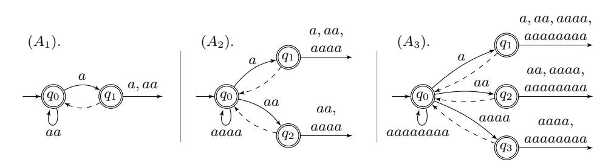
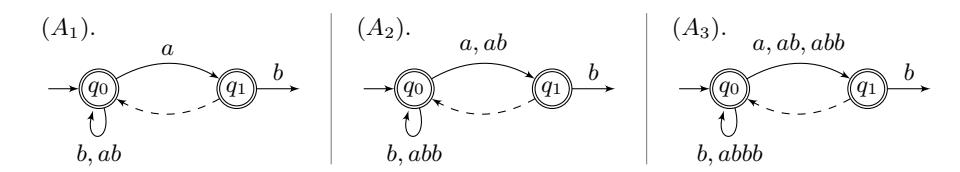
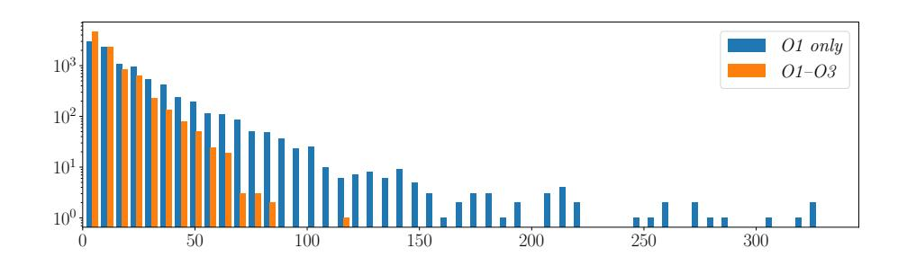

# Constructing Compact BPE Token DFAs

Martin Berglund1 , Anna Jonsson1 , Willeke Martens1 , and Brink van der Merwe2,3

1 Department of Computing Science, Umeå University, Sweden {mbe,aj,wms}@cs.umu.se

2 Department of Computer Science, Stellenbosch University, South Africa abvdm@cs.sun.ac.za

3 National Institute for Theoretical and Computational Sciences, South Africa

Abstract. Byte pair encoding (BPE) tokenization is a popular technique for subdividing text into relevant subwords and is frequently used in large language model systems. Since the tokenization procedure is deterministic and produces regular languages, it is beneficial to characterize it in terms of finite automata to allow for further automata-aided processing, such as pattern matching. In this paper, we demonstrate how to build such automata efficiently in practice, applying a series of optimization techniques to represent them compactly.

# 1 Introduction

Byte pair encoding (BPE) tokenization [\[13\]](#page-13-0) is a key preprocessing step in prominent large language model systems like OpenAI's ChatGPT. BPE tokenization iteratively merges adjacent tokens according to a dictionary of merge rules, presented in order of priority, to produce a subword tokenization of a text. For example, when tokenizing the word "Palermo" using the OpenAI GPT-3 dictionary [\[11\]](#page-13-1), we begin with each symbol as a separate token: P a l e r m o . The algorithm then repeatedly picks the highest-priority applicable rule from the dictionary and merges the left-most matching token pair. In our example, the first rule applied is e ≀ r, resulting in P a l er m o . Subsequent applications of rules a ≀ l, P ≀ al and m ≀ o yield the final tokenization Pal er mo . As no further rules apply, this is the correct GPT-3 tokenization of "Palermo".

To support formal reasoning over BPE tokenizations, it is helpful to construct finite automata operating over token sequences instead of raw text. Algorithm [1,](#page-3-0) adapted from [\[2\]](#page-13-2), builds a deterministic finite automaton (DFA) that accepts exactly the valid tokenizations for a given BPE dictionary. However, both state and transition blowup present practical challenges. The algorithm creates one state per useful dictionary rule, which is optimal in certain theoretical cases, yet problematic given the size of real-world dictionaries. Moreover, since the token alphabet grows linearly with the dictionary size, the total number of transitions grows quadratically in both theory and practice. For instance, the Phi-4 dictionary [\[10\]](#page-13-3), used in Microsoft Phi 4 models, contains 100 000 rules, resulting in a DFA with 100 000 states and nearly 10 billion transitions.

This paper explores four optimizations to reduce state and transition explosion in practice: two prevent the creation of redundant states, and two compress transition representation. The most significant optimization is the use of default transitions, which specify a fallback state when no explicit transition exists for the next input symbol. This automata extension was introduced as delayed-input automata in Kumar et al. [\[8\]](#page-13-4), but the technique occurs in many forms, notably as the failure function in the Aho-Corasick algorithm [\[1\]](#page-13-5). This in turn inspired an equivalent formalism under the name failure automata [\[7](#page-13-6)[,5\]](#page-13-7). Bille et al. [\[4\]](#page-13-8) offers a good overview of the recent literature in this area. This technique is especially effective here because Algorithm [1](#page-3-0) copies a vast number of transitions across states, resulting in substantial behavioural overlap. Fig. [1](#page-1-0) previews the automata produced by the optimized procedure. Observe the repetitive pattern of transitions to the sink state, which motivates the second optimization that focuses on compact transition representation. Together, these two optimizations enable an efficient and scalable automaton representation.

Fig. 1: Algorithm [2](#page-5-0) is applied iteratively, starting from the single-state DFA accepting any number of as. At each iteration, the next rule from the dictionary [a ≀ a, aa ≀ aa, aaaa ≀ aaaa] is incorporated into the DFA. Transitions with no target go to a sink state (not drawn). The dashed transitions are default transitions: if the current state has no transition on the next input symbol, we may take the default transition. For example, reading the token a in state q2 in A2 brings us to q1 by first defaulting to q0.

It is theoretically possible to first construct the full BPE token DFA using Algorithm [1,](#page-3-0) then minimize and insert default transitions using heuristics. However, both the initial construction and subsequent minimization and defaulttransition insertion steps are prohibitively expensive [\[7,](#page-13-6)[5\]](#page-13-7). Even given a fast heuristic for adding default transitions the size of the intermediary automaton creates problems. Instead, our approach performs all optimizations on-the-fly, integrating one dictionary rule at a time while maintaining a compact DFA.

#### 2 Background

Let N = {0, 1, 2, . . .}. For a partial function f : A → B, we write f(a) = ⊥ when f is undefined for a ∈ A. The symbol ⊥ is also used to refer to the partial empty function, i.e., the partial function that is undefined for all its arguments.

An alphabet Σ is a finite set of symbols. To distinguish between alphabets over indivisible symbols and tokens, we call Σ a base alphabet. The set Σ∗ consists of all strings over Σ, including the empty string ε. A token alphabet Γ over Σ is a finite set Γ ⊂ Σ∗ such that ε /∈ Γ, Σ ⊆ Γ, and for every token u ∈ Γ with |u| > 1, u can be written as vw for some v, w ∈ Γ. A tokenization over Γ is a sequence u1 ≀ · · · ≀ uk with each ui ∈ Γ. This sequence is distinct from the string u1 · · · uk ∈ Σ∗ obtained by concatenation. To keep notation clear, we use Σ for base alphabets and Γ for token alphabets. Furthermore, the symbols a, b, c denote elements of Σ and u, v, w elements of Γ. This includes also all super- and subscripted variants (so e.g. a3 ∈ Σ′ is a symbol in a base alphabet).

Definition 1. A byte pair dictionary D over Σ is a sequence of token pairs or rules ui ≀ vi with ui , vi ∈ Σ∗ , written as D = [u1 ≀ v1, . . . , un ≀ vn] . A rule ui ≀ vi has higher priority than uj ≀ vj if i < j. A dictionary is proper if for each j with |uj | > 1 there exists some i < j such that uj = uivi, and, symmetrically, for each j with |vj | > 1 there exists some i < j such that vj = uivi. A proper dictionary D induces the token alphabet Γ = Σ ∪ {u1v1, . . . , unvn}. The rule ui ≀ vi is useful in D if it can be applied to some input string.

We strictly consider proper dictionaries in which all rules are useful and use D and all its variants to refer to such dictionaries.

Definition 2. A delayed input deterministic finite automaton (D2FA) is a tuple A = (Q, Γ, q0, δ, ν, F) where:

- Q is a finite set of states,
- Γ is a finite token alphabet,
- q0 ∈ Q is the initial state,
- δ : Q × Γ → Q is a (possibly partial) transition function,
- ν : Q → Q is a (possibly partial) default transition function, which is acyclic (i.e. ν(· · · ν(q)· · ·) ̸= q for all q and non-zero number of applications of ν),
- F ⊆ Q is the set of accept states.

The extended transition function δ ν of A is defined recursively as:

$$\delta^\nu(q, u) = \begin{cases} \delta(q, u) & \text{when } \delta(q, u) \text{ is defined,} \\ \delta^\nu(\nu(q), u) & \text{when } \delta(q, u) = \perp \text{ and } \nu(q) \neq \perp, \\ \perp & \text{otherwise.} \end{cases}$$

A path is a sequence q1, u1, . . . , qn−1, un−1, qn, where n ∈ N, qi , qn ∈ Q and ui ∈ Γ, so that δ ν (qi , ui) = qi+1 for all i ∈ {1, . . . , n − 1}. We write q1 u1 q2 u2 · · · un−1 qn. If the path begins at the initial state and ends in an accept state, A accepts the tokenization u1 ≀ · · · ≀ un−1. The language accepted by A, denoted L(A), consists of all such accepted tokenizations. Two D2FAs A and A′ are equivalent if L(A) = L(A′ ). If ν(q) = ⊥ for all q ∈ Q, then A is a DFA.

Observation 1. Let A = (Q, Γ, q0, δ, ν, F) be a D2FA. Define the DFA A′ = (Q, Γ, q0, δν , ⊥, F). Then L(A′ ) = L(A), since the extended function δ ν simulates the effect of the default transitions in A.

In some of the constructions below, it is convenient to assume the existence of a unique sink state qs ̸∈ F so that δ(qs, u) = qs for all u ∈ Γ and ν(qs) = ⊥. By writing the state set as Q ∪ {qs}, we make this assumption explicit.

We recall the original procedure from [\[2\]](#page-13-2) for constructing a BPE token DFA from a DFA A over base alphabet Σ and dictionary D over Γ. The construction proceeds by incorporating one dictionary rule at a time, in order of priority, using Algorithm [1.](#page-3-0) Incorporating the rule u ≀ v consists of the following main steps: First, for each state triple (s1, s2, s3) such that s1 u s2 v s3, a new transition s1 uv s3 is added. Second, to prevent A from reading u followed by v without affecting other uses of s2, a new state fresh(s2) is created. This new state inherits all outgoing transitions of s2, except those on v (and on uv if u = v). Finally, all current transitions on u to s2 are redirected to fresh(s2).

#### Algorithm 1 Original algorithm from [\[2\]](#page-13-2)

1: Input: a DFA A = (Q, Γ, q0, δ, ⊥, F), and a rule u ≀ v 2: let S = {(s1, s2, s3) ∈ Q 3 | δ(s1, u) = s2, δ(s2, v) = s3} 3: let S2 = {s2 | (s1, s2, s3) ∈ S} 4: for (s1, s2, s3) ∈ S do 5: add new transition by defining δ(s1, uv) = s3 6: add uv to Γ 7: for s2 ∈ S2 do 8: create a fresh state from s2, denote it fresh(s2) 9: add fresh(s2) to Q, and if s2 ∈ F add fresh(s2) to F as well 10: if u ̸= v then 11: add new transition by defining δ(fresh(s2), α) = δ(s2, α) for all α ∈ Γ \ {v} 12: else 13: add transition by def. δ(fresh(s2), α) = δ(s2, α) for all α ∈ Γ \ {v, uv} 14: for q ∈ Q with δ(q, u) ∈ S2 do 15: replace the transition by defining δ(q, u) = fresh(δ(q, u)) 16: output the resulting DFA

#### 3 Constructing Compact Automata

We propose four optimizations to improve both the size and efficiency of the BPE token DFA construction. This section covers the three optimizations that directly modify Algorithm [1.](#page-3-0) A fourth optimization, targeting the compact encoding of sink transitions, is described in Section [5.](#page-8-0)

Our optimizations operate on D2FAs, enabling significant reductions of the transition count. Optimization O1 replaces explicit copying of transitions from s2 to fresh(s2) with a default transition from fresh(s2) to s2, only adding explicit sink transitions on v (and possibly uv). While yielding a sparser transition table, the shift also requires other minor adjustments to Algorithm [1,](#page-3-0) such as in state triplet identification.

The shift to D2FAs reduces the number of transitions, but not the state count. This is addressed by optimizations O2 and O3: the former avoids creating fresh(s2) when s2 is not multiple-use while the latter re-uses an existing cleancopy state with respect to s2 and the relevant rule. Definition [3](#page-4-0) and [4](#page-4-1) below characterize the states affected by O2 and O3, respectively. The reader may want to look ahead to Section [4](#page-5-1) for further motivation of these definitions.

Definition 3. Let A = (Q, Γ, q0, δ, ν, F) be a D2FA. For q ∈ Q and u ∈ Γ, let Pq,u ⊆ Q be the smallest set such that q ∈ Pq,u, and for all p ∈ Q, if ν(p) ∈ Pq,u and δ(p, u) = ⊥, we have p ∈ Pq,u. Let Sq,u = {v ∈ Γ | q ′ ∈ Q, δ(q ′ , v) ∈ Pq,u}. Then q is multiple-use with respect to u if |Sq,u| > 1.

Definition 4. Let A = (Q ∪ {qs}, Γ, q0, δ, ν, F) be a D2FA. For a rule u ≀ v, define Λ = {u, uv} if u = v and Λ = {u} otherwise. For q, p ∈ Q we say that q is a clean-copy state with respect to p and u ≀ v iff ν(q) = p, q ∈ F ⇔ p ∈ F, δ(q, w) = ⊥ for all w ∈ Γ \ Λ, and δ(q, w) = qs for w ∈ Λ.

We now present the modified algorithm in Algorithm [2.](#page-5-0) Note that removing all blue-highlighted lines disables O2 and all red-highlighted lines disables O3.

Algorithm [2](#page-5-0) will only ever be applied to a string DFA with a distinguished but unused sink state (i.e. initially there are no transitions to the sink), or to a D2FA which was itself produced by Algorithm [2.](#page-5-0)

Example 1. Consider the dictionary D = [a ≀ b, ab ≀ b, abb ≀ b] and the universal DFA over the token alphabet {a, b}. Fig. [2](#page-4-2) shows the token D2FA after each merge by Algorithm [2.](#page-5-0) The set S always only contains (q0, q0, q0), so S2 = {q0}. Besides being the start state, q0 is multiple-use with respect to v, disabling O2. The first merge creates the new state q1, but then O3 reuses it for all subsequent merges.

Fig. 2: Let A1 be the D2FA after merging a ≀ b into the universal DFA. A2 and A3 result from merging ab ≀ b and abb ≀ b subsequently. In each case, O3 avoids creating a new state, while O2 has no effect.

1: Input: a D2FA D = (Q ∪ {qs}, Γ, q0, δ, ν, F) and rule u ≀ v 2: for q ∈ Q such that δ(q, u) = qs do 3: add new transition by defining δ(q, uv) = qs 4: S = {(s O4, see Section [5](#page-8-0) 1, s2, s3) ∈ Q 3 | δ(s1, u) = s2, δν (s2, v) = s3} 5: for (s1, s2, s3) ∈ S do 6: add new transition by defining δ(s1, uv) = s3 7: add uv to Γ 8: S2 = S ′ 2 = {s2 ∈ Q | (s1, s2, s3) ∈ S} 9: redefine S ′ 2 = {s2 ∈ S2 | s2 is multiple-use with respect to v or q = q0} O2. 10: for s2 ∈ S ′ 2 do 11: S ′ = {q ∈ Q | q is a clean-copy with respect to s2 and u ≀ v} O3. 12: if S ′ = ∅ then 13: create a fresh state from s2, denote it fresh(s2) 14: add fresh(s2) to Q, if s2 ∈ F add fresh(s2) to F 15: add new default transition ν(fresh(s2)) = s2 O1. 16: add new transition by defining δ(fresh(s2), v) = qs 17: if u = v then 18: add new transition by defining δ(fresh(s2), uv) = qs 19: else 20: denote some s ∈ S ′ as fresh(s2) 21: for s2 ∈ S2 \ S ′ 2 do 22: redirect transition by defining δ(s2, v) = qs 23: if u = v then 24: define δ(s2, uv) = qs 25: for (s1, s2, s3) ∈ S with s2 ∈ S ′ 2 do 26: add new transition by defining δ(s1, u) = fresh(s2)

Example 2. Similarly, with the dictionary D = [a ≀ b, a ≀ ab, a ≀ aab, . . .] and the universal DFA over the token alphabet {a, b}, the first merge creates state q1, but all subsequent merges modify q1 directly via O2 since it is only reachable on a.

Example 3. Consider the dictionary {a ≀ a, aa ≀ aa, aaaa ≀ aaaa, . . . } and the universal DFA over {a}. Fig. [1](#page-1-0) shows the result of the first three merges. Neither O2 nor O3 saves any states here: q0 repeatedly takes the role of s2, and no states share the identical local behaviour for reuse. Thus, the worst case state complexity remains the same as in Algorithm [1,](#page-3-0) producing O(|Q||D|) states.

### 4 Proof of Correctness

We first demonstrate the correctness of Algorithm [2](#page-5-0) with O2 and O3 disabled (i.e. all coloured lines are removed), referring to this variant as Algorithm [2](#page-5-0)X. We then show that enabling O2 and O3 preserves correctness. Observe that O4, which deals with transition compression, is treated separately in Section [5.](#page-8-0)

Lemma 1. Take D2FAs A and A′ , and DFAs B, B′ , and C fulfilling the following. A′ and B′ are obtained from A and B using Algorithm [2](#page-5-0) X and Algorithm [1](#page-3-0) respectively (merging the rule u ≀ v). B and C are the DFA corresponding to A and A′ , respectively, applying Observation [1](#page-3-1) and removing the sink and any transitions to the sink. Then B′ is isomorphic to C.

$$\begin{array}{ccc} \text{Algorithm } 2 & A & \xrightarrow{\text{Observation } 1} B \\ A' & \xrightarrow{\text{Observation } 1} C & \xrightarrow{\text{shown to be isomorphic}} B' \end{array}$$

Proof. Let e.g. δA denote the transition function of A, δ ν A′ the extended transition function for A′ and so on. Let QA denote the states of A without the sink. Observe that QC = QA′ , QB = QA, and QA is a subset of all the other state sets. By definition, B′ and C are isomorphic iff there exists a bijection f : QA′ → QB′ such that δB′ (f(q), w) = f(δC (q, w)) for all q ∈ QA′ and w ∈ Γ ∪ {uv}.

Let h : QB → (QB′ \ QB) be the "fresh" mapping in the run of Algorithm [1](#page-3-0) and h ′ : QA → (QA′ \ QA) the one from the run of Algorithm [2](#page-5-0)X (i.e. h(q) is defined if q occurs as s2 in the algorithm, and in that case h(q) = fresh(q)). Define f(q) := h(q ′ ) if q = h ′ (q ′ ) for some q ′ ∈ QA, and f(q) := q otherwise.

We first show that f is bijective. Suppose h ′ (q ′ ) ∈ QA′ \QA. Then there exist s1, s3 ∈ QA such that δA(s1, u) = q ′ and δ ν A(q ′ , v) = s3, implying δB(s1, u) = q ′ and δB(q ′ , v) = s3, so Algorithm [1](#page-3-0) adds h(q ′ ) to QB′ . Since h and h ′ are injective, f is injective on these new states.

Conversely, if h(q ′ ) ∈ QB′ \ QB, then for some s1, s3 ∈ QA, δB(s1, u) = q ′ and δB(q ′ , v) = s3. Because δB = δ ν A, there exists p ∈ QA such that s1 ∈ Pp,u (recall Definition [3\)](#page-4-0) and δA(p, u) = q ′ . Therefore, Algorithm [2](#page-5-0)X adds h ′ (q ′ ) to QA′ , so f(h ′ (q ′ )) = h(q ′ ). Thus, f is also surjective.

To complete the proof, we show that f is a homomorphism. That is, for all w ∈ Γ ∪ {uv} and q ∈ QA′ we have δB′ (f(q), w) = f(δC (q, w)).

First, consider q ∈ QA. Algorithm [2](#page-5-0)X defines the transition function δA′ in terms of δA as follows:

$$\delta_{A'}(q, w) = \begin{cases} h'(\delta_A(q, u)) & \text{if } w = u \text{ s.t. } \delta_A^\nu(\delta_A(q, u), v) \in Q_A, \\ \delta_A^\nu(\delta_A(q, u), v) & \text{if } w = uv \text{ s.t. } \delta_A^\nu(\delta_A(q, u), v) \in Q_A, \\ q_s & \text{if } w = uv \text{ and } \delta_A(q, u) = q_s, \\ \delta_A(q, w) & \text{otherwise.} \end{cases}$$

The actions preserve the default paths on Γ for states in QA, thus if q ∈ Pp,w for some p ∈ QA before applying Algorithm [2](#page-5-0)X, then still q ∈ Pp,w afterwards. Thus, the transition function of C satisfies

$$\delta_C(q, w) = \begin{cases} h'(\delta_A^\nu(q, w)) & \text{if } w = u \text{ such that } \delta_A^\nu(q, w), v \in Q_A, \\ \delta_A^\nu(\delta_A^\nu(q, u), v) & \text{if } w = w \text{ such that } \delta_A^\nu(\delta_A^\nu(q, u), v) \in Q_A, \\ \perp & \text{if } \delta_A^\nu(q, u) = q_s, \\ \delta_A^\nu(q, w) & \text{otherwise.} \end{cases}$$

Algorithm [1](#page-3-0) applies similar changes to B to obtain B′ , retargeting transitions on u and adding transitions on uv only when δB(δB(q, u), v) ∈ QA. While no sink transitions are introduced, if B cannot read u from q, then q also has no uv-transition in B′ . Thus, for all q ∈ QA, we have δB′ (f(q), w) = f(δC (q, w)).

Now, consider a new state h ′ (q) ∈ QA′ . Algorithm [2](#page-5-0)X sets νA′ (h ′ (q)) = q and adds sink transitions on v (and uv if u = v). Thus, δC (h ′ (q), w) = δC (q, w) for all w ̸= v (and w ̸= uv if u = v), and is otherwise undefined. Likewise, Algorithm [1](#page-3-0) defines δB′ (h(q), w) = δB′ (q, w) for all w ̸= v (and w ̸= uv if u = v) and as ⊥ otherwise. Interestingly, if δB(δB(q, u), v) is also defined, then B′ maps h(q) to a new state h(δB(q, u)). Meanwhile, δA′ (h ′ (q), u) = ⊥. Yet, δC (h ′ (q), u) = δC (q, u) = h ′ (δA(q, u)). Again, we can easily verify that δB′ (f(q), w) = f(δC (q, w)), for all new states in QA′ .

Corollary 1. For any string DFA A and proper dictionary D, applying Algorithm [2](#page-5-0) X to merge all rules in D to A produces a D2FA accepting the languages of correct tokenizations of L(A).

Proof. Algorithm [1](#page-3-0) produces the language of correct tokenizations of L(A) [\[2\]](#page-13-2), and the D2FA being equivalent can be seen by iterating Lemma [1.](#page-5-2)

Having established the correctness of Algorithm [2](#page-5-0) with the optimizations O2 and O3 disabled, we now show that enabling these preserves correctness.

Lemma 2. For any D2FA A and rule u ≀ v, applying Algorithm [2](#page-5-0) with or without optimization O2 or O3 (i.e. keeping or removing the blue or red lines) results in equivalent automata.

Proof. Although O2 and O3 never apply to the same state, they may apply to different states within the same automaton. The correctness of O3 is immediate: it reuses an existing state instead of introducing a redundant copy fresh(s2) with identical local behaviour. Since such reused states only have sink and default outgoing transitions, they are unaffected by later steps in Algorithm [2.](#page-5-0) Thus, we may safely focus solely on the effect of O2.

If all s2 ∈ S2 are initial or multi-use, then enabling or disabling O2 has no effect; the equivalence follows immediately. Otherwise, assume there exists a non-initial, single-use state s2 on v — meaning that O2 applies when enabled. Then, for all q ∈ Ps2,v, (1) either q has an incoming transition on u and q ∈ S2, or (2) for any p ∈ Pq,v such that p has an incoming transition, p ∈ S2.

Without O2, Algorithm [2](#page-5-0) creates a new state fresh(q) for each q ∈ S2, redirects all incoming u-transitions from q to fresh(q), and gives fresh(q) sink transitions on v (and uv if u = v), defaulting to q otherwise. Line [26](#page-5-0) then renders s2 unreachable on u (directly or via defaults), making its behaviour on v (and uv) irrelevant and safely modifiable.

When enabled, O2 skips creating fresh(s2), leaves s2 reachable on u, and assigns it a sink transition on v (and uv if u = v), which preserves language equivalence.

With that, we can conclude that Algorithm [2](#page-5-0) is correct.

Theorem 1. For any string DFA A and proper dictionary D applying Algorithm [2](#page-5-0) to merge all rules in D to A produces a D2FA accepting the languages of correct tokenizations of L(A).

Proof. Corollary [1](#page-7-0) establishes the correctness of Algorithm [2](#page-5-0) with respect to O1, when O2 and O3 are disabled. Lemma [2](#page-7-1) shows that enabling O2 and O3 preserves correctness: the relation f in Lemma [1](#page-5-2) may no longer be bijective, but it remains homomorphic, which suffices to establish equivalence.

# 5 Efficiently Encoding Sink Transitions

The majority of the remaining transitions after applying optimizations O1–O3 originate from lines [2–3,](#page-5-0) both in practice (see Table [3\)](#page-11-0) and in the theoretical worst case (see Example [3\)](#page-5-3). Fortunately, these sink transitions have a predictable form; recall Figure [1.](#page-1-0) This section introduces the final optimization, O4, which compresses these transitions into a single 'predicate'. To preview the substantial transition reduction, compare column 4 and 6 in Table [3.](#page-11-0)

We start by presenting a one-to-one relationship between tokens and dictionary rules when all rules are useful, followed by a definition of the data structure used to compactly encode transitions to the sink reject state.

Lemma 3. Let D = [u1 ≀ v1, . . . , un ≀ vn], with all rules useful. Then uivi = ujvj implies i = j.

Proof. Follows directly from [\[3\]](#page-13-9), Corollary 1.

Definition 5. The prefix forest VD for a dictionary D = [u1 ≀ v1, . . . , un ≀ vn] is a forest of nodes labelled by token-index pairs (w, i), where i ∈ {1, . . . , n}. We refer to a node only by its associated token when the index is not important. Let VD0 be the empty forest. For i ∈ [1, . . . , n], construct the prefix forest VDi for the first i rules of D, from VDi−1 , as follows:

- 1. If no node vi exists in VDi−1 , add node (vi , i); and
- 2. if node ui exists in VDi−1 , or if we just added it in step 1, i.e. when ui = vi, add node (uivi , i) and make it a child of ui.

Observation 2. By Lemma [3,](#page-8-1) VD is indeed a forest, given node (w, i) receives an incoming edge only when it is created by processing rule ui ≀ vi , where w = uivi – which only happens once. In addition, Lemma [3](#page-8-1) guarantees that referring to a node by its token is unambiguous.

Example 4. For D = [a ≀ a, . . . , a2 ≀ a 2 , . . . , a2 n−1 ≀ a 2 n−1 ], the prefix forest VD is a unary tree of height n, where the n + 1 nodes from root to leaf correspond to the tokens a, . . . , a2 n . A state with a sink transition on the token a i , also has sink transitions on all descendant tokens of a i in this tree, see Figure [1.](#page-1-0)

Example 5. For D = [a ≀ b, ab ≀ b, abb ≀ b, . . .], the prefix forest VD is the single node b.

Proposition 1. Let A be the token D2FA resulting from applying Algorithm [2](#page-5-0) to the rules in D = [u1 ≀ v1, . . . , un ≀ vn], starting with an initial token DFA. Suppose state q in A receives an outgoing transition to the sink state on token vi in Lines [16](#page-5-0) or [22](#page-5-0) while applying Algorithm [2](#page-5-0) with rule ui ≀ vi. Then q may also receive one additional sink transitions by applying Lines [18](#page-5-0) or [24,](#page-5-0) or multiple additional sink transitions by applying Line [3.](#page-5-0) The tokens labelling these sink transitions are precisely all descendants of vi in the prefix forest VD whose associated indices j satisfy j ≥ i.

Proof (sketch). Once q receives a sink transition labelled by the token vi in Lines [16](#page-5-0) or [22,](#page-5-0) it will also receive a sink transition on uivi in Lines [18](#page-5-0) or [24](#page-5-0) if ui = vi . But if ui = vi , then uivi is a descendant of vi in VD with index i. Algorithm [2](#page-5-0) ensures that any subsequent rule of the form vi ≀ w adds a sink transition to q on viw in Line [3.](#page-5-0) This process recurses and subsequent rules of the form viw ≀ w ′ lead to a sink transitions on viww′ , also added in Line [3,](#page-5-0) and so on. Thus, q accumulates sink transitions on all tokens formed by successively extending vi through rules applied at or after step i. But these tokens are precisely all descendants of vi in the prefix forest VD whose associated indices j satisfy j ≥ i.

Observation 3. To realize the compression, a copy of VD is kept with the constructed D2FA. Each sink transition on vi introduced by Line [16](#page-5-0) or [22](#page-5-0) is replaced with a predicate matching the token vi , and all of vi 's descendants in VD with indices greater than or equal to i.

Note that the height of VD determines the worst-case time complexity of deciding whether a given symbol matches a transition predicate by traversing the forest. Fortunately, VD is in practice very shallow; see Table [4.](#page-12-0)

# 6 Theoretical Bounds

With all the optimizations in place, we can observe some straightforward bounds.

Proposition 2. Starting from an n-state string DFA, and then repeatedly applying Algorithm [2](#page-5-0) while using optimization O4 (see Observation [3\)](#page-9-0) to merge all rules in dictionary D, yields a token D2FA with O(n|D|) transitions.

Proof. We require |D| applications of Algorithm [2.](#page-5-0) With O4, line [3](#page-5-0) no longer contributes additional transitions. In each iteration, the remaining loops add O(|S2|) transitions. The complexity bounds in [\[2\]](#page-13-2) guarantee that |S2| ≤ n in every iteration, yielding the result.

Optimization O4 is required for this bound. Without it, Example [3](#page-5-3) leads to a quadratic number of sink transitions. As we will see in the next section, the difference is significant in practice as well.

Next, we provide an upper bound on the default chain-length, i.e. the maximum number of default transitions that can be taken consecutively. This demonstrates that Algorithm [2](#page-5-0) does not create cycles of default transitions, but the bound is also important for matching efficiency. First, we define subsets of D that might lead to default chains of transitions.

Definition 6. For a fixed token u, let l(u, D) := {u ′ ≀ v ′ ∈ D | u ′ = u}. Then the common left token cardinality of D is defined to be the maximum of |l(u, D)| over all tokens u.

Proposition 3. Let A be a token D2FA obtained by repeatedly applying Algorithm [2](#page-5-0) to merge rules from a dictionary D, starting from some token DFA. Then the common left token cardinality of D is an upper bound on the default chain-length of A.

Proof. Let u be a token maximizing n = |l(u, D)|, let u ≀ v1, . . . , u ≀ vn be the subsequence of rules in D, having u as left token. Then a chain can be formed by first merging u ≀ v1, where some state s2 is reached on u in Algorithm [2,](#page-5-0) and a new state fresh(s2) being created that defaults to s2. However, the only way of lengthening that chain is to again create a new state from this previous fresh(s2), but by construction it is reachable only on u, so a second rule u ≀ v2 is required. Then this argument is simply iterated.

There are interesting interactions between O2 and how chains grow. Table [4](#page-12-0) shows that optimization O2 indeed makes the chains much shorter in practice.

# 7 Testing Real-World Dictionaries

The algorithm was instrumented to enable and disable optimizations O1–O4 individually, aiming to evaluate their impact on BPE dictionaries from prominent large language systems primarily trained on English corpora, see Table [1.](#page-10-0) The

Table 1: The four dictionaries used for testing.

| Short name | System                                   | Source | Rule count |
|------------|------------------------------------------|--------|------------|
| GPT-3      | OpenAI GPT-2 and GPT-3                   | [11]   | 50 000     |
| SmolLM-2   | HuggingFace SmolLM 2 language model      | [6]    | 48 900     |
| Whisper    | OpenAI Whisper speech recognition system | [12]   | 50 000     |
| Phi-4      | Microsoft Phi 4 large language model     | [10]   | 100 000    |

number of states produced using the relevant combinations of optimizations is shown in Table [2.](#page-11-1) Clearly, O2 accounts for most of the reductions, with O3 offers marginal savings. The optimizations are not additive: applying both O2

Table 2: The number of states resulting when applying Algorithm [2,](#page-5-0) starting from a universal DFA for the various dictionaries and optimizations.

| Dictionary | No  | opt. | O2 | only | O3 | only | O2 | and O3 |
|------------|-----|------|----|------|----|------|----|--------|
| GPT-3      | 50  | 002  | 15 | 854  | 49 | 304  | 15 | 700    |
| SmolLM-2   | 48  | 902  | 15 | 905  | 48 | 201  | 15 | 730    |
| Whisper    | 50  | 002  | 16 | 732  | 49 | 035  | 16 | 561    |
| Phi-4      | 100 | 002  | 30 | 557  | 98 | 495  | 30 | 159    |

and O3 saves more than either alone, but less than their sum. The fraction of states saved is consistent across the four dictionaries.

To simplify transition counting for optimized cases, we count the overall number of normal transitions, default transitions, and predicate transitions – counting each predicate transition as one and thus not accounting for the encoding of VD. For the non-optimized case, we count only transitions to non-sink states from Algorithm [1.](#page-3-0) The results are shown in Table [3.](#page-11-0) Not all combinations are considered, since O1 dominates transition reduction.

Table 3: The number of transitions resulting when applying Algorithm [2,](#page-5-0) starting from a universal DFA for the various dictionaries and optimizations.

| Dictionary |   |     | No  | opt. | O1    | only | O1    | – O3 | O1  | and O4 |     | O1–O4 |
|------------|---|-----|-----|------|-------|------|-------|------|-----|--------|-----|-------|
| GPT-3      | 2 | 421 | 614 | 550  | 891   | 455  | 835   | 632  | 150 | 434    | 115 | 580   |
| SmolLM-2   | 2 | 299 | 440 | 749  | 942   | 645  | 888   | 855  | 147 | 044    | 113 | 342   |
| Whisper    | 2 | 453 | 532 | 446  | 704   | 658  | 652   | 783  | 150 | 367    | 116 | 109   |
| Phi-4      | 9 | 577 | 741 | 705  | 2 599 | 616  | 2 493 | 209  | 300 | 502    | 229 | 425   |

The state-count optimizations O2 and O3 also significantly reduce the lengths of default transition chains by preventing the creation of unnecessary intermediate states. We analyze the distribution of maximal default chains – chains starting at states without incoming default transitions and ending in states without an outgoing default transition. For all dictionaries, the distribution is heavily skewed toward short chains, with a long tail of very rare, longer chains. Table [4](#page-12-0) shows the effects of optimization O2 and O3 on the median and maximum lengths of default chains for the respective dictionary. An example histogram giving a sense of the distribution is shown in Figure [3.](#page-12-1)

The last two columns of Table [4](#page-12-0) show the maximum and median lengths of maximal paths in the prefix forest VD (see Definition [5\)](#page-8-2). These paths are consistently short, with maximum not exceeding 8 and medians of 1 or 2. The rare longer paths all stem from tokens such as "#####. . ." or "-----. . .", containing up to 80 repeated symbols – commonly used as separators in emails and code.

Table 4: The maximum and median length of the maximal default chains (DC), as well as the maximum and median length of the maximal paths in the prefix forest VD (see Definition [5\)](#page-8-2) for the various dictionaries.

| Dict.    | Median DC ( O1 ) | Max DC ( O1 ) | Median DC ( O1 – O3 ) | Max DC ( O1 – O3 ) | Median V D – | Max V D – |
|----------|------------------|---------------|-----------------------|--------------------|--------------|-----------|
| GPT-3    | 12               | 330           | 7                     | 114                | 1            | 6         |
| SmolLM-2 | 13               | 301           | 7                     | 134                | 2            | 7         |
| Whisper  | 10               | 282           | 6                     | 80                 | 1            | 6         |
| Phi-4    | 14               | 956           | 8                     | 203                | 2            | 8         |

Fig. 3: The distribution of default transition chain lengths in the automaton built for the GPT-3 dictionary, shown as a histogram with 50 bins. A log scale is used as longer chains are very uncommon. Observe that optimizations O2 and O3 shorten the length of default chains substantially.

This makes Example [3](#page-5-3) relevant, as an A8-like case is realized in practice. Since VD solely depends on dictionary D, these patterns are not affected by any of our optimizations.

#### 8 Conclusions

With the proposed optimizations, the algorithm produces automata with substantially fewer states, and vastly fewer transitions, making them suited for practical use. It should be observed that the state savings are more robust to transforming the automata (e.g. taking the intersection with another language), and in the future further state saving optimizations should be investigated.

Acknowledgments This work was partially supported by the Wallenberg AI, Autonomous Systems and Software Program (WASP) funded by the Knut and Alice Wallenberg Foundation. Thanks to Viktor Lindmark who performed an initial exploration of the default transition optimization [\[9\]](#page-13-12).

# References

- 1. Aho, A.V., Corasick, M.J.: Efficient string matching: an aid to bibliographic search. Commun. ACM 18(6), 333–340 (Jun 1975). doi[:10.1145/360825.360855](https://doi.org/10.1145/360825.360855)
- 2. Berglund, M., Martens, W., van der Merwe, B.: Constructing a BPE tokenization DFA. In: Fazekas, S.Z. (ed.) Implementation and Application of Automata. pp. 66–78. Springer Nature Switzerland, Cham (2024)
- 3. Berglund, M., van der Merwe, B.: Formalizing BPE tokenization. In: 13th International Workshop on Non-Classical Models of Automata and Applications, NCMA 2023, 18-19 September, 2023, Famagusta, Cyprus. pp. 16–27. Open Publishing Association (2023)
- 4. Bille, P., Gørtz, I.L., Pedersen, M.R.: Fast practical compression of deterministic finite automata. In: Kr´aloviˇc, R., K˚urkov´a, V. (eds.) SOFSEM 2025: Theory and Practice of Computer Science. pp. 136–150. Springer Nature Switzerland, Cham (2025)
- 5. Bj¨orklund, H., Bj¨orklund, J., Zechner, N.: Compression of finite-state automata through failure transitions. Theoretical Computer Science 557, 87–100 (2014)
- 6. HuggingFace: SmolLM 2 BPE dictionary (2024), [https://huggingface.co/](https://huggingface.co/HuggingFaceTB/SmolLM2-1.7B/blob/main/merges.txt) [HuggingFaceTB/SmolLM2-1.7B/blob/main/merges.txt](https://huggingface.co/HuggingFaceTB/SmolLM2-1.7B/blob/main/merges.txt), accessed 2025-04-22
- 7. Kourie, D.G., Watson, B.W., Cleophas, L., Venter, F.: Failure deterministic finite automata. In: Holub, J., Zˇd´arek, J. (eds.) Proceedings of the Prague Stringology ˇ Conference 2012. pp. 28–41. Czech Technical University in Prague, Czech Republic (2012)
- 8. Kumar, S., Dharmapurikar, S., Yu, F., Crowley, P., Turner, J.: Algorithms to accelerate multiple regular expressions matching for deep packet inspection. SIGCOMM Comput. Commun. Rev. 36(4), 339–350 (Aug 2006). doi[:10.1145/1151659.1159952](https://doi.org/10.1145/1151659.1159952)
- 9. Lindmark, V.: Analyzing the Effect of DFA Compression in Token DFAs. Master's thesis, Umeå University, Department of Computing Science (2024)
- 10. Microsoft: Phi 4 BPE dictionary (2024), [https://huggingface.co/microsoft/](https://huggingface.co/microsoft/phi-4/blob/main/merges.txt) [phi-4/blob/main/merges.txt](https://huggingface.co/microsoft/phi-4/blob/main/merges.txt), accessed 2025-04-22
- 11. OpenAI: GPT-2/GPT-3 BPE dictionary (2019), [https://huggingface.co/](https://huggingface.co/openai-community/gpt2/blob/main/merges.txt) [openai-community/gpt2/blob/main/merges.txt](https://huggingface.co/openai-community/gpt2/blob/main/merges.txt), accessed 2025-04-22
- 12. OpenAI: Whisper BPE dictionary (2024), [https://huggingface.co/openai/](https://huggingface.co/openai/whisper-large/blob/main/merges.txt) [whisper-large/blob/main/merges.txt](https://huggingface.co/openai/whisper-large/blob/main/merges.txt), accessed 2025-04-22
- 13. Sennrich, R., Haddow, B., Birch, A.: Neural machine translation of rare words with subword units. In: Proceedings of the 54th Annual Meeting of the Association for Computational Linguistics (Volume 1: Long Papers). pp. 1715–1725. Association for Computational Linguistics, Berlin, Germany (Aug 2016)