# Determinization of transducers over finite and infinite words

Marie-Pierre Béal ∗, Olivier Carton

*Institut Gaspard Monge, Universite de Marne-la-Vall ee, 5 boulevard Descartes, Champs-sur-Marne, F-77454 Marne-la-Vallee Cedex 2, France*

> Received July 2000; received in revised form March 2001; accepted May 2001 Communicated by D. Perrin

### Abstract

We study the determinization of transducers over finite and infinite words. The first part of the paper is devoted to finite words. We recall the characterization of subsequential functions due to Choffrut. We describe here a known algorithm to determinize a transducer.

In the case of infinite words, we consider transducers with all their states final. We give an effective characterization of sequential functions over infinite words. We describe an algorithm to determinize transducers over infinite words. This part contains the main novel results of the paper. c 2002 Elsevier Science B.V. All rights reserved.

*Keywords:* Automata; Transducers; Infinite words; Determinization

# 1. Introduction

The aim of this paper is the study of determinization of transducers, that is of machines realizing rational transductions. A transducer is a finite state automaton (or a finite state machine) whose edges are labeled by pairs of words taken in finite alphabets. The first component of each pair is called the input label. The second one the output label. The transducers that we consider have accepting (or final) states. Such transducers are sometimes called a-transducers (a for accepting). The rational relation defined by a transducer is the set of pairs of words which are labels of an accepting path in the transducer. We assume that the relations defined by our transducers are functions. This is a decidable property.

∗ Corresponding author. *URLs:* http:==www-igm.univ-mlv.fr=∼beal=, http:==www-igm.univ-mlv.fr=∼carton=. *E-mail addresses:* marie-pierre.beal@univ-mlv.fr (M.-P. Béal), olivier.carton@univ-mlv.fr (O. Carton).

The study of transducers has many applications. Transducers are used to model coding schemes (compression schemes, convolutional coding schemes, coding schemes for constrained channels, for instance). They are widely used in computer arithmetic [16] and in natural language processing [24]. Transducers are also used in programs analysis [14]. The determinization of a transducer is the construction of another transducer which defines the same function and has a deterministic (or right resolving) input automaton. Such transducers allow a sequential encoding and thus are called sequential transducers.

In the first part of the paper, we present a short survey of the determinization of transducers realizing functions over finite words. Our transducers may have final states. We present some known results about subsequential functions, that is functions that can be realized by transducers with a deterministic input but that may have an output function defined on states. The notion of subsequential functions has been introduced by Schutzenberger [27]. We recall the characterization of subsequential functions obtained B by Choffrut [11, 12]. This characterization gives a decision procedure for the subsequentiality of functions defined by a transducer. It has been proved in [29, 30] that this can be decided in polynomial time. We give another proof of this result which is a consequence of the decidability in polynomial time of functionality over infinite words [10]. Another proof of the same result is given in [4]. The decidability of functionality was already proved by Gire [17]. We also describe the algorithm to determinize a transducer. This algorithm takes a real-time transducer which realizes a subsequential function and outputs a subsequential transducer. This algorithm is actually contained in the proof of Choffrut [11, 12] (see also [5, pp. 109–110]). This algorithm has also been described by Mohri [21] and Roche and Shabes [24, pp. 223–233].

The determinization of a transducer realizing a subsequential function f provides a subsequential transducer realizing f. If the function is sequential, this subsequential transducer can be transformed into a sequential one. This can be obtained by the normalization of a transducer introduced by Choffrut [12, 13]. Efficient algorithms that compute the normalization have been given in [20, 22, 8, 9, 2].

In the second part of the paper, we consider transducers and functions over infinite words and our transducers have all their states final. The reason why we assume that all states are final is that the case of transducers with final states seems to be much more complex. Indeed, the determinization of automata over infinite words is already very diDcult [25]. In particular, it is not true that any rational set of infinite words is recognized by a deterministic automaton with final states. Other accepting conditions, as the Muller condition for instance, must be used.

We first give an effective characterization of sequential functions over infinite words. This characterization extends to infinite words the twinning property introduced by Choffrut [11]. We prove that a function is sequential if it is a continuous map whose domain can be recognized by a deterministic Buchi automaton, and such that the trans- B ducer obtained after removing some special states has the twinning property. These conditions can be simplified in the case where the transducer has no cycling path with an empty output label. We use this characterization to describe an algorithm checking whether a function realized by a transducer is sequential. This algorithm becomes polynomial when the transducer has no cycling path with an empty output label. Finally, we give an algorithm to determinize a real-time transducer. The algorithm can be easily adapted to the case when the transducer is not real-time. The algorithm is much more complex than in the case of finite words. It is the main result of the paper.

These determinizations do not preserve the dynamic properties of the transducers as the locality of its output. We mention that in [18], an algorithm is given to determinize transducers over bi-infinite words that have a right closing input (or that are n-deterministic or deterministic with a finite delay in the input) and a local output (see also [19, p. 143; 1, pp. 110–115]). This algorithm preserves the locality of the output. These features are important for coding applications.

The paper is organized as follows. Section 2 is devoted to transducers over finite words. Basic notions of transducers of rational functions are defined at the beginning of this section. The characterization of subsequential functions is recalled in Section 2.1, while the algorithm for determinization of transducers is described in Section 2.2. The characterization of sequential functions among subsequential ones is recalled in Section 2.3. Section 3 is devoted to transducers over infinite words. We give in Section 3.1 a characterization of sequential functions while the algorithm for determinization of transducers is described in Section 3.2. In both cases of finite and infinite words, we give examples of determinization of transducers.

Part of the results of the present paper was presented at the conference ICALP'2000 [3].

# 2. Transducers over nite words

In the sequel, A and B denote finite alphabets. The free monoid A∗ is the set of finite words or sequences of letters of A. The empty word is denoted by . We denote the fact that a finite word u is a prefix of a finite word v by u ≺ v. The relation ≺ is a partial order. If u is a prefix of v, we denote by u−1v the unique word w such that v = *uw*.

A *transducer* over the monoid A∗ × B∗ is composed of a set Q of *states*, a set E ⊂ Q × A∗ × B∗ × Q of *edges* and two sets I; F ⊂ Q of *initial* and *8nal* states. An edge e =(p; u; v; q) from p to q is denoted by p u|v −→q. The state p is the *origin*, u is the *input label*, v is the *output label*, and q is the *end*. Thus, a transducer is the same object as an automaton, except that the labels of the edges are pairs of words instead of letters.

A transducer is often denoted by A =(Q; E; I; F), or also by (Q; E; I ) if all states are final, i.e., Q = F.

A *path* in the transducer T is a sequence

$$p_0 \xrightarrow{u_0 | v_0} p_1 \xrightarrow{u_1 | v_1} \cdots \xrightarrow{u_n | v_n} p_n$$

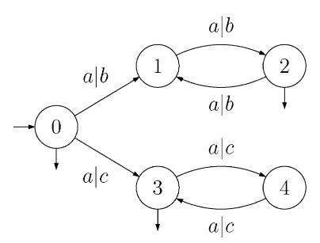

Fig. 1. A transducer for the relation (a2;b2)∗ ∪ (a2;c2)∗(a; c).

of consecutive edges. Its input label is the word u = u1u2 ··· un whereas its output label is the word v = v1v2 ··· vn. The path *leaves* p0 and *ends* in pn. The path is often denoted

$$p_0 \xrightarrow{u|v} p_n.$$

A path is *successful* if it leaves an initial state and ends in a final state. The set *recognized* by the transducer is the set of labels of its successful paths, which is actually a relation R ⊂ A∗ × B∗. The transducer computes a function if for any word u ∈A∗, there exists at most one word v ∈B∗ such that (u; v)∈R. We call it the function *realized* by the transducer. A transducer which realizes a function is sometimes called *single-valued* in the literature. Thus, a transducer can be seen as a machine computing nondeterministically output words from input words. We denote by dom(f) the domain of the function f.

A transducer is *8nite* if its set of states and its set of transitions are finite. It is a consequence of Kleene's theorem that a subset of A∗ × B∗ is a rational relation if and only if it is the set recognized by a finite transducer.

Example 1 (*from Berstel* [5]). The automaton of Fig. 1 recognizes the relation (a2;b2)∗ ∪(a2;c2)∗(a; c) over the alphabets A = {a} and B = {b; c}. This relation is actually the function which maps an to bn if n is even and to cn if n is odd.

Let T be a transducer. The *underlying input automaton* (respectively, *underlying output automaton*) of T is obtained by omitting the output label (respectively, input label) of each edge.

A transducer is said to be *real-time* if it is labeled in A × B∗. It can be proved that any rational function can be realized by a real-time transducer. Furthermore, from any transducer realizing a function can be computed in polynomial time an equivalent real-time transducer (see for instance [30, Proposition 1.1]). We say that a transducer T is *sequential* if it is real-time and if the following conditions are satisfied:

- it has a unique initial state,
- the underlying input automaton is deterministic.

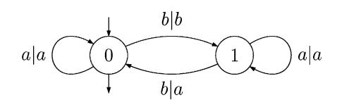

Fig. 2. A sequential transducer.

These conditions ensure that for each word u ∈A∗, there is at most one word v ∈B∗ such that (u; v) is recognized by T. Thus, the relation computed by T is a partial function from A∗ into B∗. A function is *sequential* if it can be realized by a sequential transducer.

Remark 2. In (Cohen and Collard [15, p. 299]; Berstel [5] and Berstel and Perrin [6]), it is assumed that all states of a sequential transducer are final. We follow the definition of Choffrut [11, 12], where sequential transducer may have final states. Thus, some characterizations that we give below differ from those presented in [5] for this reason. When all states are final, the domain of a sequential function is prefix closed, i.e., if uv belongs to the domain then u also belongs to the domain. As our definition allows final states, the domain of a sequential function is not necessarily prefix closed.

Example 3. Let A = B = {a; b} be the input and the output alphabets. The transducer of Fig. 2, whose initial state is 0, is sequential. It replaces by a those b's which appear after an odd number of b. On the contrary, the transducer of Example 1 is not sequential. Actually, the function computed by this transducer is not sequential. Indeed, one may verify that if f is sequential, and if u and v are two words of dom(f) such that u ≺ v, then f(u) ≺ f(v).

Remark 4. If f is a sequential function and if f() is defined, then f()= . To remove this restriction, it is possible to add an *initial word* associated with the initial state. This word is output before any computation. This initial word is necessary to get the unicity of a minimal sequential transducer [27, 12].

A *subsequential transducer* (A;) over A∗ × B∗ is a pair composed of a sequential transducer A over A∗ × B∗ with F as set of final states, and of a function : F → B∗. The function f computed by (A;) is defined as follows. Let u be a word in A∗. The value f(u) is defined if and only if there is a path i u|v −→q in A with input label u, from the initial state i to a final state q. In this case, one has f(u)= v(q). Thus, the function is used to append a word to the output at the end of the computation. A function is *subsequential* if it can be realized by a subsequential transducer.

Remark 5. Any sequential function is subsequential. It suffices to consider the function such that (q)= for any final state q.

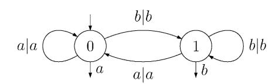

Fig. 3. A subsequential transducer.

Example 6. The function f realized by the subsequential transducer pictured in Fig. 3 appends to each word its last letter. The word u is mapped to *ua* if it ends with an a and it is mapped to ub if it ends with a b. This function is subsequential but it is not sequential. Indeed, for any word w, f(wa) is not a prefix of f(wab).

# *2.1. Subsequential functions*

In this section, we present some known results about subsequential functions. We recall the characterization of subsequential functions obtained by Choffrut [11, 12]. It is known that it is decidable whether a function realized by a transducer is subsequential. It has been proved in [29, 30] that this can be decided in polynomial time. We give here another proof of this result which is a consequence of the decidability in polynomial time of functionality over infinite words [10]. We also describe the algorithm to determinize a real-time transducer. This algorithm takes a transducer which realizes a subsequential function and outputs a subsequential transducer. This algorithm is actually contained in the proof of Choffrut [11, 12] and [5, pp. 109–110]. It has also been described by Mohri [20, 22] and Roche and Shabes [24, pp. 223–233].

If the function is actually sequential, this subsequential transducer is again transformed in a sequential transducer by the algorithm described in Section 2.3.

We give below two characterizations of subsequential functions that have been obtained by Choffrut (see [11, 12; 5, p. 105]). The first characterization is intrinsic to the function. It is based on metric properties of the function. The second characterization is effective. It is based on a property called twinning property of a transducer realizing the function. As it has been shown in [29, 30], this property can be decided in polynomial time.

Some notation is needed to state the characterization of subsequential functions. We first introduce a distance d on finite words. Let u; v be two finite words, we denote by d the distance such that

$$d(u, v) = |u| + |v| - 2|u \wedge v|,$$

where u ∧ v is the longest common prefix of u and v (see [5, p. 104]).

A partial function f : A∗ → B∗ has *bounded variation* if and only if:

$$\forall k \geq 0 \quad \exists K \geq 0 \quad \forall u, \quad v \in \text{dom}(f) \quad d(u, v) \leq k \Rightarrow d(f(u), f(v)) \leq K.$$

The decidability of the subsequentiality is essentially based on the following notion introduced by Choffrut [12, p. 133] (see also [5, p. 128]). Two states q and q of a transducer are said to be *twinned* iff for any pair of paths

$$i \xrightarrow{u|u'} q \xrightarrow{v|v'} q,$$

$$i' \xrightarrow{u|u''} q' \xrightarrow{v|v''} q',$$

where i and i are two initial states, the output labels satisfy the following property. Either v = v = or there exists a finite word w such that either u = u w and wv = v w, or u = uw and wv = vw. The latter case is equivalent to the following two conditions:

(i) 
$$|v'| = |v''|$$
,

(ii) 
$$u'v'^\omega = u''v''^\omega$$
.

A transducer has the *twinning property* if any two states are twinned.

Proposition 7 (Choffrut). *Let* f : A∗ → B∗ *be a partial function realized by a transducer* T*. The following three propositions are equivalent*:

- *The function* f *is subsequential.*
- *The function* f *has bounded variation.*
- *The transducer* T *has the twinning property.*

The equivalence between the first two statements is an intrinsic characterization of subsequential functions among rational functions. It actually suffices to suppose that the inverse image by f of any rational set is still rational and that f has bounded variation to insure that f is subsequential. However, we are in this paper interested in effective matters and we always suppose that a function on words is given by a transducer which realizes it. The equivalence between the last two statements allows us to decide the subsequentiality. The proof of this equivalence is essentially the proof of Lemma 16 below.

We mention here another characterization of the subsequentiality. For a partial function f : A∗ → B∗, define the right congruence ∼ on A∗ by u ∼ u iff there are two words finite words v and v such that the following two properties hold for any finite word w. First, the word *uw* is in the domain of f iff u w is in the domain of f. Second, if *uw* and u w are in the domain, then v−1f(*uw*)= v−1 f(*vw*). The function f is then subsequential iff the right congruence ∼ has finite index. In that case, the congruence ∼ allows one to construct directly a subsequential transducer realizing f. Furthermore, this sequential transducer is minimal in the sense that any other subsequential transducer realizing f can be projected onto this one. The algorithm presented in Section 2.2 allows one to compute effectively the right congruence ∼.

Example 8. We have already mentioned in Example 3 that the function (a2;b2)∗ ∪ (a2;c2)∗(a; c) of Example 1 is not sequential. Actually, this relation is not subsequential as it can be easily shown with Proposition 7. Indeed, the function does not have bounded variation. For any integer n, one has

$$d(a^{2n}, a^{2n+1}) = 1$$
 while  $d(b^{2n}, c^{2n+1}) = 4n + 1$ .

We now give two decidability results about rational relations. The first one is due to Schutzenberger [26] (see also [7]). The second one is due to Choffrut [11, 12] (see B also [5, p. 128]).

Proposition 9 (Schutzenberger). B *Let* T *be a transducer over* A∗ × B∗*. It is decidable whether the relation de8ned by* T *is a function.*

Choffrut also proved the decidability of the subsequentiality. He showed that it suffices to check the twinning property when the lengths of the words u and v are bounded by the square of the number of states [12, p. 133]; [5, p. 128]. However, this algorithm does not seem to be polynomial.

Proposition 10 (Choffrut). *Let* T *be a transducer labeled in* A∗ × B∗ *which realizes a function* f; *then the subsequentiality of* f *is decidable.*

The following result is due to Weber and Klemm [29, 30].

Proposition 11. *Let* f *be the function realized by a transducer labeled in* A∗ × B∗*. It is decidable in polynomial time whether* f *is subsequential.*

The proof of the proposition follows directly from Proposition 7 and from the following lemma. We give below another proof based on the decidability in polynomial time of the functionality over infinite words. A third proof is given in [4].

Lemma 12. *The twinning property of a transducer is decidable in polynomial time.*

Proof. Let T =(Q; E; I; F) be a transducer. We decide the twinning property of T in two steps. We first decide in polynomial time condition (i) and then condition (ii).

We define an automaton A whose states are the pairs of states of T and whose edges are labeled by integers. There is an edge (p; p ) n → (q; q ) iff there are two edges p a|u −→q and p a|u −→q in A such that n = |u |−|u|. The label of a path in A is the sum of the labels of the edges of the path. We claim that the transducer T satisfies condition (i) iff the label of any cycle around a pair (q; q ) accessible from some pair (i; i ) for two initial states i and i , is equal to zero. This can be done by a depth-first search.

We assume that the transducer already satisfies condition (i). This first condition insures that the output label v is empty iff v is empty. The condition (ii) is then equivalent to the functionality of the relation on infinite words defined by the transducer T with all states being final. Indeed, it is clear that if the relation defined by T is a function, then any two states are twinned. Conversely, if this relation is not a function, there exist two infinite paths labeled by x|y and x|y with y = y . Let p0p1p2 ::: and p 0p 1p 2 ::: be the states visited by the two paths. Let k an index such that yk = y k . There exist indices m¿n such that (pm;p m)=(pn;p n). Moreover, n may be chosen great enough such that the outputs along the paths from the initial state to pn and p n have a length greater than k. Then the states pm and p m are not twinned.

It is decidable in polynomial time whether a relation on infinite words realized by a transducer is a function [10].

### *2.2. Determinization of transducers over 8nite words*

In this section, we describe an algorithm which determinizes a real-time transducer which has the twinning property. This algorithm proves that the conditions of Proposition 7 are sufficient.

Let T =(Q; E; I; F) be a real-time transducer, that is labeled in A × B∗, realizing a function which is subsequential. We give below an algorithm to determinize the transducer T, that is, which produces a subsequential transducer realizing f. The algorithm is exponential in the number of states of T. The determinization of an automaton is already exponential.

We define a subsequential transducer D as follows. A state P of D is a set of pairs (q; w) where q is a state of T and w is a word over B. We now describe the transitions of T. Let P be state of D and let a be a letter. The pair (P; a) determines a set R defined by

$$R = \{(q', wu) \mid \text{there exist } (q, w) \in P \text{ and } q \xrightarrow{a|u} q' \in E\}.$$

If R is empty, there is no transition from P input labeled by a. Otherwise, let v be the longest common prefix of the words wu for (q ; wu)∈R and

$$P' = \{(q', w') \mid (q', vw') \in R\}.$$

There is then a transition P a|v −→ P . The initial state of D is the set J = {(i; ) | i ∈I} where I is the set of initial states of T. It follows from the definition of the transitions of D that if P is a state accessible from the initial state, the longest common prefix of the words w for (q; w)∈P is the empty word. We only keep in D the accessible part from the initial state. The transducer D has a deterministic input automaton.

The following lemma states the main property of the transitions of D.

Lemma 13. *Let* u *be a 8nite word. Let* J u|v −→P *be the unique path in* D *with input label* u *from the initial state. Then*; *the state* P *is equal to*

$$P = \{(q, w) \mid \text{there exists a path } i \xrightarrow{i|pw} q \text{ in } \mathcal{T} \text{ where } i \in I\}.$$

Proof. The proof of the lemma is by induction on the length of u. Let us consider the following path in D

$$J \xrightarrow{u|v} P \xrightarrow{a|t} P',$$

where a is a letter. Let (q ;w ) be a pair in P . By the definition of the transitions of D, there is a pair (q; w) in P and a transition q a|t −→q in T such that tw = wt .

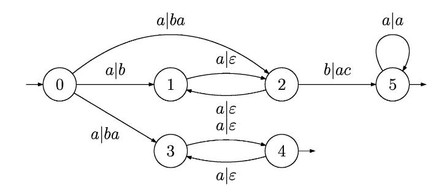

Fig. 4. Transducer of Example 14.

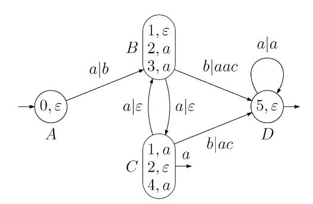

Fig. 5. Determinization of the transducer of Fig. 4.

By the induction hypothesis, there is a path i u|vw −→q in T. Finally, one has vtw = vwt .

The preceding lemma has the following consequence. If both pairs (q; w) and (q ;w ) belong to a state P which is accessible from the initial state and if both q and q are final states in T, then the equality w = w necessarily holds. Otherwise, the relation realized by T is not a function. This remark allows us to define the set of final states of D and the function . A state P is final if it contains as least one pair (q; w) where q is a final state of T. The function maps such a final state P to the word w.

Example 14. Consider the transducer pictured in Fig. 4. If the algorithm for determinization is applied to this transducer, one gets the subsequential transducer pictured in Fig. 5. This subsequential transducer is transformed into a sequential transducer in Examples 19.

This defines a subsequential transducer which may have an infinite number of states. However, we claim that the bounded variation property of T implies that the lengths of the words in states of D are bounded. Thus, the number of states of D is actually finite.

Lemma 15. *Let* v1;v2;v 1 *and* v 2 *be four 8nite words such that* |v2| = |v 2| *and* v1v! 2 = v 1v 2 !*. For any words* v3 *and* v 3;

$$d(v_1 v_2 v_3, v'_1 v'_2 v'_3) = d(v_1 v_3, v'_1 v'_3).$$

Proof. By symmetry, we may suppose that |v1| 6 |v 1|. There is then a finite word w such that v 1 = v1w and wv 2 = v2w. Thus, the word v 1v 2v 3 is equal to v1v2wv 3. It follows that

| $d(v_1 v_2 v_3, v'_1 v'_2 v'_3) = d(v_3, wv'_3) = d(v_1 v_3, v'_1 v'_3).$ | □ |
|---------------------------------------------------------------------------|--------------------------------------|
|---------------------------------------------------------------------------|--------------------------------------|

The following lemma states that if a transducer T has the twinning property, then the outputs labels of two paths with the same input label have a long common prefix. It proves that if the relation realized by T is a function, it has bounded variation. The proof is very close to the proof of Proposition 6:4 in [5] but we do not assume that the relation realized by T is a function. This is useful when transducers realizing relations on infinite words are considered.

Lemma 16. *Let* T *be a transducer which has the twinning property. There is a constant* K *such that the outputs of two paths* i u|v −→q *and* i u|v −→q *from two initial states* i *and* i *satisfy*

$$d(v, v') \leq K.$$

Proof. Let K be equal to 2n2M, where n is the number of states of the transducer and M is the maximal length of the output label of a transition. We prove d(v; v ) 6 K by induction on the length of u. If |u| 6 n2, the result holds by definition of K. Otherwise, both paths can be factorized

$$i \xrightarrow{u_1|v_1} p \xrightarrow{u_2|v_2} p \xrightarrow{u_3|v_3} q,$$

$$i' \xrightarrow{u_1|v'_1} p' \xrightarrow{u_2|v'_2} p' \xrightarrow{u_3|v'_3} q',$$

where u1u2u3 = u; v1v2v3 = v; v 1v 2v 3 = v and |u2|¿0. By the twinning property, one has d(v1v2v3;v 1v 2v 3)= d(v1v3;v 1v 3) and the result follows from the induction hypothesis.

The following lemma states that the lengths of the words w of the pairs (q; w) in the states of D are bounded. This implies that the number of states of D is finite.

Lemma 17. *There is a constant* K *such that for any pair* (q; w) *in a state* P *of* D; *one has* |w| 6 K*.*

Proof. Let J u|v −→P be a path in D. Let (q; w) be a pair in some state P. By definition of the transitions of D, there is another pair (q ;w ) in D such that w and w have no common prefix. By Lemma 13, there are two paths, i u|vw −→q and i u|vw −→ q in T. By Lemma 16, there is a constant K such that d(vw; vw ) 6 K and thus |w| 6 K.

The following proposition finally states that the subsequential transducer D is equivalent to the transducer T. It follows directly from Lemma 13 and the definition of the function .

Proposition 18. *The sequential transducer* D *realizes the same function* f *as the transducer* T*.*

We have already mentioned in Proposition 11 that it can be decided in polynomial time whether a function realized by a transducer is subsequential. The algorithm described above is exponential but it provides another decision procedure. Indeed, Lemma 17 gives a upper bound of the lengths of words which can appear in states of D. By Lemma 16, this upper bound is 2n2M, where n is the number of states of T and M is the maximal length of the output label of a transition of T. Let T be a transducer realizing a function f. If the algorithm is applied to T, either it stops and gives a subsequential transducer D or it creates a state P containing a pair (q; w) such that the length of w is greater than 2n2M. In the former case, the subsequential transducer D is equivalent to T and the function f is subsequential. In the latter case, the function f is not subsequential.

# *2.3. Sequential functions*

The determinization of a transducer realizing a subsequential function f provides a subsequential transducer realizing f. Even if the function f is sequential, the algorithm does not give a sequential transducer but this subsequential transducer can be transformed into a sequential one.

This transformation is based on a normalization of subsequential transducers introduced by Choffrut [12, 13]. This normalization consists in pushing as much as possible the output labels from final states towards the initial state. Algorithms computing the normalized transducer are given in [20, 22, 8, 9, 2]. The algorithms given in [20, 22, 2] run in time O(|E|P), where E is the set of transitions of the transducer, and where P is the maximal length of the greatest common prefix of the output labels of paths leaving each state of the transducer. If the normalization is applied to a subsequential transducer, the resulting transducer is sequential iff the function is sequential. Since the normalization can be performed in polynomial time, it can be checked in polynomial time whether a function realized by a subsequential transducer is sequential. It can be shown that a function realized by a subsequential transducer is sequential iff it preserves prefixes. This was already proved in [29, 30] that this property can be checked in polynomial time.

In order to transform a subsequential transducer into a sequential one, it is not necessary to push as much as possible the output labels from final states towards the

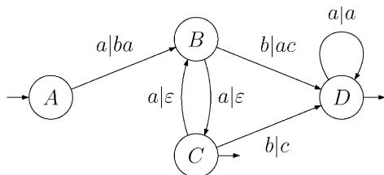

Fig. 6. Sequential transducer of Example 19.

initial state, as the normalization does. It suffices to push these output labels until the output of all states are empty. Therefore, the algorithm given in [2] can be adapted to meet this requirements. This gives a time complexity of O(|E|L) instead of O(|E|P) where L is the maximal length of the output words.

Example 19. Consider the transducer pictured in Fig. 5, where the states have been renamed A, B, C and D. If the normalization is applied to this subsequential transducer, one gets the sequential transducer pictured in Fig. 6.

# 3. Transducers over infinite words

In this section, we consider transducers over infinite words with all states being final. We first give an effective characterization of sequential functions over infinite words. This characterization extends to infinite words the twinning property introduced by Choffrut [11, 12]. We use this characterization to describe an algorithm to check whether a function realized by a transducer is sequential. Finally, we give an algorithm to determinize a transducer.

In this section, we denote by A! the set of all (right-)infinite words over the alphabet A. We consider transducers over infinite words. The edges of the transducers are still labeled in A∗ × B∗. The transducer has initial states but we suppose that all states are final. Thus, we omit the set F of final states in the notation. An infinite path is then *successful* if it leaves an initial state. The relation over infinite words defined by the transducer is the set R ⊂ A! × B! of labels of its successful paths. The *domain* of the transducer is the set of infinite words x such that there is some infinite word y such that (x; y) labels a successful path in the transducer. When the transducer realizes a function, its domain is also the domain of the function. A function from A! to B! is *sequential* if it is realized by a sequential transducer. We point out that the notion of subsequential function is irrelevant in the case of infinite words.

# *3.1. Characterization of sequential functions*

In this section, we characterize functions realized by transducers with all states final that can be realized by sequential transducers. This characterization uses topological properties of the function and some twinning property of the transducer. In this section, we assume that all states of transducers are final.

We first introduce a definition. We define a subset of states which play a particular role in the sequel. We say that a state q of a transducer is non*constant* if there are two paths leaving q labeled by two pairs (x; y) and (x ;y ) of infinite words such that y = y . If a state q is constant, either there is no path leaving q labeled by a pair of infinite words or there is an infinite word yq called the constant of q such that for any pair (x; y) of infinite words labeling a path leaving q, then y = yq. In the former case, the state q can be removed since it cannot occur in an accepting path labeled by a pair of infinite words. In the sequel, we always assume that such states have been removed. The constant yq is an ultimately periodic word. It should be noticed that any state accessible from a constant state is also constant. We now state the characterization of sequential functions.

Proposition 20. *Let* f *be a function realized by a transducer* T *with all states 8nal. Let* T *be the transducer obtained by removing from* T *all constant states. Then the function* f *is sequential i= the following three properties hold*:

- *the domain of* f *can be recognized by a deterministic Buchi automaton >* ;
- *the function* f *is continuous*;
- *the transducer* T *has the twinning property.*

Since the function f is realized by a transducer, the domain of f is rational. However, it is not true that any rational set of infinite words is recognized by a deterministic Buchi automaton. Landweber's theorem states that a set of infinite words is recognized B by a deterministic Buchi automaton iff it is rational and B G, [28]. Recall that a set is said to be G, if it is equal to a countable intersection of open sets for the usual topology of A!.

It is worth pointing out that the domain of a function realized by a transducer may be any rational set although it is supposed that all states of the transducer are final. The final states of a Buchi automaton can be encoded in the outputs of a trans- B ducer in the following way. Let A =(Q; E; I; F) be a Buchi automaton. We construct B a transducer T by adding an output to any transition of A. A transition p a → q of A becomes p a|v −→q in T, where v is empty if p is not final and is equal to a fixed letter b if p is final. It is clear that the output of a path is infinite iff the path goes infinitely often through a final state. Thus, the domain of the transducer T is the set recognized by A. For instance, the domain of a transducer may be not recognizable by a deterministic Buchi automaton as in the following example. It is, however, B true that the domain is closed if the transducer has no cycling path with an empty output.

Example 21. The domain of the function f realized by the transducer of Fig. 7 is the set (a+b)∗b! of words having a finite number of a. The function f cannot be realized by a sequential transducer since its domain is not a G, set.

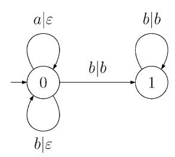

Fig. 7. Transducer of Example 21.

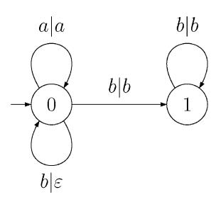

Fig. 8. Transducer of Example 22.

It must be also pointed out that a function realized by a transducer may be not continuous although it is supposed that all states of the transducer are final as it is shown in the following example.

Example 22. The image of an infinite word x by the function f realized by the transducer of Fig. 8 an infinite number of a and f(x)= anb! if the number of a in x is n. The function f is not continuous. For instance, the sequence xn = bnab! converges to b! while f(xn)= ab! does not converge to f(b!)= b!.

Proof. We first explain why the above three conditions of the proposition are necessary. The fact that the conditions are sufficient follows from the algorithm that we describe in Section 3.2.

If the function f is realized by a sequential transducer D, a deterministic Buchi B automaton recognizing the domain of f can be deduced from the input automaton of D in the following way. Each state q is first split in two states q1 and q2. We distribute then the edges arriving in q between q1 and q2 according to the emptiness of their output. Edges with an empty output arrive in q1 while edges with a nonempty output arrive in q2. The state q2 is then final and q1 is not. If q was initial, exactly one among q1 and q2 is then initial. All edges going out of q are duplicated in edges going out of q1 and q2. In symbolic dynamics, such a transformation is called an input state splitting. It is clear that this deterministic Buchi automaton recognizes the domain B of f. It is also clear that any sequential function is continuous.

We now prove that the third condition is necessary. We suppose that we have the following picture representing paths in T

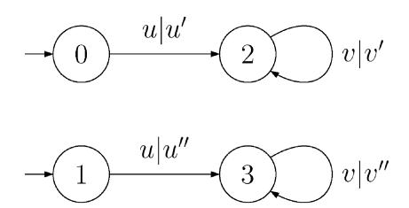

where 0 and 1 are initial states, u, u , u, v, v and v are finite words. Let D be a sequential transducer realizing the same function as T. There are in D paths

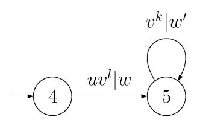

where 0 is the initial state, w and w are finite words. By prolonging the path in T from 0 to 2 (respectively, from 1 to 3) with l iterations of the path around 2 (respectively, around 3), we can assume without loss of generality that l = 0. By replacing the cycling path around 2 (respectively, around 3) by k iterations of this path, we can assume that k = 1.

We claim that if the state 2 is not constant, then the equality |w| = |v | holds. Since states 2 and 3 are not constant, then if v = then v = v = and the twinning property is satisfied. We now assume that v is not empty. Let x|x and y|y be the infinite labels of two infinite paths leaving 2 such that x = y . There are in D two infinite paths labeled by x|x and y|y leaving the state 5 such that

$$u'v'^nx' = ww'^nx'',$$

$$u'v'''y' = ww'''y''.$$

If |v |¡|w |, the words x and y have a common prefix of length |w|−|u |+n(|w |−|v |) for any large n. This leads to the contradiction that x = y . If |v |¿|w |, the words x and y have a common prefix of length |u|−|w| + n(|v |−|w |) for any large n. This leads to the contradiction that x = y and x = y .

By symmetry, if the state 3 is not either constant, then the equality also |w| = |v| holds and therefore |v | = |v|.

If both words v and v are nonempty, then f(uv!)= u v! = uv!.

Before describing the algorithm for determinization, we first study a particular case. It turns out that the first two conditions of the proposition are due to the fact that the transducer T may have cycling paths with an empty output. If the transducer T has no cycling path with an empty output, the previous proposition can be stated in the following way.

Proposition 23. *Let* f *be a function realized by a transducer* T *with all states 8nal. Suppose also that* T *has no cycling path with an empty output. Let* T *be the transducer obtained by removing from* T *all constant states. Then the function* f *is sequential i= the transducer* T *has the twinning property.*

If the transducer T has no cycling path with an empty output, any infinite path has an infinite output. Thus, an infinite word x belongs to the domain of f iff it is the input label of an infinite path in T. The domain of f is then a closed set. It is then recognized by a deterministic Buchi automaton whose all states are final. This B automaton can be obtained by the usual subset construction on the input automaton of T. Furthermore, if the transducer T has no cycling path with an empty output, the function f is necessarily continuous. This could be proved directly but it follows from Lemma 31.

We now study the decidability of the conditions of Propositions 20 and 23. We have the following results.

Proposition 24. *It is decidable if a function* f *given by a transducer with all states 8nal is sequential. Furthermore*; *if the transducer has no cycling path with an empty output*; *this can be decided in polynomial time.*

Note that the result does not hold if it is not supposed that the transducer has no cycling path with an empty output. In the general case, the problem is NP-hard. For any Buchi automaton, consider the transducer obtained by replacing each transi- B tion p a → q of the Buchi automaton by a transition B p a| −→q if p is not final and by p a|b −→q for a fixed letter b if p is final. The function maps any infinite word to b! and its domain is exaclty the set of infinite words recognized by the Buchi automa- B ton. This function is sequential iff its domain is deterministic. Since testing whether the set of infinite words recognized by a given nondeterministic Buchi automaton is B deterministic is an NP-hard problem, testing whether a function is sequential is also NP-hard.

Proof. As explained in the proof of Proposition 20, a Buchi automaton recognizing the B domain of the function can be easily deduced from the transducer. It is then decidable if this set can be recognized by a deterministic Buchi automaton [28, Theorem 5 B :3].

It is decidable in polynomial time if a function given by a transducer with final states is continuous [23].

We now show that the third condition of Proposition 20 can be decided in polynomial time. Since, we have already proved in Lemma 12 that the twinning property can be decided in a polynomial time, it suffices to prove that the transducer T can be computed in polynomial time. We claim that it can be decided in polynomial time whether a given state is constant.

Let A be the output automaton of the transducer. By a depth first search, it can be found two finite words u and v such that |u| + |v|6 n and such that uv! labels a path leaving q. One constructs a complete deterministic automaton B recognizing uv! with a sink state 0 which is the only nonaccepting state. We then consider the synchronized product automaton of A and B. There is a transition from (p; r) to (p ;r ) labeled by a finite word w (perhaps empty) iff there is a transition from p to p in A and a path from r to r in B. The infinite word uv! is the label of all paths leaving q iff no state (q ; 0) is accessible from (q; iB) where iB is the initial of B. This naive algorithm runs in quadratic time for each state q. Therefore, the constant states of a transducer can be computed in cubic time. It turns out that they can be computed in linear time [10].

# *3.2. Determinization of transducers over in8nite words*

In this section, we describe an algorithm to determinize a real-time transducer which satisfies the properties of Proposition 20. This algorithm can easily be adapted to the case when the transducer is not real-time. This algorithm proves that the conditions of the proposition are sufficient.

Let T =(Q; E; I ) be a transducer and let T be the transducer obtained by removing from T all constant states. We assume that T has the twinning property. We denote by S the set of constant states. For a state q of S, we denote by yq, the single output of q which is an ultimately periodic word. We suppose that the domain of f is recognized by the deterministic Buchi automaton B A. This automaton is used in the constructed transducer to insure that the output is infinite only when the input belongs to the domain of the function.

We describe the deterministic transducer D realizing the function f. A state of D is a pair (p; P), where p is a state of A and P is a set containing two kinds of pairs. The first kind are pairs (q; z) where q belong to Q\S and z is a finite word over B. The second kind are pairs (q; z); where q belongs to S and z is an ultimately periodic infinite word over B. We now describe the transitions of D. Let (p; P) be a state of D and let a be a letter. Let R be equal to the set defined as follows

$$R = \{(q', zw) \mid q' \notin S \text{ and } \exists(q, z) \in P, q \notin S \text{ and } q \xrightarrow{a|w} q' \in E\}$$

$$\cup \{(q', zwy_{q'}) \mid q' \in S \text{ and } \exists(q, z) \in P, q \notin S \text{ and } q \xrightarrow{a|w} q' \in E\}$$

$$\cup \{(q', z) \mid q' \in S \text{ and } \exists(q, z) \in P, q \in S \text{ and } q \xrightarrow{a|w} q' \in E\}.$$

We now define the transition from the state (p; P) input labeled by a. If R is empty, there is no transition from (p; P) input labeled by a. Otherwise, the output of this transition is the word v defined as follows. Let p a → p be the transition in A from p labeled by a. If p is not a final state of A, we define v as the empty word. If p

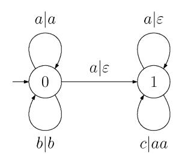

Fig. 9. Transducer of Example 25.

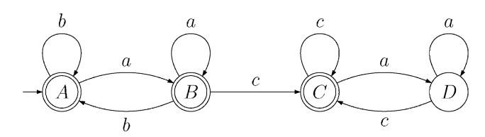

Fig. 10. A deterministic Buchi automaton for the domain. B

is a final state, we define v as the first letter of the words z if R only contains pairs (q ;z) with q ∈ S and if all the infinite words z are equal. Otherwise, we define v as the longest common prefix of all the finite or infinite words z for (q ;z) ∈ R. The state P is then defined as follows

$$P' = \{(q', z) | (q', vz) \in R\}.$$

There is then a transition (p; P) a|v −→(p ;P ) in D. The initial state of D is the pair (iA;J ) where iA is the initial state of A and where J = {(i; ) | i ∈I and i=∈S}∪ {(i; yi) | i ∈I and i ∈S}. If the state p is not final in A, the output of the transition from (p; P) to (p ;P ) is empty and the words z of the pairs (q; z) in P, may have a nonempty common prefix. We only keep in D the accessible part from the initial state. The transducer D has a deterministic input automaton. It turns out that the transducer D has a finite number of states. This will be proved in Lemma 33. It will be also proved in Proposition 34 that the transducer D realizes the same function as T.

Example 25. Consider the transducer pictured in Fig. 9. A deterministic Buchi automa- B ton recognizing the domain is pictured in Fig. 10. If the algorithm for determinization is applied to this transducer, one gets the transducer pictured in Fig. 11.

The following lemma states the main property of the transitions of D.

Lemma 26. *Let* u *be a 8nite word. Let* (iA;J ) u|v −→(p; P) *be the unique path in* D *with input label* u *from the initial state. Then*; *the state* p *is the unique state of* A

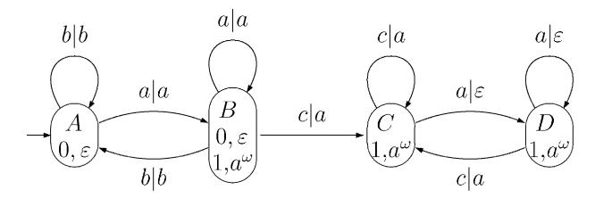

Fig. 11. Determinization of the transducer of Fig. 9.

*such that* iA u → p *is a path in* A *and the set* P *is equal to*

$$P = \{ \{q, z\} | \exists i \stackrel{\text{alt}}{=} q \text{ in } \mathcal{T} \text{ such that } ' = vz \text{ if } q \notin Sv'_{y_q} = vz \text{ if } q \in S\}.$$

Proof. The proof of the lemma is by induction on the length of u. Let us consider the following path in D

$$(i_{\mathcal{A}}, J) \xrightarrow{u|v} (p, P) \xrightarrow{a|t} (p', P').$$

where a is a letter. Let (q ;z ) be a pair in P . If q ∈= S, there is a pair (q; z) in P and a transition q a|t −→q in T. If both states q and q do not belong to S, the proof is similar to the proof of Lemma 13. If q=∈S and q ∈S, one has tz = zt yq . By the induction hypothesis, there is a path i u|vz −→q in T. One finally gets vtz = vzt yq . If q ∈S and q ∈S, one has tz = z. By the induction hypothesis, there is a path i u|v −→q in T such that v yq = vz. Since, yq = t yq , one finally gets vtz = v t yq .

The previous lemma has the corollary which states that each state q is the first component of at most one pair (q; z) in the second component P of a state (p; P) of D.

Corollary 27. *Let* q *be a state of* T *and let* (p; P) *be a state of* D*. The subset* P *contains at most one pair* (q; z)*.*

Proof. Let (iA;J ) u|v −→(p; P) be a path in D and let (q; z) and (q; z ) be two pairs in P.

We first suppose that q is not constant. Let x | y and x | y be two pairs of infinite words which label two paths leaving q such that y = y . By the previous lemma, there are two paths i u|vz −→q and i u|vz −→q in T. One has f(ux)= vzy = vz y and f(ux )= vzy = vz y . If z = z , it may be assumed by symmetry that |z |¿|z| and that z = zw for some finite word w. This leads to the contradiction y = y = w!.

We now suppose that q is constant. Let x | y be a pair of infinite words which labels a path leaving q. By the previous lemma, there are two paths i u|w −→q and i u|w −→q in T such that wy = vz and w y = vz . Furthermore, one has f(ux)= wy = w y and thus z = z .

We now introduce some technical property of the paths of a transducer. This property is a kind of twinning property when the output of one of the cycling paths is empty. It turns out that this property is equivalent to the continuity of the function realized by the transducer when it is already supposed that the transducer has the twinning property. Let T be a transducer and let S be its set of constant states. The transducer T is said to have the -*compatibility property* iff for any pair of paths

$$i \xrightarrow{u|u'} q \xrightarrow{v|v'} q,$$

$$i \xrightarrow{u|u''} q' \xrightarrow{v|\varepsilon} q'$$

such that i and i are two initial states and v is a nonempty word, the state q is constant and its constant yq satisfies uyq = u v!. If the states q and q are twinned, there cannot be a pair of such paths. If the output along the second cycling path is empty, the output along the first cycling path should also be empty. The above conditions add some compatibility of the outputs when q and q are not twinned.

The following lemma states that if the function realized by the transducer is continuous, then the transducer has the -compatibility property. The converse is established in Lemma 31.

Lemma 28. *Let* T *be transducer realizing a function* f *on in8nite words. If the function* f *is continuous*; *then the transducer* T *has the -compatibility property.*

Proof. Let x|y be a pair of infinite words which labels a path leaving q . For any integer n, one has f(uvnx)= uy and f(uv!)= uy by continuity of f. Since, f(uv!) = u v!, the state q is constant and its constant yq satisfies uyq = u v!.

For a finite word w and an infinite word x, we denote by d(w; x) the integer |w|− |w ∧x|; where w ∧x is the longest common prefix of w and x. Remark that d is not a distance but Lemma 15 still holds when v 3 is an infinite word.

Lemma 29. *Let* T *be a transducer. Suppose that* T *has the -compatibility property and that* T *has the twinning property. There is a constant* K *such that for any two paths* i u|v −→q *and* i u|v −→q ; *where* i *and* i *are initial states*;q=∈S *and* q ∈S; *one has*

$$d(v, v' y_{q'}) \leq K.$$

Proof. Let K be equal to n2M; where n is the number of states of the transducer and M is the maximal length of the output label of a transition. We prove d(v; v yq )6K by induction on the length of u. If |u|6n2, the result holds by definition of K. Otherwise, both paths can be factorized

$$i \xrightarrow{u_1|v_1} p \xrightarrow{u_2|v_2} p \xrightarrow{u_3|v_3} q,$$

$$i' \xrightarrow{u_1|v_1'} p' \xrightarrow{u_2|v_2'} p' \xrightarrow{u_3|v_3'} q',$$

where |u2|¿0 and |u3|6n2. If both words v2 and v 2 are empty, the result follows directly from the induction hypothesis. Thus, we may assume that one of the words v2 or v 2 is not empty. Since q does not belong to S, p does not belong to S either. The -compatibility property implies then that v2 cannot be empty.

We first suppose that p ∈= S. By the twinning property, Lemma 15 and the above remark, one has d(v1v2v3;v 1v 2v 3yq )= d(v1v3;v 1v 3yq ) and the result follows from the induction hypothesis.

We now suppose that p ∈S and we claim that v 1v 2v 3yq = v1v! 2 . Since p is constant, yp = v 3yq . If the word v 2 is empty, the -compatibility property implies that v 1yp = v1v! 2 . If v 2 is nonempty, yp = v !. Since f(u1u! 2 )= v1v! 2 = v 1v !, the claimed equality holds. In both cases, one has d(v1v2v3;v 1v 2v 3yq )= d(v1v2v3;v1v! 2 ) 6|v3|6K.

The following lemma states some technical consequence of the -compatibility property.

Lemma 30. *Let* T *be a transducer which has the -compatibility property and let* f *the function realized by* T*. Then if* x *is in the domain of* f *and* x *is the input label of a path entirely out of* S; *the output of this path is in8nite and is thus equal to the image of* x *by* f*.*

Proof. Suppose that x is the input label of two paths 1 and 1 . Suppose also that all states of 1 do not belong to S and the output along 1 is an infinite word. Since the number of states is finite, both paths 1 and 1 can be factorized

$$\gamma = i \xrightarrow{u_0|v_0} q \xrightarrow{u_1|v_1} q \xrightarrow{u_2|v_2} q \cdots,$$

$$\gamma' = i' \xrightarrow{u_0|v'_0} q' \xrightarrow{u_1|v'_1} q' \xrightarrow{u_2|v'_2} q' \cdots.$$

Furthermore, it can be assumed that each v k is nonempty since v 0v 1v 2 ::: is an infinite word. By hypothesis, this implies that each vk is also nonempty.

The following lemma states a kind of converse of Lemma 28. It shows in particular that if a transducer T has no cycling path with an empty output and if T has the twinning property, then the function realized by T is continuous. If x and y are two infinite words, d(x; y) denotes the usual distance between x and y which makes the set A! of all infinite words a compact space.

Lemma 31. *Let* T *be a transducer which has the -compatibility and such that* T *has the twinning property. Then the function realized by* T *is continuous.*

Proof. Let f be the function realized by the transducer T and let x be an infinite word in the domain of f. We claim that for any integer m there is an integer k such that for any infinite word x also in the domain f, the inequality d(x; x )62−k implies the inequality d(f(x);f(x ))62−m. Let y = f(x) be the image of x. Let 1 be a path labeled by x|y and let i be the initial state of 1. Let 1 be a path labeled by (x ;y ); where y = f(x ). According to the previous lemma, it can be assumed that either there is a path entirely out of S which is labeled by x|y or that x is not the input label of a path entirely out of S.

We first suppose that the path 1 is entirely out of S. By Lemma 15, there is a constant K such that if i u|v −→q and i u|v −→q are two paths with q=∈S and q ∈= S, then one has d(v; v )6K. By Lemmas 28 and 29, there is another constant K such that if i u|v −→q and i u|v −→q are two paths with q=∈S and q ∈S, then one has d(v; v yq )6K. Let k be chosen such that the output along the first k transitions of 1 has a length greater then m + max(K; K ). Let q be the state of 1 reached after k transitions and let v be the output of 1 along the first k transitions. Suppose that x satisfies d(x; x )6k and that 1 is a path labeled by x |y ; where y = f(x ). Let i the initial state of 1 and let q be the state of 1 reached after k transitions. If q does not belong to S, one has d(v; v )6K where v is the output of 1 along the first k transitions. Since |v|¿m + K, one has |v ∧v |¿m and thus d(y; y )62−m. If q belongs to S, one has d(v; y )6K . Since |v|¿m + K , one has |v ∧y |¿m and thus d(y; y )62−m.

We now suppose that x is not the input label of a path entirely out of S. There is then an integer K such that any path input labeled by a prefix of x of length greater than K ends in a state of S. Let k be equal to K + K where K is the length of part of 1 inside S which contains at least n2 transitions with a nonempty output. If d(x; x )62−k , both paths 1 and 1 can be factorized

$$\gamma = i \frac{u_0 |v_0}{q} q^{\frac{u_1 |v_1}{q}} q^{\frac{u_2 |v_2}{q}} \cdots,$$

$$\gamma' = i' \frac{u_0 |v'_0}{q'} q'^{\frac{u_1 |v'_1}{q'}} q'^{\frac{u_2 |v'_2}{q'}} \cdots,$$

where u0u1u2 = x, u0u1u 2 = x , v1 is nonempty and q and q belong to S. We claim that y = y . One has y = v0yq and y = v 0yq . Since v1 is nonempty, one also has yq = v! 1 . If v 1 is also nonempty, one has yq = v 1 ! and f(u0u! 1 )= v0v! 1 = v 0v 1 ! and thus y = y . If the word v 1 is empty, the -compatibility property implies v0yq = v 0yq and y = y .

In both cases, an integer k satisfying the claimed property has been found. The function f is then continuous.

The following lemma states that the lengths of the words z of the pairs (q; z) in the states of D are bounded. It is essentially due to the twinning property of T .

Lemma 32. *There is a constant* K *such that for any pair* (q; z) *in* P *of a state* (p; P) *of* D *where* q=∈S *and* z *is a 8nite word*; *one has* |z|6K*.*

Proof. Let m and n be the respective numbers of states of A and T. By Lemmas 16 and 29, there is a constant K such that if i u|v −→q and i u|v −→q are two paths such that q=∈S, then one has d(v; v )6K if q ∈= S or d(v; v yq )6K if q ∈S. Let K = K +mnM; where M is the maximal length of the output label of a transition in T. Let (p; P) be a state of D and consider a path

$$(i_{\mathcal{A}}, J) \xrightarrow{u'|v'} (p', P') \xrightarrow{u|v} (p, P),$$

where p is a final state of A. If there is no path from (iA;J ) to (p; P) which goes through a state (p ;P ) with p final, we assume that (p ;P ) is actually (iA;J ). The proof is by induction on the length of u. If |u| = 0, the state p is actually a final state of A. In the case where p is final, the longest common prefix of the words z of the pairs (q; z) in P is empty. Lemmas 16, 26 and 29 imply that |z|6K . We now suppose that p is not final. If |u|6mn, the result follows from the definition of the transitions of D. We now suppose that |u|¿mn and that (p ;P ) is the last state along the path from (iA;J ) to (p; P) such that p is a final state of A. Let (q; z) be a pair in P such that q=∈S and z is a finite word. By definition of the transitions of D, there is a pair (q ;z ) in P and a path q u|w −→q in T such that z w = vz. There is also a path p u → p in A. Since |u|¿mn, both paths can be factorized

$$p' \xrightarrow{u_1} p'' \xrightarrow{u_2} p'' \xrightarrow{u_3} p,$$

$$q' \xrightarrow{u_1|w_1} q'' \xrightarrow{u_2|w_2} q'' \xrightarrow{u_3|w_3} q,$$

where u1u2u3 = u and w1w2w3 = w. Since the cycling path p u2 −→p in A does not contain any final state, the infinite word u u1u! 2 does not belong to the domain of f. This implies that the word w2 is empty. We then consider the path

$$(p', P') \xrightarrow{u_1 u_3 | v''} (p, P'')$$

in D. The subset P contains a pair (q; z) for some finite word z. We claim that z = z. Indeed, one has z w1w2w3 = z w1w3 = vz = vz. As both paths p u1u2u3 −→ p and p u1u3 −→p in A contain no other final state than p, both outputs v and v along the corresponding paths in D are empty. Thus, one gets z = z. By the induction hypothesis, one has |z| = |z|6K.

It is now possible to prove that the transducer D has a finite number of states. However, the number of states of D can be exponential as in the case of finite words.

Lemma 33. *The number of states of* D *is 8nite.*

Proof. We have proved in the preceding lemma that the lengths of the finite words z are bounded. It remains to show that there is a finite number of different infinite words z which can appear in some pair (q; z). By definition of the transitions, any infinite word z of a pair is the suffix of z wyq where (q ;z ) is a pair such that q ∈= S and z is finite and where q ∈S and q a|w −→q is a transition of T. Since the length of z is bounded, the number of such words z wyq is finite and they are ultimately periodic. There are then a finite number of suffixes of such words.

The following proposition finally states that the sequential transducer D is equivalent to the transducer T. Both transducers realize the same function over infinite words.

Proposition 34. *The sequential transducer* D *realizes the same function* f *as the transducer* T*.*

Proof. We, respectively, denote by f and f the functions realized by the transducer T and D. We first prove that if an infinite word x belongs to the domain of f, it also belongs to the domain of f and f(x)= f (x).

Let x = a0a1a2 ::: be an infinite word which is in the domain of f. Let 1 be a path

$$\gamma = i \xrightarrow{a_0|v_0} q_1 \xrightarrow{a_1|v_1} q_2 \xrightarrow{a_2|v_2} \cdots \quad (1)$$

be a path in T input labeled by x and whose output v0v1v2 ::: is an infinite word. Consider the unique path 2 in D input labeled by x

$$\Gamma = (i_{\mathcal{A}}, J) \frac{a_0 |v'_0}{p_1} (p_1, P_1) \frac{a_1 |v'_1}{p_2} (p_2, P_2) \frac{a_2 |v'_2}{p_3} \cdots$$

By Lemma 26, each state Pn contains a pair (qn;zn).

We first suppose that x input labels a path in T entirely out of S. By Lemma 30, it can be assumed that each state qn does not belong to S and that each zn is finite. By Lemma 26, the equality v0 :::vn = v 0 :::v nzn holds for any integer n. By Lemma 32, the lengths of the words zn are bounded. This implies the equality v0v1v2 ::: = v 0v 1v 2 ::: of the two outputs.

We now suppose that x is not the input label of a path entirely out of S. There is then an integer n such that for any m¿n, Pm only contains pairs (q; z) with q ∈S and z infinite. Both path 1 and 2 can be factorized

$$\gamma = i \xrightarrow{u_0|_{v_0}} q \xrightarrow{u_1|_{v_1}} q \xrightarrow{u_2|_{v_2}} q \cdots,$$

$$\Gamma = (i_{\mathcal{A}'}, J) \xrightarrow{u_0|_{\mathcal{A}'}} (p, P) \xrightarrow{u_1|_{\mathcal{A}'}} (p, P) \xrightarrow{u_2|_{\mathcal{A}'}} (p, P) \cdots.$$

Furthermore, it can be assumed that each vn is nonempty. Thus, each path p uk −→p in A contains a final state of A. The single output of the state q is v! 1 . By Lemma 26, the subset P contains a pair (q; z) and v0yq = v0v! 1 = v 0z.

Let (q0;z ) be another pair in P. By definition of the transitions of D, there is a sequence (qn)n¿0 of states such that the pairs (qn;v 1 n z ) belong to P. Since there is a finite number of states, there are n¡m such that qn = qm. This implies that there is in T a cycling path around qn input labeled by um−n 1 . Let q = qn = qm. We first claim that v 1 n z = z . If the word v 1 is empty, this is obvious. Otherwise, Corollary 27 implies that v 1 n z = v 1 mz . Thus, z = v 1 ! and the equality v 1 n z = z also holds. The subset P contains a pair (q;z ). By Lemma 26, there is a path i u0|v −→ q in T such that v 0z = vyq . By construction, there is also a cycling path around q input labeled by um−n 1 . We suppose that the output label of this cycling path is the word w. If the word w is empty, Lemma 28, states that vyq = v0v! 1 . Thus, one has v 0z = vyq = v0v! 1 = v 0z and z = z . If the word w is nonempty, one has yq = w! and f(u0u! 1 )= vw! = v0v! 1 . This implies z = z .

Since we have proved that all pairs (q; z) in P share the same infinite word z and since each path p → ui p contains a final state, each word v i is nonempty by definition of the transitions of D and the equality v 1v 2v 3 ::: = z holds. This last equality implies that v0yq = v 0z = v 0v 1v 2 ::: and that f(x)= f (x).

Conversely, the definition of the transitions of D implies that the domain of f is contained in the domain of f. Thus, both functions f and f have the same domain and f = f .

We have already mentioned in Proposition 24 that it can be decided whether a function over infinite words realized by a transducer with all states final is sequential. As in the case of finite words, the algorithm described above provides another decision procedure. Indeed, Lemma 32 gives an upper bound K of the lengths of finite words which can appear in states of D. Let T be a transducer with all states final realizing a function f. If the algorithm is applied to T, either it stops and gives a sequential transducer D or it creates a state (p; P) containing a pair (q; z) such that the length of z is greater than K. In the former case, the sequential transducer D is equivalent to T and the function f is sequential. In the latter case, the function f is not sequential.

### Acknowledgements

The authors would like to thank Jean Berstel for very helpful suggestions and Christian Choffrut for his relevant comments on a preliminary version of this paper.

### References

- [1] M.-P. Béal, Codage Symbolique, Masson, 1993. [2] M.-P. Béal, O. Carton, Computing the prefix of an automaton, Tech. Rep. 2000-08, Institut Gaspard Monge, 2000. [3] M.-P. Béal, O. Carton, Determinization of transducers over infinite words, in: U. Montanari, et al., (Eds.), ICALP'2000, Lecture Notes in Computer Science, Vol. 1853, Springer, Berlin, 2000, pp. 561–
- 570. [4] M.-P. Béal, O. Carton, C. Prieur, J. Sakarovitch, Squaring transducers: an efficient procedure for deciding functionality and sequentiality, in: G. Gonnet, D. Panario, A. Viola (Eds.), LATIN'2000, Lecture Notes in Computer Science, Vol. 1776, Springer, Berlin, 2000, pp. 397–406. [5] J. Berstel, Transductions and Context-Free Languages, B.G. Teubner, 1979. [6] J. Berstel, D. Perrin, Finite and infinite words, in: M. Lothaire (Ed.), Algebraic Combinatorics on Words, Cambridge, 1999, to appear. [7] M. Blattner, T. Head, Singled valued a-transducers, J. Comput. System Sci. 15 (1977) 310–327. [8] D. Breslauer, The suffix tree of a tree and minimizing sequential transducers, in: CPM'96, Lecture Notes in Computer Science, Vol. 1075, Springer, Berlin, 1996, pp. 116 –129. [9] D. Breslauer, The suffix tree of a tree and minimizing sequential transducers, Theoret. Comput. Sci. 191 (1998) 131–144.

- [10] O. Carton, C. Choffrut, C. Prieur, How to decide functionality of rational relations on infinite words, Preprint. [11] C. Choffrut, Une caract(erisation des fonctions s(equentielles et des fonctions sous-s(equentielles en tant que relations rationnelles, Theoret. Comput. Sci. 5 (1977) 325–338. [12] C. Choffrut, Contribution Pa l'(etude de quelques familles remarquables de fonctions rationnelles, ThPese d'Etat Universit( ( e Paris VII, 1978. [13] C. Choffrut, A generalization of Ginsburg and Rose's characterization of gsm mappings, in: ICALP'79 Lecture Notes in Computer Science, Vol. 71, Springer, Berlin, 1979, pp. 88–103. [14] A. Cohen, J.-F. Collard, Instance-wise reaching definition analysis for recursive programs using context-free transductions, in: PACT'98, 1998. [15] S. Eilenberg, Automata, Languages and Machines, Vol. A, Academic Press, New York, 1972. [16] C. Frougny, Numeration systems, in: M. Lothaire (Ed.), Algebraic Combinatorics on Words, Cambridge, 1999, to appear. [17] F. Gire, Two decidability problems for infinite words, Inform. Proc. Lett. 22 (1986) 135–140. [18] B. Kitchens, Continuity properties of factor maps in ergodic theory, Ph.D. Thesis, University of North Carolina, Chapel Hill, 1981. [19] D. Lind, B. Marcus, An Introduction to Symbolic Dynamics and Coding, Cambridge University Press, Cambridge, 1995. [20] M. Mohri, Minimization of sequential transducers, in: M. Crochemore, D. Gusfield (Eds.), CPM'94, Lecture Notes in Computer Science, Vol. 807, Springer, Berlin, 1994, pp. 151–163. [21] M. Mohri, On some applications of finite-state automata theory to natural languages processing,
- J. Natur. Language Eng. 2 (1996) 1–20. [22] M. Mohri, Minimization algorithms for sequential transducers, Theoret. Comput. Sci. 234 (2000) 177–201. [23] C. Prieur, How to decide continuity of rational functions on infinite words, Theoret. Comput. Sci. 250 (2001) 71–82. [24] E. Roche, Y. Schabes, Finite-State Language Processing, MIT Press, Cambridge, 1997 (Chapter 7). [25] S. Safra, On the complexity of !-automata, 29th Ann. Symp. on Foundations of Computer Sciences, 1988, pp. 24 –29. [26] M.-P. Schutenberger, Sur les relations rationnelles, in: H. Brakhage (Ed.), Automata Theory and Formal B Languages, 2nd GI Conference, Lecture Notes in Computer Science, Vol. 33, Springer, Berlin, 1975, pp. 209–213. [27] M.-P. Schutenberger, Sur une variante des fonctions s( B equentielles, Theoret. Comput. Sci. 11 (1977) 47–57. [28] W. Thomas, Automata on infinite objects, in: J. van Leeuwen (Ed.), Handbook of Theoretical Computer Science, Vol. B, Elsevier, Amsterdam, 1990, pp. 133–191. [29] A. Weber, R. Klemm, Economy of description for single-valued transducers, in: P. Enjalbert, E.W. Mayr, K.W. Wagner (Eds.), STACS'94, Lecture Notes in Computer Science, Vol. 775, Springer, Berlin, 1994, pp. 607– 618. [30] A. Weber, R. Klemm, Economy of description for single-valued transducers, Inform. Comput. 118 (1995) 327–340.