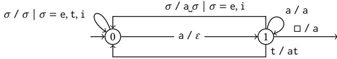
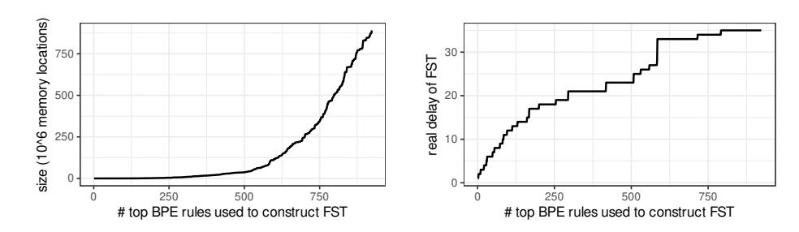
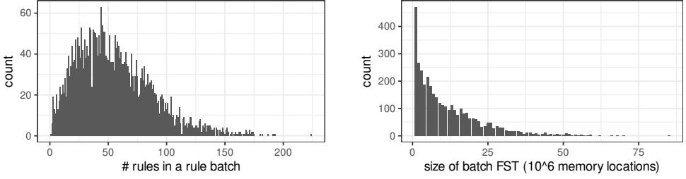
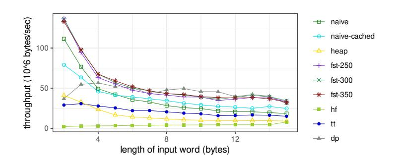
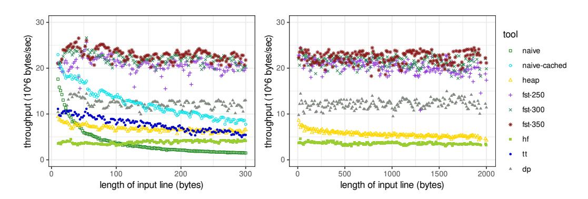
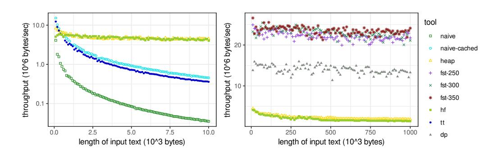
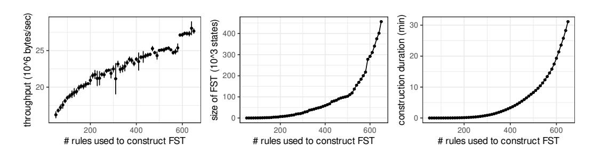

# An Efficient Algorithm for Streaming BPE Tokenization

[KONSTANTINOS MAMOURAS,](https://orcid.org/0000-0003-1209-7738) Rice University, USA

[ANGELA W. LI,](https://orcid.org/0000-0002-4523-3401) Rice University, USA

[YUDI YANG,](https://orcid.org/0009-0009-3156-0637) Rice University, USA

Tokenization is an essential text preprocessing step in almost all large language models (LLMs), and byte-pair encoding (BPE) is a popular tokenization method used by models such as GPT, GPT-2, and RoBERTa. Since LLMs have many applications that require the fast processing of large amounts of data (e.g., real-time document summarization and analysis), offline tokenization algorithms may have high latency or prohibitive memory requirements. In this paper, we study BPE tokenization with a focus on providing a streaming implementation. A BPE tokenizer is specified with an ordered list of token merge rules, where each rule describes the merging of two adjacent tokens. We introduce the concept of delay for a list of BPE merge rules, which corresponds to the amount of lookahead needed before tokens can be finalized. We view BPE tokenization as a sequence-tosequence transduction and show how to obtain a bound on delay. This bound enables streaming tokenization with a low memory footprint. We propose a novel streaming algorithm that uses a small amount of memory (independent of the input text) and has linear time complexity in the length of the input text. Our experimental evaluation shows that our algorithm performs well in comparison to existing BPE tokenizers.

CCS Concepts:• Computing methodologies → Natural language processing;• Theory of computation → Transducers; Design and analysis of algorithms.

Additional Key Words and Phrases: byte-pair encoding, subword segmentation, LLM, lexical analysis

#### ACM Reference Format:

Konstantinos Mamouras, Angela W. Li, and Yudi Yang. 2026. An Efficient Algorithm for Streaming BPE Tokenization. Proc. ACM Program. Lang. 10, PLDI, Article 252 (June 2026), [24](#page-23-0) pages. [https://doi.org/10.1145/](https://doi.org/10.1145/3808330) [3808330](https://doi.org/10.1145/3808330)

#### 1 Introduction

Large language models (LLMs) are becoming increasingly important in modern machine learning systems and are already widely used in practical applications. A key preprocessing step in most LLM pipelines is tokenization, the process of splitting raw text into a sequence of short strings called tokens. These tokens form the interface between text and neural model computation. After tokenization, the tokens are embedded into continuous vector representations for processing by the neural architecture.

Despite being an essential component of almost all LLM systems, tokenization has received less attention than other aspects of LLMs. At the same time, the performance requirements imposed on tokenizers continue to increase. In many applications, LLMs process not only short user prompts, but also large amounts of additional text. One example is retrieval-augmented generation (RAG) [\[31\]](#page-21-0), a technique that augments a user prompt with a substantial amount of content retrieved from an external repository. This technique has been shown to be effective across a range of knowledgeintensive NLP tasks. It may require tokenizing large amounts of additional data, potentially at the scale of software repositories (with millions of lines of code) or enterprise document collections.

Authors' Contact Information: [Konstantinos Mamouras,](https://orcid.org/0000-0003-1209-7738) Rice University, Houston, USA, mamouras@rice.edu; [Angela W. Li,](https://orcid.org/0000-0002-4523-3401) Rice University, Houston, USA, awl@rice.edu; [Yudi Yang,](https://orcid.org/0009-0009-3156-0637) Rice University, Houston, USA, yudi.yang@rice.edu.

[This work is licensed under a Creative Commons Attribution 4.0 International License.](https://creativecommons.org/licenses/by/4.0)

© 2026 Copyright held by the owner/author(s).

Processing large inputs requires tokenizers to operate at high throughput, particularly in applications with strict latency constraints. For example, a real-time document analysis tool must be able to quickly perform analyses over large document collections, as users typically expect responses within a few seconds; a longer processing time may lead users to view the tool as slow and therefore less useful. When a large document is given as input to a tokenizer, memory consumption could become a concern, since existing tokenizers typically require the entire input to be loaded into memory prior to tokenization. To address the need for fast tokenization under memory constraints, it is natural to consider streaming approaches. Streaming algorithms have a low memory footprint, because they avoid keeping the full input in memory. Offline algorithms, on the other hand, may incur prohibitive memory costs.

One of the most common tokenization algorithms used in the context of LLMs is byte-pair encoding (BPE) [\[22,](#page-21-1) [67\]](#page-23-1). A tokenizer is specified by a BPE ruleset[1](#page--1-0) , which is a list of token merge rules ordered by priority and is learned from a training corpus. The merge rules reflect the most frequent subword units in the training corpus. Given an input text string, the BPE tokenization algorithm first considers each character of the original string to be an individual token. Then, the algorithm iteratively merges the leftmost highest-priority pair of mergeable adjacent tokens until there are no more mergeable pairs.

In this paper, we study BPE tokenization with a focus on the streaming setting. Our main contributions include the following:

- We view BPE tokenization as a sequence-to-sequence transduction (more specifically, a transduction that transforms a sequence of characters into a sequence of subword tokens) and we introduce the notion of delay for BPE rulesets.
- We show that bounding the delay of a BPE ruleset enables streaming tokenization, because delay characterizes the worst-case lookahead needed before tokens can be safely emitted.
- While a precise calculation of the delay of a BPE ruleset is infeasible (when using a monolithic transducer for the ruleset), we show how to compute a useful upper bound for it.
- We propose a streaming algorithm for BPE tokenization that has time complexity ��(��), where �� is the length of the input text. Moreover, the memory footprint is independent of ��.
- We have implemented our proposed streaming algorithm and compared it against existing tokenizers, including the widely used HuggingFace [\[20\]](#page-21-2) and tiktoken [\[77\]](#page-23-2).

#### 2 Background: Byte-Pair Encoding (BPE)

BPE was introduced by Gage [\[22\]](#page-21-1) as a lossless data compression algorithm. The main idea is to examine all adjacent pairs of bytes in the input data, count the frequency of each pair, and replace the most frequently occurring pair of bytes with an unused byte. This process is repeated until a desired compression ratio is achieved. Much later, Sennrich et al. [\[67\]](#page-23-1) adapted BPE to the task of segmenting words into subword units. BPE enables the representation of an open vocabulary using character sequences over a fixed-size alphabet, making it a suitable word segmentation method for neural network models. The BPE tokenization stage is preceded by a training stage in which merge rules are learned from a training corpus. We describe training and tokenization below.

BPE Training. A BPE ruleset contains (i) a list of base rules, each of which maps a base character to an identifier, followed by (ii) a list of merge rules, each of which specifies the merging of two neighboring tokens. The ruleset is ordered by priority, and rules occurring earlier in the list are considered to be of higher priority during tokenization. The training algorithm takes as input a text corpus (variable corpus of type Vect(C), a vector of characters drawn from C) and the number

1We use the non-standard term 'BPE ruleset' as a synonym to 'ordered set of BPE merge rules'. The term 'vocabulary' is commonly used for the set or list of all tokens. With the term 'ruleset' we emphasize the rules that generate the tokens.

of merge rules (variable n\_rules of type N) that the BPE ruleset should have. Every character �� ∈ C is associated with an identifier, denoted enc(��). The first step of training is to initialize a vector compressed (a vector of type Vect(N) containing identifiers) that results from corpus by replacing each character by its identifier. The algorithm then enters its main loop, which runs exactly n\_rules times. In each iteration, it chooses the most frequent adjacent pair (id0, id1) of identifiers. The next available identifier id is used for the rule that merges the pair (id0, id1). We write this merge rule with the notation (id0, id1) → id. Ties are broken arbitrarily but (typically) according to a fixed deterministic strategy. Then, the vector compressed is reduced by replacing (with a single left-to-right pass) every occurrence of a pair (id0, id1) with the identifier id. After the training process is complete, the resulting BPE ruleset contains all learned merge rules.

Example 1. Consider the character alphabet C = {A, B, N} and the training corpus BANANA. Suppose that enc(A) = 0, enc(B) = 1, and enc(N) = 2. We write the base rules as A → 0, B → 1, and N → 2. They specify that the characters A, B, and N have token identifiers 0, 1, and 2 respectively. We train a BPE ruleset consisting of 3 merge rules. First, the algorithm initializes compressed to 1 0 2 0 2 0.

| step | compressed  | (decoded)             | pair      | (decoded)    | merge rule    | (decoded)            |
|------|-------------|-----------------------|-----------|--------------|---------------|----------------------|
| 1    | 1 0 2 0 2 0 | B ␣ A ␣ N ␣ A ␣ N ␣ A | ( 0 , 2 ) | ( A , N )    | ( 0 , 2 ) → 3 | ( A , N ) → AN       |
| 2    | 1 3 3 0     | B ␣ AN ␣ AN ␣ A       | ( 1 , 3 ) | ( B , AN )   | ( 1 , 3 ) → 4 | ( B , AN ) → BAN     |
| 3    | 4 3 0       | BAN ␣ AN ␣ A          | ( 4 , 3 ) | ( BAN , AN ) | ( 4 , 3 ) → 5 | ( BAN , AN ) → BANAN |

The symbol ␣ is a token separator. The resulting BPE ruleset yields the tokens [A, B, N, AN, BAN, BANAN].

BPE Tokenization. In the tokenization stage, the input consists of a trained BPE ruleset and a string. Initially, the input string is treated as a sequence of characters, each of which forms a token. Then, using the ruleset, the tokenization algorithm repeatedly merges the leftmost highest-priority mergeable pair (of adjacent tokens) until there are no more mergeable pairs. The resulting vector of tokens is the output of BPE tokenization. Fig. [1](#page-3-0) shows pseudocode for this procedure. The main loop repeats until there are no more mergeable pairs in the string. In each iteration, the algorithm scans the current vector of tokens and finds the best pair to merge. If such a pair exists, the algorithm merges it. Otherwise, there are no more pairs to merge, and the algorithm terminates. The complexity of this tokenization algorithm is ��(�� ), where �� is the length of the input text. The quadratic complexity arises because there can be up to ��(��) merge operations, and each merge requires scanning the entire sequence to identify the best merge available.

Example 2. We have C = {a, b, c} and the BPE ruleset with tokens [a, b, c, ac, bb, ab, acbb], listed in order of decreasing priority. The ruleset contains 4 merge rules: (0, 2) → 3, (1, 1) → 4, (0, 1) → 5, and (3, 4) → 6. We use this ruleset to tokenize the input text abacbb.

| step | text ids    | (decoded)             | best rule     | (decoded)          |
|------|-------------|-----------------------|---------------|--------------------|
| 1    | 0 1 0 2 1 1 | a ␣ b ␣ a ␣ c ␣ b ␣ b | ( 0 , 2 ) → 3 | ( a , c ) → ac     |
| 2    | 0 1 3 1 1   | a ␣ b ␣ ac ␣ b ␣ b    | ( 1 , 1 ) → 4 | ( b , b ) → bb     |
| 3    | 0 1 3 4     | a ␣ b ␣ ac ␣ bb       | ( 0 , 1 ) → 5 | ( a , b ) → ab     |
| 4    | 5 3 4       | ab ␣ ac ␣ bb          | ( 3 , 4 ) → 6 | ( ac , bb ) → acbb |

In the final step, text\_ids is reduced to 5 6 (decoded ab␣acbb). The remaining pair cannot be merged and therefore the algorithm terminates. So, ab␣acbb is the BPE tokenization of abacbb.

The top-level structure of BPE tokenization is shown in Fig. [2.](#page-3-1) The input consists of a BPE ruleset and a piece of text to be tokenized. The input text has type Vect(C) and the output has type Vect(Tk), where Tk = C ∗ is the type of tokens. First, the algorithm converts the text into a vector of token identifiers, one for each character. The function CompressBPE can be TokNaive (Fig. [1\)](#page-3-0) or any other tokenization variant (see TokNaiveCache in Fig. [3\)](#page-4-0). Finally, the identifiers are decoded

// Perform BPE tokenization in place, i.e., by mutating text\_ids Function TokNaive(ruleset : RulesBPE, text\_ids : &mut Vect(N)): if text\_ids.len = 0 then return while true do // repeat while there is a pair to merge (best\_rule\_id, best\_pos) ← (∞, nil) for �� = 0, . . . , text\_ids.len − 2 do // find the best pair to merge pair ← (text\_ids[��], text\_ids[�� + 1]) rule\_id ← ruleset.get(pair) // returns ∞ if pair cannot be merged if rule\_id &lt; best\_rule\_id then // higher priority best\_rule\_id ← rule\_id; best\_pos ← �� if best\_rule\_id &lt; ∞ then �� ← best\_pos; assert �� + 1 &lt; text\_ids.len; text\_ids[��] ← best\_rule\_id text\_ids.remove(�� + 1) // remove element and shift the suffix else break

Fig. 1. Naive BPE tokenization algorithm with time complexity ��(�� ).

// Input: BPE ruleset to be used for tokenization & text to tokenize Function TokenizeBPE(ruleset : RulesBPE, text : Vect(C)): Vect(N) text\_ids ← [ ] // vector for the identifiers of each character // translate from characters of the alphabet to token identifiers for �� = 0, . . . , text.len − 1 do text\_ids[��] ← enc(text[��]) CompressBPE(ruleset, &mut text\_ids) // compress in place (mutate text\_ids) // text\_ids now contains the identifiers of the subword tokens of text // translate back from token identifiers to subword tokens (strings) Vect(Tk) tokens ← [ ] // initialize the vector of output tokens for �� = 0, . . . , text\_ids.len − 1 do Tk token ← ruleset.dec(text\_ids[��]); tokens.push(token) return tokens

Fig. 2. High-level description of BPE tokenization as a function from C ∗ to Tk∗ .

into the corresponding tokens (i.e., substrings of the input text). The function ruleset.dec decodes a token identifier (of type N) into the corresponding token (of type Tk). We will use Fig. [2](#page-3-1) to define the denotation of a BPE ruleset in [§3.](#page-5-0)

Variants of the BPE Tokenization Algorithm. The algorithm of Fig. [1](#page-3-0) performs pair lookups with function calls of the form ruleset.get(pair). When an adjacent pair remains unchanged, then repeating the lookup is redundant. Pair lookups have a non-negligible cost, as they typically give rise to irregular memory accesses (e.g., hash table accesses), so it is desirable to avoid repeating them. The variant of Fig. [3](#page-4-0) caches the results of pair lookups. In the beginning, the cache is initialized by looking up each adjacent pair. After each merge, the cache is fixed by updating at most two entries. The algorithm performs ��(��) pair lookups in ruleset, because the total number of merges is ��(��). Moreover, the memory accesses when reading cache have good spatial locality. Despite this improvement, the TokNaiveCache algorithm has ��(�� ) complexity (there is a quadratic number of cache accesses). We will see in [§4](#page-14-0) that caching results in a significant performance improvement.

The cached tokenization algorithm can be further improved by introducing a heap (priority queue), which stores the priorities of mergeable adjacent pairs. Using a heap, we avoid the linear search for the best pair to merge in each iteration. Instead, we pop the highest-priority pair from the top of the heap. When a merge is performed at position ��, at most two pairs are affected: at positions (�� − 1,��) and (��,�� + 1). The new pairs are inserted into the heap, and each insertion needs ��(log��) time. Obsolete pairs are not explicitly removed from the heap. When we pop an entry from the top of the heap, we can detect in ��(1) time if it is obsolete and discard it. We use a doubly

// Perform BPE tokenization in place, i.e., by mutating text\_ids Function TokNaiveCache(ruleset : RulesBPE, text\_ids : &mut Vect(N)): if text\_ids.len = 0 then return cache ← [ ] // empty vector for �� = 0, . . . , text\_ids.len − 2 do // look up all pair priorities pair ← (text\_ids[��], text\_ids[�� + 1]) rule\_id ← ruleset.get(pair) // returns ∞ if pair cannot be merged cache.push(rule\_id) while true do // repeat while there is a pair to merge (best\_rule\_id, best\_pos) ← (∞, nil) for �� = 0, . . . , text\_ids.len − 2 do // find the best pair to merge if cache [��] &lt; best\_rule\_id then // higher priority best\_rule\_id ← cache [��]; best\_pos ← �� if best\_rule\_id &lt; ∞ then �� ← best\_pos; assert �� + 1 &lt; text\_ids.len text\_ids[��] ← best\_rule\_id; text\_ids.remove(�� + 1); cache.remove(��) if �� &gt; 0 then // fix pair to the left pair ← (text\_ids[�� − 1], text\_ids[��]) cache [�� − 1] ← ruleset.get(pair) // returns ∞ if pair cannot be merged if �� + 1 &lt; text\_ids.len then // fix pair to the right pair ← (text\_ids[��], text\_ids[�� + 1]) cache [��] ← ruleset.get(pair) // returns ∞ if pair cannot be merged else break

Fig. 3. Naive BPE tokenization algorithm with caching. The time complexity is ��(�� ).

linked list to represent the sequence of token identifiers, which avoids the cost of shifting suffixes. It follows that the complexity of the heap-based algorithm is ��(�� log��).

Although the heap-based algorithm has better time complexity than the naive cached algorithm, it incurs non-negligible overhead due to heap maintenance. When the input length is relatively small, the naive cached algorithm can be faster than the heap-based algorithm (see [§4\)](#page-14-0). For this reason, both algorithms are currently used in modern LLM tokenizers [\[20,](#page-21-2) [77\]](#page-23-2).

Pre-tokenization. Before BPE tokenization is applied, some LLMs employ a pre-tokenization stage, in which the input text is first split into shorter pieces called pre-tokens. Depending on the specific LLM, different pre-tokenization methods may be used, such as splitting by whitespace and punctuation (as in BERT) or using a regular expression (as in GPT-2). The regex used in the GPT-2 pre-tokenizer separates contractions (e.g., 's, 't, 're, 've, 'm, 'll, 'd), words, numbers, and punctuation. After pre-tokenization, BPE tokenization is applied to smaller chunks of text. As a result of pre-tokenization, the BPE tokenizer does not merge across pre-token boundaries. For example, the input text hello world may first be split into the pre-tokens hello and world by a whitespace-based pre-tokenizer. This prevents cross-boundary merges, e.g., between llo and wo. Commonly used BPE tokenization algorithms have super-linear running time, so pre-tokenization can improve the running time because the size of each pre-token is typically small.

Streaming BPE Tokenization. We are interested in performing BPE tokenization in the streaming model of computation, in which the input text is provided incrementally from left to right, either symbol by symbol or in small blocks. The input text should be thought of as being ephemeral, which means that we cannot assume that it remains available in memory. If, at some point during the computation, a streaming algorithm requires access to earlier parts of the input, then these parts must have been explicitly buffered (a streaming algorithm cannot "rewind" the input stream).

Consider the BPE ruleset with vocabulary [a, b, c, d, e, f, ef, de, cd, bc, ab] (given in order of priority). Suppose we have seen the prefix abcde of the input stream. At this point, we are unable to

produce any output token. Even the first token depends on future input. If the next input symbol is a, then the output would start with a␣bc␣de. If, on the other hand, the next input symbol is f, then the output would start with ab␣cd␣ef. This implies that output generation is delayed, because the output token stream lags behind the input text stream by 5 symbols. One way to implement this computation (in the streaming model) is to introduce a buffer that stores the most recent input symbols for which the corresponding output tokens cannot yet be determined. If we can put a bound on the delay (i.e., how far behind the output stream is with respect to the input stream), then we can also put a bound on the size of the buffer that holds input symbols for "pending" tokens.

There are some rulesets for which this delay can become large. Generalizing the example of the previous paragraph, let us consider a set Γ = {��0, ��1, . . . , ����−2, ����−1} of �� symbols (where �� is even) and the merge rules (����−2, ����−1) → ����−2����−1, . . . , (��1, ��2) → ��1��2, (��0, ��1) → ��0��1 (in order of priority). The maximum delay for this ruleset is equal to �� − 1. The argument is similar to what we described before. For the stream prefix �� = ��0��1 . . . ����−2 (of length �� − 1) we cannot even determine the first output token. If the prefix �� is extended with ����−1, then we would produce the output token sequence �� = ��0��1␣��2��3␣ . . . ␣����−2����−1. If, on the other hand, the prefix �� gets extended with ��0, then the output token stream would start with �� ′ = ��0␣��1��2␣ . . . ␣����−3����−2. Observe that the token sequences �� and �� ′ have the same length but differ at all positions (even the first tokens are different). This shows that the output has to be delayed (in the worst case) by �� − 1 input symbols. A streaming algorithm can handle this unavoidable delay by maintaining a buffer of size at most �� − 1 that holds the symbols for which tokens cannot be formed yet. In this example, the parameter �� can be arbitrarily large. This is not an issue, however, because the set Γ can be encoded with a small finite alphabet Σ using a binary encoding scheme for the symbols of Γ.

DP Algorithm. A dynamic programming algorithm for BPE tokenization has been proposed in [\[70\]](#page-23-3). We will refer to this algorithm with the name DP. It has complexity ��(��), where �� is the length of the input text. Given input �� of length ��, DP fills in a table �� of size �� + 1 so that �� [��] (for �� = 1, 2, . . . , ��) is the identifier of the last token in the BPE tokenization of the prefix �� [0..��] (slice of length ��). For convenience with indexing, the entry �� [0] is unused. The table �� is filled in efficiently with a left-to-right pass. The advantage of DP is that from the table �� we can read off (with a backward pass) the tokenization for every prefix �� [0..��] of the input text. Moreover, DP naturally supports the incremental extension of the input text. If �� is extended to ����, then DP can extend the table �� with |��| more entries and fill them using the same left-to-right procedure.

DP supports incremental extensions naturally and operates at character-level granularity: an extension by one character can be handled with one additional step. This requires maintaining the entire table �� in memory, so DP is not designed for low-memory streaming settings, where state is typically discarded. Our algorithm, which we describe in [§3,](#page-5-0) focuses on bounding the amount of state required for streaming tokenization. It supports incremental input extension (as it is a streaming algorithm), but requires re-computation at block boundaries (Theorem [11\)](#page-9-0). So, the granularity of incremental extensions is coarser (block-by-block processing) compared to DP.

As far as we can tell from the code repository for DP [(readme file](https://github.com/github/rust-gems/blob/main/crates/bpe/README.md) and the ["encode via backtracking"](https://github.com/github/rust-gems/blob/main/crates/bpe/src/byte_pair_encoding.rs) function), there is a variant of DP that works by maintaining the tokenization only for the whole text (not its prefixes) and employs backtracking to find the correct tokens. This variant does not target the streaming setting either, as it maintains the vector of candidate tokens in memory.

## 3 Transducers for BPE Tokenization

In this section, we will see that we can describe BPE tokenization using subsequential transducers, a class of deterministic sequence-to-sequence transducers. The idea is that for each BPE rule, we can create a transducer that consumes the tokens to be merged (according to the rule) and outputs the

merged token. At the same time, the transducer does not alter the input tokens that are irrelevant to the merge rule of interest. We first introduce the relevant definitions, including that of the denotation of a BPE ruleset and that of BPE transducers, and then we present the construction of a transducer for a given BPE merge rule. We point out the fact that for every BPE ruleset, there exists a transducer that simulates the ruleset in the sense that it performs the tokenization in exactly the same way as a correct BPE algorithm would.

Let  $\mathbb{C}$  be an alphabet of characters and  $G$  be a BPE ruleset. We define the *denotation* of  $G$  to be the function  $\llbracket G \rrbracket : \mathbb{C}^* \rightarrow \mathbb{Tk}^*$ , given by:  $\llbracket G \rrbracket(x) = \text{TokenizeBPE}(G, x)$  for  $x \in \mathbb{C}^*$  (recall the definition of TokenizeBPE from Fig. 2).

**Definition 3 (BPE Transducers).** Let  $\mathbb{Tk}$  be a BPE vocabulary and  $\Sigma, \Gamma \subseteq \mathbb{Tk}$ . A *BPE transducer* with input alphabet  $\Sigma$  and output alphabet  $\Gamma$  is a tuple  $\mathcal{A} = (Q, \text{init}, \delta, \vartheta, \eta)$ , where (i)  $Q$  is a finite set of states, (ii)  $\text{init} \in Q$  is the initial state, (iii)  $\delta : Q \times \Sigma \rightarrow Q$  is the transition function, (iv)  $\vartheta : Q \times \Sigma \rightarrow \Gamma^*$  is the output function, and (v)  $\eta : Q \rightarrow \Gamma^*$  is the finalization function.

We extend the transition function to input sequences, i.e.,  $\delta : Q \times \Sigma^* \rightarrow Q$ , as follows:  $\delta(q, \varepsilon) = q$  and  $\delta(q, x\sigma) = \delta(\delta(q, x), \sigma)$  for every  $q \in Q$ ,  $x \in \Sigma^*$ , and  $\sigma \in \Sigma$ . We also extend the output function to input sequences, i.e.,  $\vartheta : Q \times \Sigma^* \rightarrow \Gamma^*$ , as follows:  $\vartheta(q, \varepsilon) = \varepsilon$  and  $\vartheta(q, x\sigma) = \vartheta(q, x) \cdot \vartheta(\delta(q, x), \sigma)$  for every  $q \in Q$ ,  $x \in \Sigma^*$ , and  $\sigma \in \Sigma$ .

The *denotation* of a transducer  $\mathcal{A}$  is the function  $\llbracket \mathcal{A} \rrbracket : \Sigma^* \rightarrow \Gamma^*$ , defined as follows:  $\llbracket \mathcal{A} \rrbracket(x) = \vartheta(\text{init}, x) \cdot \eta(\delta(\text{init}, x))$ . We say that the transducer  $\mathcal{A}$  *computes* (or *implements*) the function  $\llbracket \mathcal{A} \rrbracket$ .

We use the following example to illustrate the construction of a transducer from a BPE merge rule, which performs the required merge while leaving the rest of the input tokens unchanged.

**Example 4.** Input alphabet  $\Sigma = \{e, a, t, i\}$  and output alphabet  $\Gamma = \{e, a, t, i, at\}$ . We will show the transducer for the merge rule  $(a, t) \rightarrow at$ .

In state (0), if we receive any one of the tokens  $e, t$ , or  $i$ , we emit it to the output because it is irrelevant to the merge rule  $(a, t) \rightarrow at$ . However, if we receive  $a$ , we transition to state (1), where we wait for  $t$  to perform a merge. In state (1), if we receive  $t$ , we perform the merge by emitting  $at$  and we return to the initial state (0). If we receive  $a$ , we remain in state (1), but we must emit  $a$  to account for the previous  $a$  that triggered the transition to state (1). If we receive any other token  $\sigma$ , it means that a merge is not possible at this point, so we emit the token  $a$  that was consumed before followed by the current input token  $\sigma$ , and we return to the initial state (0). If we receive the end-of-input symbol  $\square$  in state (1), we emit the previously consumed  $a$ , thus finalizing the output.

We now introduce the general construction of a BPE transducer for a given merge rule.

**Definition 5 (Transducer for Rule).** Let  $r$  be a rule of a BPE ruleset that is of the form  $(\sigma_1, \sigma_2) \rightarrow \tau$  with  $\sigma_1 \neq \sigma_2$ . We define the transducer  $\text{FST}(r)$  with states  $Q = \{q_0, q_1\}$ , initial state  $\text{init} = q_0$ , and

$$\begin{aligned} \delta(q_0, \sigma_1) &= q_1 & \vartheta(q_0, \sigma_1) &= \varepsilon & \eta(q_0) &= \varepsilon \\ \delta(q_0, \sigma) &= q_0, \text{ if } \sigma \neq \sigma_1 & \vartheta(q_0, \sigma) &= \sigma, \text{ if } \sigma \neq \sigma_1 & \eta(q_1) &= \sigma_1 \\ \delta(q_1, \sigma_1) &= q_1 & \vartheta(q_1, \sigma_1) &= \sigma_1 \text{ and } \vartheta(q_1, \sigma_2) &= \tau \\ \delta(q_1, \sigma) &= q_0, \text{ if } \sigma \neq \sigma_1 & \vartheta(q_1, \sigma) &= \sigma_1 \text{ and } \vartheta(q_1, \sigma_2) &= \sigma_2 \end{aligned}$$

Let �� = the␣re␣f␣o␣re ∈ Tk∗ . Recall that the symbol ␣ separates the tokens in a sequence. The length of �� (as a string over Tk) is equal to 5 because there are 5 tokens. The real length of �� is the length of flatten(��) (as a string over C), i.e., ∥�� ∥ = |flatten(��)|. For the example, we have ∥�� ∥ = 9 because there are 9 characters in the string formed by the concatenation of all the tokens.

#### 3.1 The Notion of Delay for BPE Transducers

We now introduce the notion of delay in BPE transducers. Informally, the delay describes the difference in the real length between the sequence of input tokens and the output tokens. For a BPE transducer, the real length of the output tokens is always at most that of the input tokens.

To motivate the notion of the delay of a transducer, consider the BPE ruleset consisting of the rules [(c, d) → cd, (b, c) → bc, (a, b) → ab] ordered by priority, with earlier rules having higher priority. Suppose we see the string ab in the input. Although (a, b) → ab is a merge rule in the ruleset, we should not perform this merge yet, as the next input symbol may be c, in which case it would be incorrect to produce the token ab. This is because b should be merged with c instead, as the merge rule (b, c) → bc has higher priority than (a, b) → ab. However, even if we see the symbol c next, we should not produce the token bc, because we might see d next and must preserve c for producing the token cd, which has a higher priority. So, we cannot output a single token even after having seen three symbols a, b, and c. The notion of delay, which we will formally introduce next, captures this situation of having to delay the generation of output tokens.

Definition 6 (Transducer Delay). Let A = (��, init, ��, ��, ��) be a BPE transducer with input alphabet Σ and output alphabet Γ. We define the delay of A on input �� ∈ Σ ∗ as

$$\text{delay}_{\mathcal{A}}(x) = \|x\| - \|\vartheta(\text{init}, x)\|.$$

The delay of A is defined as delay(A) = sup{delayA (��) | �� ∈ Σ ∗ } (the delay is equal to ∞ if the set is unbounded).

Lemma 7 (Computing the Delay of a Transducer). The delay of a BPE transducer can be computed in time that is polynomial in the size of the transducer.

Proof. Let A = (��, init, ��, ��, ��) be a BPE transducer with input alphabet Σ and output alphabet Γ. The computation of delay(A) relies on a reachability algorithm. Every transducer A considered in this paper satisfies delayA (��) ≥ 0 for every �� ∈ Σ ∗ , because the (flattened) output tokens always form a prefix of the (flattened) input tokens. For this reason, we will slightly simplify the exposition of the delay computation algorithm by describing it as reachability over a graph that consists of vertices of the form (��, ��), where �� is a state of the transducer and �� ∈ N is a delay. The initial vertex is (init, 0). We include an edge (��, ��) → (�� ′ , ��′ ) if there exists an input symbol �� ∈ Σ such that �� ′ = �� (��, ��) and �� ′ = �� + ∥��∥ − ∥�� (��, ��) ∥. We only need to consider up to delay �� = �� · |��|, where �� = max��,�� ∥�� (��, ��) ∥. If such a delay can be achieved, then we know that the witnessing path has more than |��| states (thus forming a cycle somewhere along the path), which means that the delay can be made infinite (by repeating the cycle an arbitrary number of times). (Note that transducers that result from BPE merge rules never have infinite delay, but Def. [3](#page-6-0) allows for a larger class of transducers that can have infinite delay.) □

We now consider the serial composition of transducers and show an upper bound for the delay of the composed transducer in terms of the delay of the individual transducers.

Definition 8 (Serial Composition). Suppose that Σ1, Σ2, Σ3 ⊆ Tk, where Tk is a BPE vocabulary. Let A1 = (��1, init1, ��1, ��1, ��1) be a BPE transducer (over Σ1, Σ2) and A2 = (��2, init2, ��2, ��2, ��2) be a BPE transducer (over Σ ′ , Σ3) with Σ2 ⊆ Σ ′ . We define the transducer (A1 ≫ A2) = (��, init, ��, ��, ��)

(with input alphabet  $\Sigma_1$  and output alphabet  $\Sigma_3$ ) as follows:

$$\begin{aligned} Q &= Q_1 \times Q_2 & \delta((q_1, q_2), \sigma) &= (\delta_1(q_1, \sigma), \delta_2(q_2, \vartheta_1(q_1, \sigma))) \\ \text{init} &= (\text{init}_1, \text{init}_2) & \vartheta((q_1, q_2), \sigma) &= \vartheta_2(q_2, \vartheta_1(q_1, \sigma)) \\ & & \eta((q_1, q_2)) &= \vartheta_2(q_2, \eta_1(q_1)) \cdot \eta_2(\delta_2(q_2, \eta_1(q_1))) \end{aligned}$$

Two transducers  $\mathcal{A}_1, \mathcal{A}_2$  are said to be *compatible* (for the serial composition  $\mathcal{A}_1 \gg \mathcal{A}_2$ ) when the output alphabet of  $\mathcal{A}_1$  is contained in the input alphabet of  $\mathcal{A}_2$ .

The product construction of Def. 8 is known to be an implementation of the composition of transductions (as relations) [63]. That is,  $\llbracket \mathcal{A}_1 \gg \mathcal{A}_2 \rrbracket = \llbracket \mathcal{A}_1 \rrbracket \gg \llbracket \mathcal{A}_2 \rrbracket$  (the operation  $\gg$  on transductions is function/relation composition written in diagrammatic order).

**Lemma 9 (Delay of Serial Composition).** Let  $\mathcal{A}_1$  and  $\mathcal{A}_2$  be compatible BPE transducers. Then,  $\text{delay}(\mathcal{A}_1 \gg \mathcal{A}_2) \leq \text{delay}(\mathcal{A}_1) + \text{delay}(\mathcal{A}_2)$ .

**PROOF.** From the definitions of the extended transition function  $\delta : Q \times \Sigma^* \rightarrow Q$  and the extended output function  $\vartheta : Q \times \Sigma^* \rightarrow \Gamma^*$ , we obtain the following with inductive arguments:

$$\delta(q, xy) = \delta(\delta(q, x), y) \quad \vartheta(q, xy) = \vartheta(q, x) \cdot \vartheta(\delta(q, x), y)$$

for every  $q \in Q$  and  $x, y \in \Sigma^*$ .

For the serial composition  $\mathcal{A} = (\mathcal{A}_1 \gg \mathcal{A}_2) = (Q, \text{init}, \delta, \vartheta, \eta)$ , we get the following properties with inductive arguments:

$$\delta((q_1, q_2), x) = (\delta_1(q_1, x), \delta_2(q_2, \vartheta_1(q_1, x))) \quad \vartheta((q_1, q_2), x) = \vartheta_2(q_2, \vartheta_1(q_1, x))$$

for all  $q_1 \in Q_1, q_2 \in Q_2$ , and  $x \in \Sigma_1^*$ .

We write  $\text{delay}_1$  and  $\text{delay}_2$  for the (string-specific) delay functions for the automata  $\mathcal{A}_1$  and  $\mathcal{A}_2$  respectively. Let  $x \in \Sigma^*$  be an arbitrary input sequence. It follows that

$$\begin{aligned} \text{delay}_{\mathcal{A}}(x) &= \|x\| - \|\vartheta(\text{init}, x)\| = \|x\| - \|\vartheta((\text{init}_1, \text{init}_2), x)\| = \|x\| - \|\vartheta_2(\text{init}_2, y)\| \\ &= \|x\| - \|y\| + \|y\| - \|\vartheta_2(\text{init}_2, y)\| = \text{delay}_1(x) + \text{delay}_2(y), \end{aligned}$$

where  $y = \vartheta_1(\text{init}_1, x)$ . To show the lemma, it suffices to establish that  $\text{delay}(\mathcal{A}_1) + \text{delay}(\mathcal{A}_2)$  is an upper bound of  $\{\text{delay}_{\mathcal{A}}(x) \mid x \in \Sigma_1^*\}$ . Let  $x \in \Sigma_1^*$  and define  $y = \vartheta_1(\text{init}_1, x) \in \Sigma_2^*$ . It follows that  $\text{delay}_{\mathcal{A}}(x) = \text{delay}_1(x) + \text{delay}_2(y) \leq \text{delay}(\mathcal{A}_1) + \text{delay}(\mathcal{A}_2)$ , which completes the proof.  $\square$ 

The next proposition establishes an upper bound on the delay of a BPE transducer, which implements a BPE ruleset  $G$ , in terms of the size and the number of rules in  $G$ .

**Theorem 10.** Let  $\mathbb{C}$  be an alphabet of characters and  $G$  be a BPE ruleset. The BPE tokenization function  $\llbracket G \rrbracket : \mathbb{C}^* \rightarrow \mathbb{Tk}^*$  can be computed by a BPE transducer  $\mathcal{A}_G$  with  $\text{delay}(\mathcal{A}_G) \leq \sum_{i=0}^{n-1} \|\sigma_i\|$ , where  $(\sigma_i, \sigma'_i) \rightarrow \tau_i$  is the  $i$ -th merge rule of  $G$  and  $n$  is the total number of merge rules in  $G$ .

**PROOF.** The BPE tokenization algorithm described in Fig. 1 is equivalent to the following procedure: consider each merge rule  $r$  in order of decreasing priority (i.e., from the rule with the lowest index to the rule with the highest index) and apply  $r$  repeatedly (with a left-to-right pass over the token sequence) until all  $r$ -merges have been performed. Each round of this procedure, for a specific merge rule  $r$ , can be encoded as the BPE transducer  $\text{FST}(r)$ . So, the overall tokenization algorithm can be described as the serial composition (i.e., pipeline)  $\mathcal{B}_G = \text{FST}(r_0) \gg \text{FST}(r_1) \gg \dots \gg \text{FST}(r_{n-1})$ , where  $r_0, r_1, \dots, r_{n-1}$  is an enumeration of all the merge rules of  $G$  in order of decreasing priority. Finally, we can define the transducer  $\mathcal{A}_G$  as the result of normalizing (minimization can also be performed, but it is not necessary)  $\mathcal{B}_G$  [12, 13, 49, 51]. Recall that FST normalization means that

the transducer  $\mathcal{A}_G$  emits output as early as possible. It follows that the normalized FST satisfies  $\text{delay}(\mathcal{A}_G) \leq \text{delay}(\mathcal{B}_G)$ .

Suppose that  $r$  is an arbitrary merge rule of the form  $(\sigma, \sigma') \rightarrow \tau$ . It holds that  $\text{delay}(\text{FST}(r)) = \|\sigma\|$ , because the delay is equal to 0 when the transducer is in state (0) and the delay is equal to  $\|\sigma\|$  when the transducer is in state (1). Intuitively, in state (1) the transducer “remembers” that the last input symbol was  $\sigma$  but the output is pending, because we do not know if the next symbol will be  $\sigma'$  (which will result in a merge) or not.

Using the observations above and Lemma 9, we conclude that  $\text{delay}(\mathcal{A}_G) \leq \text{delay}(\mathcal{B}_G) \leq \text{delay}(\text{FST}(r_0)) + \dots + \text{delay}(\text{FST}(r_{n-1})) = \|\sigma_0\| + \dots + \|\sigma_{n-1}\| = \sum_{i=0}^n \|\sigma_i\|$ .  $\square$ 

Given Theorem 10, we can define the *delay* of a BPE ruleset  $G$ , denoted  $\text{delay}(G)$ , to be equal to the delay of the transducer  $\mathcal{A}_G$  described in the proof.

Having extended the notion of delay from a BPE transducer to the ruleset it implements, we can now state the following theorem that enables any BPE algorithm to correctly finalize some tokens without having to see the entire input stream.

**Theorem 11 (Prefix of BPE Tokenization).** Let  $\mathbb{C}$  be an alphabet of characters and  $G$  be a BPE ruleset. Suppose that  $x \in \mathbb{C}^*$  with  $|x| > \text{delay}(G)$ . Let  $\bar{\sigma} \in \mathbb{Tk}^*$  be the shortest prefix of the BPE tokenization  $\llbracket G \rrbracket(x) \in \mathbb{Tk}^*$  that satisfies  $\|\bar{\sigma}\| \geq |x| - \text{delay}(G)$ . Then,  $\bar{\sigma}$  is a prefix of  $\llbracket G \rrbracket(xy)$  for every  $y \in \mathbb{C}^*$ .

**PROOF.** Consider the BPE transducer  $\mathcal{A}_G = (Q, \text{init}, \delta, \vartheta, \eta)$  that was described in the proof of Theorem 10. By the definition of delay for the ruleset  $G$ , we have that  $\text{delay}(G) = \text{delay}(\mathcal{A}_G)$ . Since the transducer  $\mathcal{A}_G$  computes the BPE tokenization  $\llbracket G \rrbracket$ , it holds that  $\llbracket \mathcal{A}_G \rrbracket = \llbracket G \rrbracket$  and therefore  $\llbracket G \rrbracket(x) = \vartheta(\text{init}, x) \cdot \eta(\delta(\text{init}, x))$ . Observe that  $|x| = \|x\|$  for  $x \in \mathbb{C}^*$ . From the definition of  $\text{delay}(\mathcal{A}_G)$ , we know that  $\text{delay}_{\mathcal{A}_G}(x) = \|x\| - \|\vartheta(\text{init}, x)\| \leq \text{delay}(\mathcal{A}_G)$ .

Let us define  $d_G = \text{delay}(G) = \text{delay}(\mathcal{A}_G)$  for notational brevity. The inequality in the previous paragraph says that  $\|\vartheta(\text{init}, x)\| \geq |x| - d_G$ . Informally, this says that the output that the transducer  $\mathcal{A}_G$  produces after receiving  $x$  (but without consuming the end-of-input marker  $\square$ , which would trigger the finalization) has real length at least  $|x| - d_G$ . So, we can define  $\bar{\sigma} \in \mathbb{Tk}^*$  to be the shortest prefix of  $\vartheta(\text{init}, x) \in \mathbb{Tk}^*$  that satisfies  $\|\bar{\sigma}\| \geq |x| - d_G$ .

Now, let us consider an arbitrary  $y \in \mathbb{C}^*$ . Since  $\mathcal{A}_G$  computes  $\llbracket G \rrbracket$ , we know that  $\llbracket G \rrbracket(xy) = \vartheta(\text{init}, xy) \cdot \eta(\delta(\text{init}, xy)) \in \mathbb{Tk}^*$ . But we saw earlier in the proof of Lemma 9 that  $\vartheta(\text{init}, xy) = \vartheta(\text{init}, x) \cdot \vartheta(\delta(\text{init}, x), y)$ , which implies that  $\vartheta(\text{init}, x)$  is a prefix of  $\llbracket G \rrbracket(xy)$ . We thus conclude that  $\bar{\sigma}$  is a prefix of  $\llbracket G \rrbracket(xy)$ .  $\square$ 

Theorem 11 essentially says that even if we only see part (i.e.,  $x$ ) of the overall text (i.e.,  $xy$ ) that we want to tokenize, we are still able to settle on some initial tokens (i.e.,  $\bar{\sigma}$ ). In other words, it is not necessary for us to see the entire input text before we start emitting tokens. Theorem 11 puts a precise bound on how much text we need to see and therefore it enables streaming tokenization.

### 3.2 Putting a Bound on the Delay of BPE Tokenization

Let  $G$  be a BPE ruleset. The previous section suggests a procedure for computing the delay of  $G$ : (1) compute the transducer  $\text{FST}(r_i)$  for each rule  $r_i$  of the ruleset, (2) compute the serial composition  $\mathcal{B}_G = \text{FST}(r_0) \gg \dots \gg \text{FST}(r_{n-1})$ , (3) normalize [13] and possibly minimize  $\mathcal{B}_G$  to obtain  $\mathcal{A}_G$ , and (4) compute  $\text{delay}(G) = \text{delay}(\mathcal{A}_G)$  using the algorithm of Lemma 7.

The procedure of the previous paragraph could give us the precise value for  $\text{delay}(G)$ , which has the promise of enabling a “maximally streaming” implementation. The problem is that transducer sizes grow extremely fast, because  $\gg$  is a product construction. One approach to control the sizes of the transducers is to repeatedly apply minimization [13], thus forming the following sequence

Fig. 4. (Left) FST size w.r.t. number of rules. (Right) Real delay of FST.

of minimal transducers: A0 = FST(��0) (which is minimal), and A�� = minimize(A��−1 ≫ FST(����)) for �� &gt; 0. Even with minimization, the transducers grow extremely large and their sizes become unmanageable for the available system memory.

To investigate the feasibility of constructing an FST for (subsets) of merge rules, we used a BPE ruleset with 200k rules (which is one of typical sizes used, see also [§4\)](#page-14-0). In Fig. [4](#page-10-0) (left plot), we see the size of an FST with respect to the number of rules used in its construction (minimization is applied for every FST). We stopped the experiment when the FST exceeded 2 million states. Our last point corresponds to 923 merge rules and 2 000 938 states for the FST. The size of the FST is much larger than the number of states, because the FST maintains tables for the transition, output, and finalization functions. In total, the largest FST needed more than 800 million memory locations, which translates to several gigabytes of system memory. It can be seen in Fig. [4](#page-10-0) (left plot) that the rate of growth is so large that there is no hope of scaling to thousands of rules. So, the standard BPE rulesets that are currently in use (typical sizes are, for example, 100k and 200k) cannot be handled using a monolithic FST.

We have used the delay computation algorithm from [§3.1](#page-7-2) (see Lemma [7](#page-7-1) and its proof) to compute the delays for some of the FSTs that we managed to construct. Due to extremely long computation times (the algorithm is polynomial-time, but the input FST sizes are large), we managed to analyze FSTs with up to 923 merge rules. The maximum delay that we observed is 35. In Fig. [4](#page-10-0) (right plot) we show the FST delay w.r.t. the number of merge rules used in the construction of the FST.

Since the approach of constructing monolithic FSTs and applying the delay analysis to them does not scale, the other (extreme) approach is to use the upper bound suggested by Theorem [10.](#page-8-1) This gives, however, a rather loose upper bound. For the 923 top merge rules, it would give us an estimate of delay that more than 45 times higher than the real value. For the entire 200k BPE ruleset, Theorem [10](#page-8-1) gives an estimate of delay that is roughly 700k.

#### 3.3 Improving the Delay Estimate

We can improve the estimate of the delay for the BPE ruleset by following an approach that is between these two extremes of (i) a single monolithic FST for all the rules and (ii) an individual FST for each rule. We observe that it is possible to group merge rules into "batches", where each batch can be encoded using an FST of a more manageable size than the approach described in the previous section. Informally, the idea is that a batch contains rules that do not have any dependencies among them. The goal is to have an FST-based implementation of an entire batch of rules, where the FST searches for occurrences of the corresponding token pairs of the rules (with a left-to-right pass over the input sequence) without having to worry about the priorities of the rules.

Definition 12 (Batch of Rules). Let �� be a BPE ruleset. A contiguous subsequence ���� , ����+1, . . . , ���� of rules from �� is said to form a batch of rules if it satisfies the following properties:

1. (1) [No Output Dependency] There is no rule  $(\sigma, \sigma') \rightarrow \tau$  in the batch so that  $\sigma$  or  $\sigma'$  appears in the right-hard side of an earlier rule.
2. (2) [No Priority Dependency] There is no rule  $(\sigma_j, \sigma'_j) \rightarrow \tau_j$  and an earlier rule  $(\sigma_i, \sigma'_i) \rightarrow \tau_i$  with  $\sigma'_j = \sigma_i$ .

**Example 13.** Definition 12 can be understood with examples where the requirements are violated.

Consider the three consecutive rules  $r_1 : (t, h) \rightarrow th, r_2 : (i, n) \rightarrow in$ , and  $r_3 : (th, e) \rightarrow the$ . The two first rules  $r_1, r_2$  form a batch, because both requirements are satisfied. The three rules  $r_1, r_2, r_3$  do not form a batch, because the “no output dependency” requirement is violated: the output  $th$  of  $r_1$  is used as input in the rule  $r_3$ .

Now, let us consider the three consecutive rules  $r_1 : (e, r) \rightarrow er, r_1 : (o, n) \rightarrow on$ , and  $r_3 : (r, e) \rightarrow re$ . Again, the two first rules  $r_1, r_2$  form a batch, because both requirements are satisfied. The three rules  $r_1, r_2, r_3$  do not form a batch, because the “no priority dependency” requirement is violated: the second token  $e$  of the lower priority rule  $r_3$  is the same as the first token of the higher priority rule  $r_3$ . The difficulty that this “priority dependency” poses is that when we see the two symbols  $r_{ee}$  in the input, we do not know whether to merge or not. If the next symbol is  $r$ , then we should merge  $(e, r)$ , otherwise we should merge  $(r, e)$ .

Suppose that  $r_1, \dots, r_n$  is a batch of rules (according to Def. 12). The transducer  $FST(r_1, \dots, r_n)$  for the batch is defined similarly to the transducer for a single rule (recall Definition 5). The batch transducer has an initial state and a state for each symbol  $\sigma$  that it needs to remember (i.e., a left symbol from a rule in the batch). The key property that this construction satisfies is that  $FST(r_1, \dots, r_n)$  is equivalent to the serial composition  $FST(r_1) \gg \dots \gg FST(r_n)$ . Intuitively, the transducer  $FST(r_1, \dots, r_n)$  merges any mergeable (according to the batch rules) pair that it encounters during a left-to-right pass over the input. The batch conditions ensure that this process is the same as rule-by-rule merging, where the rules are considered in order of decreasing priority.

**Lemma 14.** Let  $r_1, \dots, r_n$  be consecutive rules of a BPE ruleset  $G$  that form a batch (Def. 12). Then,  $FST(r_1, \dots, r_n)$  is equivalent to  $FST(r_1) \gg \dots \gg FST(r_n)$ .

**PROOF.** Let  $\mathcal{B} = FST(r_1, \dots, r_n)$ . The  $FST \mathcal{B}$  performs a left-to-right pass over the input and merges each occurrence of a pair  $(\sigma, \sigma')$  that appears in the merge rules  $r_1, \dots, r_n$ . Let  $x$  be an input sequence and suppose that the leftmost occurrence of a merge pair  $(\sigma, \sigma')$  is at position  $k$ . This means that  $x = u\sigma\sigma'v$ , where  $|u| = k$ . The automaton  $\mathcal{B}$  will apply the merge rule  $(\sigma, \sigma') \rightarrow \tau$  to this occurrence. The “no output dependency” property implies that the token  $\tau$  cannot participate in any merge of the batch. So, any other merge can only occur entirely within the suffix  $v$ . We get that

$$\llbracket \mathcal{B} \rrbracket(x) = \llbracket \mathcal{B} \rrbracket(u\sigma\sigma'v) = u\tau \cdot \llbracket \mathcal{B} \rrbracket(v), \quad (1)$$

where  $\cdot$  is sequence concatenation.

Consider an  $FST \mathcal{A} = FST(r)$  that implements the merging of a single rule  $(\sigma, \sigma') \rightarrow \tau$ . Let  $x$  be an input sequence and  $k$  be an position in  $x$ . Suppose that there is no occurrence of the merge pair  $(\sigma, \sigma')$  at a position pair  $(\ell, \ell + 1)$  with  $\ell < k$ . This means that there can be no merging that affects  $x$ ’s prefix of length  $k$ . There is unique way to write  $x = uv$  with  $|u| = k$ . So,

$$\llbracket \mathcal{A} \rrbracket(x) = \llbracket \mathcal{A} \rrbracket(uv) = u \cdot \llbracket \mathcal{A} \rrbracket(v). \quad (2)$$

Equation (2) captures the fact that any merge can only occur entirely within the suffix  $v$ .

Let  $\mathcal{A}_i = FST(r_i)$  for  $i = 1, \dots, n$ . We introduce the notation  $\llbracket \mathcal{A}_{i,j} \rrbracket = \llbracket \mathcal{A}_i \rrbracket \gg \dots \gg \llbracket \mathcal{A}_j \rrbracket$ . It suffices to show that  $\llbracket \mathcal{B} \rrbracket(x) = \llbracket \mathcal{A}_{1,n} \rrbracket(x)$  for every input sequence  $x$ . We argue by induction on the length of  $x$ . Let  $x$  be an arbitrary input sequence. If  $x$  contains no merge pair of the batch, then both sides are equal to  $x$ . From now on, we assume that there is at least one occurrence

Fig. 5. (Left) Histogram of batch sizes. (Right) Histogram of batch FST sizes.

of a merge pair. Suppose that the leftmost occurrence of a merge pair occurs at position  $k$ . This means that  $x = u\sigma_m\sigma'_m v$ , where  $|u| = k$  and  $(\sigma_m, \sigma'_m) \rightarrow \tau_m$  is rule  $r_m$  of the batch. Consider now a rule  $r_i$  with  $i < m$ . Since the enumeration  $r_1, r_2, \dots, r_n$  of batch rules is in order of priority,  $r_i$  has higher priority than  $r_m$ . We know that the merge pair of  $r_i$  does not occur within the prefix  $u$ . It (obviously) does not occur at position  $k$ , because the rules are all distinct. Moreover, it cannot occur at position  $k + 1$ , because this would contradict the “no priority dependency” property of batches. Using Equation (2), we obtain that  $\llbracket \mathcal{A}_{1\dots m-1} \rrbracket(x) = \llbracket \mathcal{A}_{1\dots m-1} \rrbracket(u\sigma_m\sigma'_m v) = u\sigma_m\sigma'_m \cdot \llbracket \mathcal{A}_{1\dots m-1} \rrbracket(v)$ . It follows that  $\llbracket \mathcal{A}_{1\dots m} \rrbracket(x) = u\tau_m \cdot \llbracket \mathcal{A}_{1\dots m} \rrbracket(v)$ . Again, using Equation (2) several times,  $\llbracket \mathcal{A}_{1\dots n} \rrbracket(x) = u\tau_m \cdot \llbracket \mathcal{A}_{1\dots n} \rrbracket(v)$ . Equation (1) gives us that  $\llbracket \mathcal{B} \rrbracket(x) = u\tau_m \cdot \llbracket \mathcal{B} \rrbracket(v)$ . Since  $|v| < |x|$ , the I.H. says that  $\llbracket \mathcal{B} \rrbracket(v) = \llbracket \mathcal{A}_{1\dots n} \rrbracket(v)$ . We conclude that  $\llbracket \mathcal{B} \rrbracket(x) = \llbracket \mathcal{A}_{1\dots n} \rrbracket(x)$ , which completes the proof.  $\square$ 

To analyze the BPE ruleset, we partition the rules into batches. The first batch contains the maximal number of top rules that form a batch of rules according to Definition 12. The rest of the batches are recursively found by processing the remaining rules of the ruleset. Following this procedure, the 200k merge rules of the BPE ruleset are partitioned into 3581 batches. This gives an average batch size of 55.85 rules. Fig. 5 (right plot) shows the histogram of batch sizes.

The number of states of a batch FST is bounded above by  $1 + n$ , where  $n$  is the number of rules in the batch. While this upper bound on number of states is small, the transducers can grow large because the input alphabet can become very large and all the functions are explicitly represented. Fig. 5 (left plot) shows the histogram of batch FST sizes, where size is measured in memory locations used in the representation. The average batch FST size is roughly 11 million and the maximum size is roughly 85 million. While these sizes are large, it turns out that batch FSTs are manageable.

**Remark 15 (FST Size & Alphabet).** For the original symbols of the text, we use the approach of *byte-level BPE*. Text is represented using the UTF-8 [76] encoding and the individual bytes of this encoding are used as the basic symbols. This means that all FSTs we construct for tokenization (i.e., top  $K$  rules of the ruleset) have a byte-level input alphabet. Batch FSTs can have a larger input alphabet, because they can receive not only basic symbols but also token identifiers from earlier (higher priority) merge rules. E.g., if a batch FST  $\mathcal{A}$  covers the merge rules with identifiers 1000–1009 (i.e., 10 merge rules), then the input symbols are all token identifiers in the range 0–999. So, the input alphabet of  $\mathcal{A}$  has size 1000. A consequence of this is that the width of the transition table for a batch FST can be very large. This explains the large sizes shown in Fig. 5 (right plot). We are reporting sizes using an explicit representation of the transition tables. There is redundancy in these explicit representations, because many of the input symbols are handled similarly. Exploiting this redundancy (as in the symbolic FSTs of [71]) can reduce the representation sizes.

**Tighter Upper Bound on Ruleset Delay.** By organizing the merge rules into batches, we are able to obtain a tighter bound on the delay of the BPE ruleset. Making use of Lemma 9, we add the

// Input: ruleset to be used when performing BPE tokenization // unbounded input stream to tokenize Function TokenizeStream(ruleset : RulesBPE, text : Stream(C)): // desired buffer size: �� · ��, where �� is a bound on ruleset delay and �� ≥ 2 Vect(C) buffer ← [ ] while true do extend buffer with text.read(�� · ��) // read �� · �� characters from the input stream Vect(Tk) tokens ← TokenizeBlock(ruleset, buffer) �� ← smallest �� such that the real length of tokens[0..�� ] is at least |buffer| − �� ℓ ← real length of tokens[0..�� ] emit tokens[0..�� ] // output tokens that are guaranteed to be correct buffer ← buffer[ℓ..] // keep the remaining un-tokenized buffer Function TokenizeBlock(ruleset : RulesBPE, text : Vect(C)): Vect(N) text\_ids ← [ ] // vector for the identifiers of each character for �� = 0, . . . , text.len − 1 do text\_ids[��] ← enc(text[��]) compress text\_ids using an FST that implements the top �� rules of ruleset if text\_ids.len is short then complete BPE encoding of text\_ids using TokNaiveCache else // text\_ids.len is long complete BPE encoding of text\_ids using the heap-based variant of TokNaiveCache Vect(Tk) tokens ← [ ] // initialize the vector of output tokens for �� = 0, . . . , text\_ids.len − 1 do Tk token ← ruleset.dec(text\_ids[��]); tokens.push(token) return tokens

Fig. 6. Efficient streaming BPE tokenization.

delays of the individual batch FSTs to obtain an overall upper bound of 29 872, which is less than 30k. This upper bound on delay(��) is significantly better than the bound of 700k that is given by considering the serial composition of individual FSTs for each rule.

The precision of this analysis can be improved by composing neighboring batch FSTs and performing the delay analysis on the composition. Let �� be the number of consecutive batch FSTs that are grouped together and serially composed into one FST for the delay analysis. The table below explores the tradeoff between analysis time and the precision of the delay upper bound.

| <i>k</i> | 1    | 2    | 3    | 4    | 5    | 6   | 7   | 8    | 9    | 10   | 11   | 12   | 13   | 14   | 15   | 16   |
|----------|------|------|------|------|------|-----|-----|------|------|------|------|------|------|------|------|------|
| <i>D</i> | 2972 | 1688 | 1198 | 1973 | 2774 | 661 | 837 | 5223 | 4299 | 4137 | 4029 | 3732 | 3544 | 3000 | 3511 | 2963 |
| <i>t</i> | 6    | 19   | 29   | 95   | 95   | 134 | 175 | 214  | 262  | 317  | 376  | 437  | 506  | 582  | 659  | 734  |

The first row corresponds to ��, the parameter that controls the tradeoff between precision and analysis time. The second row gives the delay estimate ��, which is an upper bound on delay(��). The third row gives the total duration �� of the analysis in minutes. It take about 6 minutes to analyze each batch individually (i.e., �� = 1) and obtain the delay estimate 29 872. For �� = 16, the analysis takes about 12 hours and 14 minutes. It gives a delay estimate of 2969, which is less than 3k.

We report analysis duration for a single-threaded implementation. Each group of rules can be analyzed independently of the rest, which means that the analysis is easily parallelizable. We leave an investigation of parallelizing the delay analysis as future work.

## 3.4 A Streaming BPE Tokenization Algorithm

Fig. [6](#page-13-0) shows the high-level structure of our streaming BPE tokenization algorithm. The input stream is read in chunks of size ��·��, where �� is a bound on ruleset delay and �� ≥ 2 is a factor that determines the buffer size. Notice that up to �� characters are re-processed in each round. For this reason, �� should be chosen to be sufficiently large so that the cost of re-processing becomes negligible. The function TokenizeBPE that tokenizes a buffer of text can be chosen to be any BPE tokenization algorithm (e.g., the standard naive algorithm with quadratic complexity, or the optimized variant that uses the heap data structure). We have chosen a hybrid version that (i) first uses an FST for the top �� rules to perform only part of the merges and (ii) then proceeds to complete BPE encoding using one of the standard tokenization algorithms (heap-based if the input sequence is long).

Theorem 16. The algorithm of Fig. [6](#page-13-0) performs streaming BPE tokenization. It has time complexity ��(��), where �� is the length of the input stream. The memory footprint of the algorithm is ��(��), which is independent of ��.

Proof. The correctness of the algorithm is a consequence of Theorem [11.](#page-9-0) The size of the buffer is ��(�� · ��) and therefore independent of ��, the length of the input stream. For this reason, the time complexity is proportional to the number of buffers that are processed, namely ��(��). □

Notice that our algorithm of Fig. [6](#page-13-0) has better asymptotic running time than the widely used BPE tokenizers that have complexity ��(�� ) and ��(�� log��). It matches the ��(��) time complexity of DP. While DP has memory footprint Θ(��), the memory usage of our algorithm is independent of ��.

#### 4 Experiments

We designed experiments to understand the performance of our proposed transducer-based hybrid algorithm. We consider three different settings: (1) when the text is pre-tokenized, (2) when the text is not pre-tokenized but has natural delimiters such as line breaks, and (3) when the text has no natural delimiters. The first setting is consistent with the standard tokenization pipeline used by popular LLM libraries such as HuggingFace [\[20\]](#page-21-2). The second setting is motivated by the widespread use of tokenizers that operate directly on raw text, without an explicit pre-tokenization stage that first splits the input into words. The third setting allows us to investigate scalability, which is important when dealing with large unsegmented inputs.

Baseline tools. For our comparison, we include the tools HuggingFace (hf) [\[20\]](#page-21-2), tiktoken (tt) [\[77\]](#page-23-2), and DP [\[70\]](#page-23-3) (the backtracking version). HuggingFace provides a heap-based linearithmic implementation of the BPE algorithm (as discussed in [§2\)](#page-1-0) as part of its tokenizers library. On the other hand, tiktoken [\[77\]](#page-23-2), the tokenizer library used with OpenAI's language models, implements the cached naive BPE algorithm (Fig. [3\)](#page-4-0), which is quadratic. We have implemented ourselves the naive quadratic and the heap-based linearithmic (heap) algorithms. For the quadratic algorithm, we have implemented both the uncached (naive, see Fig. [1\)](#page-3-0) and cached (naive-cached, see Fig. [3\)](#page-4-0) variant.

Ruleset, input datasets and normalization. As a source of text, we used the Plaintext Wikipedia dataset [\[26\]](#page-21-3), which contains Wikipedia articles covering a wide range of topics. The raw dataset has a total size of 11.2 GB. We selected 1.2 GB of text as our testing dataset for benchmarking tokenization performance, and the remaining 10 GB was used for BPE training. Before use, the text in the dataset was first normalized by applying the standard NFD transformation [\[69\]](#page-23-7), which is a widely adopted normalization scheme in many libraries, including HuggingFace [\[20\]](#page-21-2).

Modern LLMs use tokenizers with a wide range of BPE vocabulary sizes. Smaller models such as LLaMA and LLaMA 2 have vocabulary size 32 000. GPT and GPT-2 have vocabulary sizes 40 478 and 50 257, respectively. Slightly larger models, including LLaMA 3, DeepSeek V3, and QWEN, have vocabulary sizes between 100 000 and 200 000. Gemma 3, to the best of our knowledge, uses the largest vocabulary size at 262 208. For our benchmarks, we chose BPE vocabulary size 200 000, which is close to sizes used in modern LLMs.

Fig. 7. Performance of the tools on length-based word groups.

Fig. 8. Performance of the tools on different length-based groups.

Experimental setup. All experiments were conducted on a Linux (Ubuntu) machine equipped with 64 GB of RAM and a Xeon 18-core processor with a maximum frequency of 4.8 GHz.

Performance with Pre-tokenization. We performed pre-tokenization using a regular expression that splits the input text into words. Then, we grouped all words (without de-duplication) based on their length. We measured the performance of the tools over these groups. Fig. [7](#page-15-0) shows the throughput of tokenization over word groups of length 2 to 15. The horizontal axis shows the word length associated with each group, and the vertical axis shows the throughput of the tools in megabytes per second. Our three FST-based algorithms fst-250, fst-300, and fst-350 (where the parameter indicates the top, i.e. highest priority, number of rules used in constructing the FSTs) have essentially the same performance. The DP algorithm has similar performance to our FST-based algorithms. All the other tools are slower, but naive-cached is competitive. When the input word length is short, the quadratic algorithms (naive, naive-cached, and tt) mostly outperform the heap-based algorithms (heap and hf). The heap-based algorithms have lower asymptotic complexity, but the overhead of heap manipulation becomes significant over short inputs.

Performance on Text Segmented into Lines. We consider input text that has not been pretokenized, but can be naturally segmented using a delimiter. In our experiments, we use newline characters as the natural separator, thus segmenting the input into lines. We group lines by length and measure the throughput of each tool on each group. The performance results are shown in Fig. [8,](#page-15-1) where the left plot focuses on the groups with line length from 15 to 300, and the right plot focuses on the groups with line length from 15 to 2000. We omit the quadratic algorithms in

Fig. 9. Performance of the tools on large unseparated inputs. The plot on the right, whose vertical axis is in log scale, zooms in on the quadratic algorithms and showcases their rapid decline in throughput.

Fig. 10. FST tradeoffs involving tokenization throughput, FST size, and FST construction time.

the right plot due to their rapid running time growth on larger inputs. Our FST-based algorithms (fst-250, fst-300, and fst-350) have similar performance and achieve higher throughput than the other tools over all line groups. The tool DP is competitive in performance. In the left plot, we observe that the two heap-based algorithms, hf and heap, which were previously outperformed by the quadratic algorithms on words (see Fig. [7\)](#page-15-0), are closing the gap in terms of throughput. In particular, hf starts to outperform naive at around length 100, and heap surpasses tt at around length 270. Among the quadratic algorithms, we observe that naive-cached performs significantly better than naive, likely due to improved spatial locality of memory accesses. For longer lines (plot on the right), heap and hf have a slight downward trend. The FST-based algorithms and DP have stable throughput across all line sizes.

Performance on Unsegmented Text. We have also used large inputs that cannot be easily split into chunks. The goal is to evaluate the scalability and robustness of the algorithms. Fig. [9](#page-16-0) shows the throughput of the tools on unsegmented text inputs of size up to 1 MB. The left plot shows the performance of the non-linear algorithms. Since the quadratic algorithms are slow on large inputs, we limit the size to 10 KB. We observe a rapid decrease in throughput for naive, naive-cached, and tt. In the right plot, we present the performance of all tools except the quadratic ones. As expected, heap and hf exhibit a gradual but consistent decline in performance as the input length increases. The FST-based algorithms and DP maintain stable throughput across all input sizes. Our fst-350 algorithm has throughput close to 23 MB/sec. DP's throughput is around 14 MB/sec.

Parameter ��: Performance vs FST Size and Construction Time. Fig. [10](#page-16-1) explores the tradeoffs that arise when choosing the parameter �� of top BPE merge rules used to construct the FST for the tokenization algorithm of Fig. [6.](#page-13-0) The left plot shows the throughput of our tokenization algorithm (in 106 bytes/sec), the middle plot shows the size of the FST (in 103 states), and the right plot shows the FST construction time (in minutes). We see that increasing the parameter �� results in higher throughput, but the FST size and construction time increase rapidly. FST construction is performed ahead of time (i.e., prior to tokenization), so the duration of construction (e.g., a bit over 30 minutes for �� = 650) is not particularly limiting. We consider FST size to be the main constraint, because the FST is explicitly represented in memory during BPE tokenization. E.g., for �� = 650 the FST representation requires several hundreds of megabytes of memory. One reasonable strategy is to choose the largest �� so that the FST representation is within the memory budget for the BPE tokenizer. This strategy maximizes tokenization throughput subject to a memory constraint.

Note: In the previous sections, we chose �� = 250, 300, 350 for the experimental results. We chose these values because they are reasonable choices considering all the tradeoffs.

Latency, Block Size, and Throughput. Existing tools for BPE tokenization (including tiktoken and HuggingFace) keep the entire input text in memory and do not rely on a guarantee for when early tokens can be safely emitted (as this would amount to putting a non-trivial bound on the delay of the BPE ruleset, as defined in Def. [6\)](#page-7-3). Without a bound on delay, a tokenizer has unbounded latency. We use the term latency to refer to the amount of time from when a piece of input text is made available to when its tokenization is produced. To see this, assume that the input is a stream of length �� that is read in blocks of size ��. The typical case is that �� is much larger than �� (e.g., �� = 64 KiB, which is the standard buffer size for pipes in Linux, and �� = 1 GiB). Moreover, in a streaming setting, the length �� is not known to the algorithm from the start. Instead, the end of the stream is indicated with an end-of-stream marker. If the tokenizer cannot emit tokens early, then the entire input stream (of length ��) has to be processed before the tokens of the first block can be emitted. So, the latency is unbounded, because we have no a priori bound on how large �� could be.

Latency is not an issue in practice when the input can be naturally split up into small chunks (e.g., words, lines, or paragraphs), but it can become large when the input lacks separators. Now, we will continue to see how our approach gives rise to low latency. By relying on our delay estimate ��, which is an upper bound on the maximum delay of the BPE ruleset, we process the input in blocks of size �� = �� ·�� (see Fig. [6\)](#page-13-0). There is an overlap of at most �� characters between consecutive blocks. Under the assumption that loading the input blocks is fast, the latency is determined by the processing time for a block. More specifically, the latency is equal to ��/��proc, where ��proc is the processing throughput. The table below shows the latency in milliseconds:

| $c$          | 1    | 2    | 3    | 4    | 5    | 6    | 6    | 8    | 9    | 10   |
|--------------|------|------|------|------|------|------|------|------|------|------|
| latency (ms) | 0.13 | 0.26 | 0.39 | 0.42 | 0.56 | 0.67 | 0.90 | 1.03 | 1.16 | 1.29 |

The parameter �� controls the latency by determining the size of each input block.

## 5 Related Work

Byte pair encoding (BPE) was originally introduced as a compression technique [\[22\]](#page-21-1) and was later adapted for subword segmentation in neural machine translation to address the open-vocabulary problem [\[67\]](#page-23-1). BPE is now widely used to segment text into subword units suitable for neural language models, including GPT-1 [\[57\]](#page-22-2), GPT-2 [\[58\]](#page-22-3), RoBERTa [\[37\]](#page-21-4), GPT-3 [\[8\]](#page-20-2), and LLaMA [\[68\]](#page-23-8). Other commonly used techniques for subword segmentation are WordPiece [\[65,](#page-23-9) [74\]](#page-23-10) and UnigramLM [\[27\]](#page-21-5). WordPiece training is similar to BPE in that it incrementally constructs a vocabulary of subword tokens, but it selects new tokens based on a criterion that improves the likelihood of the training corpus under a subword language model. WordPiece differs from BPE during tokenization by repeatedly choosing the longest prefix that is a token of the learned vocabulary. This longest-match

approach is similar to maximal-munch tokenization in compilers. If it fails to fully tokenize a word with this procedure, then a special "unknown" token is used to represent the entire word. WordPiece is used in the BERT model [\[17\]](#page-21-6). UnigramLM [\[27\]](#page-21-5) ("unigram language model") is a probabilistic tokenization method that can output multiple tokenizations with associated probabilities. During training, a large seed vocabulary is pruned to maximize the likelihood of the training corpus. A sentence can be probabilistically tokenized by sampling from the distribution of all of its possible tokenizations. The most likely tokenization can be computed with the Viterbi algorithm [\[73\]](#page-23-11). UnigramLM is used in several LLM models, including ALBERT [\[29\]](#page-21-7), XLNet [\[75\]](#page-23-12), and T5 [\[59\]](#page-23-13).

Several variants of BPE tokenization have been proposed. BPE-dropout [\[56\]](#page-22-4) samples subword segmentations using a list of BPE merge rules, where merges are randomly skipped during tokenization, resulting in multiple possible segmentations for the same input. SuperBPE [\[36\]](#page-21-8) allows "superword" tokens that can span multiple words, thus relaxing the typical constraint that token merges occur only within word boundaries. BoundlessBPE [\[64\]](#page-23-14) does not employ pre-tokenization and applies BPE directly to the raw text, thus allowing tokens to span words. Scaffold-BPE [\[35\]](#page-21-9) introduces "scaffold" tokens, defined as tokens that primarily act as intermediate parts of larger tokens, and proposes a method that temporarily uses scaffold tokens during tokenization before removing them from the final representation. PickyBPE [\[10\]](#page-20-3) is a modified BPE algorithm that refines the vocabulary during training by removing merges that leave intermediate "junk" tokens.

The relationship between two similar (but subtly different) methods for BPE tokenization is investigated in [\[6\]](#page-20-4). The authors also define the concept of "lookahead constant", which is similar to our notion of delay for BPE rulesets, but they obtain an upper bound (Theorem 2 of [\[6\]](#page-20-4), page 24) that is weaker than that of Theorem [10](#page-8-1) and therefore much weaker than the bounds of [§3.3.](#page-10-2) Berglund et al. [\[5\]](#page-20-5) describe the construction of DFAs for recognizing correct BPE tokenizations. Finite-state transductions are proposed as a unifying framework for tokenization in [\[14\]](#page-20-6).

Tiktoken [\[77\]](#page-23-2) is the tokenizer used by OpenAI, implementing the naive ��(�� ) algorithm. SentencePiece [\[28\]](#page-21-10) is a software tool that provides implementations of both BPE and UnigramLM. For BPE, SentencePiece uses a heap-based data structure to store mergeable tokens by their priorities, and has time complexity ��(�� log��). HuggingFace [\[20\]](#page-21-2) uses a similar algorithm. A dynamic programming algorithm with linear-time complexity has been proposed in [\[70\]](#page-23-3) (see also [§2\)](#page-1-0).

Transducers. There is a very rich body of work on transducers that perform sequence-tosequence transformations, which are usually called string transductions. Transducers extend acceptors (i.e., automata that have Boolean output to either accept or reject an input string) by also producing a string as output. A Mealy machine [\[47\]](#page-22-5) has an output function �� : �� × Σ → Γ that produces a single output symbol on each transition. A Moore machine [\[54\]](#page-22-6) has an output function �� : �� → Γ that produces an output symbol when it enters a state. A GSM (generalized sequential machine) [\[23,](#page-21-11) [24\]](#page-21-12) has an output function �� : �� × Σ → Γ ∗ , which gives more flexibility to produce zero or more output symbols per input symbol. A sequential machine or transducer (called a "subsequential transducer" by some authors to distinguish from GSMs) extends a GSM with a final output function �� : �� → Γ ∗ that specifies additional output at the end of a computation. The functions computed by subsequential transducers are called the sequential functions.

A rational transducer (which can be nondeterministic) specifies initial states, final states, and a transition relation Δ ⊆ �� × Σ ∗ × Γ ∗ × ��. It computes a so-called rational relation from Σ ∗ to Γ ∗ . A rational transducer that computes a function is called functional. The functions computed by such transducers are called rational functions [\[7\]](#page-20-7). Rational functions are also characterized by the model of bimachines [\[61,](#page-23-15) [66\]](#page-23-16). Computing a rational function may require unbounded lookahead, whereas computing a sequential function can be done with bounded lookahead. The class of regular functions is strictly larger than the class of rational functions. This class can be characterized

using MSO-definable transductions [\[15\]](#page-20-8), two-way deterministic string transducers [\[19\]](#page-21-13), and SSTs (streaming string transducers) [\[2\]](#page-20-9). String-to-string transducers and their extension with weights have been consider in NLP applications [\[50,](#page-22-7) [53\]](#page-22-8) (survey [\[52\]](#page-22-9) on algorithms for weighted automata).

The notion of delay and the closely related notion of lookahead have been widely considered in the study of transducers [\[16,](#page-20-10) [18\]](#page-21-14). (Sub)sequential transducers have bounded delay/lookahead [\[11\]](#page-20-11), whereas rational transducers have unbounded lookahead. Filiot et al. [\[21\]](#page-21-15) consider delay in SSTs. The notion of delay arises in the online monitoring of Metric Temporal Logic (MTL) with past-time and bounded future-time temporal connectives [\[41–](#page-22-10)[43,](#page-22-11) [46\]](#page-22-12). An extension of bounded-delay monitoring algorithms to DMTL (i.e., MTL with regular expressions) [\[39\]](#page-22-13) is possible. Explicit (bounded or unbounded) lookahead operators are used in practical regular expressions [\[9,](#page-20-12) [40,](#page-22-14) [48,](#page-22-15) [55\]](#page-22-16). Some stream-processing formalisms [\[3,](#page-20-13) [4,](#page-20-14) [38,](#page-22-17) [45\]](#page-22-18) can be used to specify transductions with lookahead or delay. Our definition of delay is similar to prior uses, but one difference is our distinction between length and "real length" for token sequences, which is particular to the context of BPE tokenization.

In this paper, we use FSTs that are based on subsequential transducers, but BPE tokenization raises challenges that are not common in traditional applications of transducers (e.g., string transformations, input validation and sanitization). A monolithic FST for a BPE ruleset would have an astronomical numbers of states. To keep sizes manageable, we decompose the overall computation using pipelines of FSTs. Existing work on symbolic transducers [\[71\]](#page-23-6) addresses redundancies by grouping input symbols. The fusion of pipelines of symbolic transducers is considered in [\[62\]](#page-23-17). Our approach uses FSTs in combination with specialized algorithms for BPE tokenization.

Lexing in Compilers. Tokenization in compilers is also referred to as lexical analysis (lexing or scanning). Lexers are specified with regular expressions and tokens are disambiguated using a longest-match semantics, which is commonly referred to with the term maximal munch. This is similar to the leftmost-longest POSIX policy, which differs from the greedy disambiguation policy that is common in regex engines [\[44\]](#page-22-19). Johnson et al. [\[25\]](#page-21-16) propose the use of regular expressions and finite-state automata for the automatic generation of "lexical processors". The standard textbook algorithm for lexing is based on DFAs [\[1\]](#page-20-15) (DFA-based scanners use this algorithm). This standard algorithm may exhibit quadratic-time behavior (in the worst case) due to backtracking. The lexer generators Lex [\[30\]](#page-21-17) and flex [\[72\]](#page-23-18) implement the technique described in [\[1\]](#page-20-15). Backtracking is used because there are lexing grammars that need unbounded lookahead (e.g., the ruleset with rules a and a\*b ). DFA-based scanners can be implemented either with explicit representation of DFAs using tables (e.g., flex) or with code that simulates the DFA execution (e.g., re2c). Reps [\[60\]](#page-23-19) proposes a linear-time lexing algorithm that uses memoization to avoid exploring paths that are already known to fail. This memoization approach has high memory usage. Two linear-time tokenization algorithms are proposed in [\[32\]](#page-21-18). The approach of [\[32\]](#page-21-18) solves both the quadratic backtracking issue of flex [\[72\]](#page-23-18) and the high memory cost of [\[60\]](#page-23-19). A streaming algorithm that tokenizes with bounded delay is presented in [\[33\]](#page-21-19). Li et al. [\[34\]](#page-21-20) propose a technique to parallelize tokenization.

#### 6 Conclusion

In this paper, we study BPE tokenization through the lens of sequence-to-sequence transductions. Using this FST-based formulation, we are able to obtain a bound on the delay of a BPE ruleset, which enables streaming BPE tokenization. The delay quantifies the lookahead that is needed for a BPE tokenizer to determine that tokens can be safely emitted. Using the results of this delay analysis, we propose a streaming algorithm that has bounded memory footprint (independent of the input text) and running time that is linear in the length of the input text.

Our use of FSTs to speed up BPE tokenization may create opportunities for fusing pre-tokenization (implemented using automata-based lexing algorithms [\[32,](#page-21-18) [33\]](#page-21-19)) with BPE tokenization.

# Data Availability Statement

The software artifact used in this paper is not publicly available at the time of publication.

# Acknowledgments

We thank the anonymous reviewers for their constructive feedback. This research was supported in part by the US National Science Foundation award [CCF 2319572.](https://www.nsf.gov/awardsearch/showAward?AWD_ID=2319572)

#### References

[1] Alfred V. Aho, Monica S. Lam, Ravi Sethi, and Jeffrey D. Ullman. 2006. Compilers: Principles, Techniques and Tools (2nd ed.). Addison Wesley. [2] Rajeev Alur and Pavol Černy. 2010. Expressiveness of Streaming String Transducers. In ` IARCS Annual Conference on Foundations of Software Technology and Theoretical Computer Science (FSTTCS 2010) (Leibniz International Proceedings in Informatics (LIPIcs), Vol. 8), Kamal Lodaya and Meena Mahajan (Eds.). Schloss Dagstuhl–Leibniz-Zentrum fuer Informatik, Dagstuhl, Germany, 1–12. [doi:10.4230/LIPIcs.FSTTCS.2010.1](https://doi.org/10.4230/LIPIcs.FSTTCS.2010.1) [3] Rajeev Alur, Dana Fisman, Konstantinos Mamouras, Mukund Raghothaman, and Caleb Stanford. 2020. Streamable Regular Transductions. Theoretical Computer Science 807 (2020), 15–41. [doi:10.1016/j.tcs.2019.11.018](https://doi.org/10.1016/j.tcs.2019.11.018) [4] Rajeev Alur, Konstantinos Mamouras, and Caleb Stanford. 2019. Modular Quantitative Monitoring. Proceedings of the ACM on Programming Languages 3, POPL, Article 50 (2019), 31 pages. [doi:10.1145/3290363](https://doi.org/10.1145/3290363) [5] Martin Berglund, Willeke Martens, and Brink van der Merwe. 2024. Constructing a BPE Tokenization DFA. In Implementation and Application of Automata (CIAA 2024) (Lecture Notes in Computer Science, Vol. 15015), Szilárd Zsolt Fazekas (Ed.). Springer, Cham, 66–78. [doi:10.1007/978-3-031-71112-1_5](https://doi.org/10.1007/978-3-031-71112-1_5) [6] Martin Berglund and Brink van der Merwe. 2023. Formalizing BPE Tokenization. In 13th International Workshop on Non-Classical Models of Automata and Applications (NCMA 2023) (Electronic Proceedings in Theoretical Computer Science, Vol. 388). Open Publishing Association, 16–27. [doi:10.4204/eptcs.388.4](https://doi.org/10.4204/eptcs.388.4) [7] Jean Berstel. 1979. Transductions and Context-Free Languages. Teubner, Stuttgart. [doi:10.1007/978-3-663-09367-1](https://doi.org/10.1007/978-3-663-09367-1) [8] Tom Brown, Benjamin Mann, Nick Ryder, Melanie Subbiah, Jared D. Kaplan, Prafulla Dhariwal, Arvind Neelakantan, Pranav Shyam, Girish Sastry, Amanda Askell, Sandhini Agarwal, Ariel Herbert-Voss, Gretchen Krueger, Tom Henighan, Rewon Child, Aditya Ramesh, Daniel Ziegler, Jeffrey Wu, Clemens Winter, Chris Hesse, Mark Chen, Eric Sigler, Mateusz Litwin, Scott Gray, Benjamin Chess, Jack Clark, Christopher Berner, Sam McCandlish, Alec Radford, Ilya Sutskever, and Dario Amodei. 2020. Language Models are Few-Shot Learners. In Advances in Neural Information Processing Systems (NeurIPS 2020), H. Larochelle, M. Ranzato, R. Hadsell, M. F. Balcan, and H. Lin (Eds.), Vol. 33. Curran Associates, Inc., Red Hook, NY, USA, 1877–1901. [https://proceedings.neurips.cc/paper_files/paper/2020/file/](https://proceedings.neurips.cc/paper_files/paper/2020/file/1457c0d6bfcb4967418bfb8ac142f64a-Paper.pdf) [1457c0d6bfcb4967418bfb8ac142f64a-Paper.pdf](https://proceedings.neurips.cc/paper_files/paper/2020/file/1457c0d6bfcb4967418bfb8ac142f64a-Paper.pdf) [9] Agnishom Chattopadhyay, Angela W. Li, and Konstantinos Mamouras. 2025. Verified and Efficient Matching of Regular Expressions with Lookaround. In Proceedings of the 14th ACM SIGPLAN International Conference on Certified Programs and Proofs (CPP '25). ACM, New York, NY, USA, 198–213. [doi:10.1145/3703595.3705884](https://doi.org/10.1145/3703595.3705884) [10] Pavel Chizhov, Catherine Arnett, Elizaveta Korotkova, and Ivan P. Yamshchikov. 2024. BPE Gets Picky: Efficient Vocabulary Refinement During Tokenizer Training. In Proceedings of the 2024 Conference on Empirical Methods in Natural Language Processing (EMNLP 2024), Yaser Al-Onaizan, Mohit Bansal, and Yun-Nung Chen (Eds.). Association for Computational Linguistics, 16587–16604. [doi:10.18653/v1/2024.emnlp-main.925](https://doi.org/10.18653/v1/2024.emnlp-main.925) [11] Christian Choffrut. 1977. Une Caracterisation des Fonctions Sequentielles et des Fonctions Sous-Sequentielles en tant que Relations Rationnelles. Theoretical Computer Science 5, 3 (1977), 325–337. [doi:10.1016/0304-3975(77)90049-4](https://doi.org/10.1016/0304-3975(77)90049-4) [12] Christian Choffrut. 1979. A Generalization of Ginsburg and Rose's Characterization of G-S-M Mappings. In Automata, Languages and Programming (ICALP 1979) (Lecture Notes in Computer Science, Vol. 71), Hermann A. Maurer (Ed.). Springer, Berlin, Heidelberg, 88–103. [doi:10.1007/3-540-09510-1_8](https://doi.org/10.1007/3-540-09510-1_8) [13] Christian Choffrut. 2003. Minimizing Subsequential Transducers: A Survey. Theoretical Computer Science 292, 1 (2003), 131–143. [doi:10.1016/S0304-3975(01)00219-5](https://doi.org/10.1016/S0304-3975(01)00219-5) Selected Papers in honor of Jean Berstel. [14] Marco Cognetta and Naoaki Okazaki. 2025. Tokenization as Finite-State Transduction. Computational Linguistics 51, 4 (2025), 1119–1149. [doi:10.1162/COLI.a.23](https://doi.org/10.1162/COLI.a.23) [15] Bruno Courcelle. 1994. Monadic Second-Order Definable Graph Transductions: A Survey. Theoretical Computer Science 126, 1 (1994), 53–75. [doi:10.1016/0304-3975(94)90268-2](https://doi.org/10.1016/0304-3975(94)90268-2) [16] Vrunda Dave, Paul Gastin, and Shankara Narayanan Krishna. 2018. Regular Transducer Expressions for Regular Transformations. In Proceedings of the 33rd Annual ACM/IEEE Symposium on Logic in Computer Science (LICS '18). ACM, New York, NY, USA, 315–324. [doi:10.1145/3209108.3209182](https://doi.org/10.1145/3209108.3209182)

[17] Jacob Devlin, Ming-Wei Chang, Kenton Lee, and Kristina Toutanova. 2019. BERT: Pre-training of Deep Bidirectional Transformers for Language Understanding. In Proceedings of the 2019 Conference of the North American Chapter of the Association for Computational Linguistics: Human Language Technologies, Volume 1 (Long and Short Papers), Jill Burstein, Christy Doran, and Thamar Solorio (Eds.). Association for Computational Linguistics, Minneapolis, Minnesota, 4171–4186. [doi:10.18653/v1/N19-1423](https://doi.org/10.18653/v1/N19-1423) [18] Joost Engelfriet. 1976. Top-down Tree Transducers with Regular Look-ahead. Mathematical Systems Theory 10, 1 (1976), 289–303. [doi:10.1007/BF01683280](https://doi.org/10.1007/BF01683280) [19] Joost Engelfriet and Hendrik Jan Hoogeboom. 2001. MSO Definable String Transductions and Two-way Finite-state Transducers. ACM Transactions on Computational Logic 2, 2 (2001), 216–254. [doi:10.1145/371316.371512](https://doi.org/10.1145/371316.371512) [20] Hugging Face. 2026. Hugging Face Tokenizers: Fast State-of-the-Art Tokenizers Optimized for Research and Production. <https://github.com/huggingface/tokenizers> [21] Emmanuel Filiot, Ismaël Jecker, Christof Löding, and Sarah Winter. 2023. A Regular and Complete Notion of Delay for Streaming String Transducers. In 40th International Symposium on Theoretical Aspects of Computer Science (STACS 2023) (Leibniz International Proceedings in Informatics (LIPIcs), Vol. 254), Petra Berenbrink, Patricia Bouyer, Anuj Dawar, and Mamadou Moustapha Kanté (Eds.). Schloss Dagstuhl – Leibniz-Zentrum für Informatik, Dagstuhl, Germany, 32:1–32:16. [doi:10.4230/LIPIcs.STACS.2023.32](https://doi.org/10.4230/LIPIcs.STACS.2023.32) [22] Philip Gage. 1994. A New Algorithm for Data Compression. The C Users Journal 12, 2 (1994), 23–38. [23] Seymour Ginsburg. 1962. An Introduction to Mathematical Machine Theory. Addison-Wesley Publishing Company, Inc., USA. [24] Seymour Ginsburg and Gene F. Rose. 1966. A Characterization of Machine Mappings. Canadian Journal of Mathematics 18 (1966), 381–388. [doi:10.4153/CJM-1966-040-3](https://doi.org/10.4153/CJM-1966-040-3) [25] Walter L. Johnson, James H. Porter, Stephanie I. Ackley, and Douglas T. Ross. 1968. Automatic Generation of Efficient Lexical Processors Using Finite State Techniques. Commun. ACM 11, 12 (1968), 805–813. [doi:10.1145/364175.364185](https://doi.org/10.1145/364175.364185) [26] Kaggle. 2024. Plaintext Wikipedia (Full English). [https://www.kaggle.com/datasets/ffatty/plaintext-wikipedia-full](https://www.kaggle.com/datasets/ffatty/plaintext-wikipedia-full-english)[english](https://www.kaggle.com/datasets/ffatty/plaintext-wikipedia-full-english) [27] Taku Kudo. 2018. Subword Regularization: Improving Neural Network Translation Models with Multiple Subword Candidates. In Proceedings of the 56th Annual Meeting of the Association for Computational Linguistics (Volume 1: Long Papers), Iryna Gurevych and Yusuke Miyao (Eds.). Association for Computational Linguistics, 66–75. [doi:10.18653/v1/](https://doi.org/10.18653/v1/P18-1007) [P18-1007](https://doi.org/10.18653/v1/P18-1007) [28] Taku Kudo and John Richardson. 2018. SentencePiece: A Simple and Language Independent Subword Tokenizer and Detokenizer for Neural Text Processing. In Proceedings of the 2018 Conference on Empirical Methods in Natural Language Processing: System Demonstrations (EMNLP 2018), Eduardo Blanco and Wei Lu (Eds.). Association for Computational Linguistics, 66–71. [doi:10.18653/v1/D18-2012](https://doi.org/10.18653/v1/D18-2012) [29] Zhenzhong Lan, Mingda Chen, Sebastian Goodman, Kevin Gimpel, Piyush Sharma, and Radu Soricut. 2020. ALBERT: A Lite BERT for Self-supervised Learning of Language Representations. In 8th International Conference on Learning Representations (ICLR 2020). OpenReview.net. <https://openreview.net/forum?id=H1eA7AEtvS> [30] M. Lesk. 1975. Lex–A Lexical Analyzer Generator. Technical Report. Murray Hill, NJ, USA. Computing Science Technical Report 39. [31] Patrick Lewis, Ethan Perez, Aleksandra Piktus, Fabio Petroni, Vladimir Karpukhin, Naman Goyal, Heinrich Küttler, Mike Lewis, Wen-tau Yih, Tim Rocktäschel, Sebastian Riedel, and Douwe Kiela. 2020. Retrieval-Augmented Generation for Knowledge-Intensive NLP Tasks. In Proceedings of the 34th International Conference on Neural Information Processing Systems (NeurIPS '20). Curran Associates Inc., Red Hook, NY, USA, Article 793, 16 pages. [32] Angela W. Li and Konstantinos Mamouras. 2025. Efficient Algorithms for the Uniform Tokenization Problem. Proceedings of the ACM on Programming Languages 9, OOPSLA1, Article 133 (2025), 27 pages. [doi:10.1145/3720498](https://doi.org/10.1145/3720498) [33] Angela W. Li, Yudi Yang, and Konstantinos Mamouras. 2026. Static Analysis for Efficient Streaming Tokenization. In Proceedings of the 31st ACM International Conference on Architectural Support for Programming Languages and Operating Systems, Volume 2 (USA) (ASPLOS '26). ACM, New York, NY, USA, 85–100. [doi:10.1145/3779212.3790227](https://doi.org/10.1145/3779212.3790227) [34] Le Li, Shigeyuki Sato, Qiheng Liu, and Kenjiro Taura. 2021. Plex: Scaling Parallel Lexing with Backtrack-Free Prescanning. In 2021 IEEE International Parallel and Distributed Processing Symposium (IPDPS). IEEE, USA, 693–702. [doi:10.1109/IPDPS49936.2021.00079](https://doi.org/10.1109/IPDPS49936.2021.00079) [35] Haoran Lian, Yizhe Xiong, Jianwei Niu, Shasha Mo, Zhenpeng Su, Zijia Lin, Hui Chen, Jungong Han, and Guiguang Ding. 2025. Scaffold-BPE: Enhancing Byte Pair Encoding for Large Language Models with Simple and Effective Scaffold Token Removal. Proceedings of the AAAI Conference on Artificial Intelligence 39, 23, 24539–24548. [doi:10.1609/aaai.v39i23.34633](https://doi.org/10.1609/aaai.v39i23.34633) [36] Alisa Liu, Jonathan Hayase, Valentin Hofmann, Sewoong Oh, Noah A. Smith, and Yejin Choi. 2025. SuperBPE: Space Travel for Language Models. In Second Conference on Language Modeling (COLM 2025). <https://arxiv.org/abs/2503.13423> [37] Yinhan Liu, Myle Ott, Naman Goyal, Jingfei Du, Mandar Joshi, Danqi Chen, Omer Levy, Mike Lewis, Luke Zettlemoyer, and Veselin Stoyanov. 2019. RoBERTa: A Robustly Optimized BERT Pretraining Approach. arXiv[:1907.11692](https://arxiv.org/abs/1907.11692) [cs.CL]

#### <https://arxiv.org/abs/1907.11692>

[38] Konstantinos Mamouras. 2020. Semantic Foundations for Deterministic Dataflow and Stream Processing. In Programming Languages and Systems (ESOP 2020) (Lecture Notes in Computer Science, Vol. 12075), Peter Müller (Ed.). Springer, Berlin, Heidelberg, 394–427. [doi:10.1007/978-3-030-44914-8_15](https://doi.org/10.1007/978-3-030-44914-8_15) [39] Konstantinos Mamouras. 2025. Efficient Offline Monitoring for Dynamic Metric Temporal Logic. In Runtime Verification (RV 2024) (Lecture Notes in Computer Science, Vol. 15191), Erika Ábrahám and Houssam Abbas (Eds.). Springer, Cham, 128–149. [doi:10.1007/978-3-031-74234-7_8](https://doi.org/10.1007/978-3-031-74234-7_8) [40] Konstantinos Mamouras and Agnishom Chattopadhyay. 2024. Efficient Matching of Regular Expressions with Lookaround Assertions. Proceedings of the ACM on Programming Languages 8, POPL, Article 92 (2024), 31 pages. [doi:10.1145/3632934](https://doi.org/10.1145/3632934) [41] Konstantinos Mamouras, Agnishom Chattopadhyay, and Zhifu Wang. 2021. Algebraic Quantitative Semantics for Efficient Online Temporal Monitoring. In Tools and Algorithms for the Construction and Analysis of Systems (TACAS 2021) (Lecture Notes in Computer Science, Vol. 12651), Jan Friso Groote and Kim Guldstrand Larsen (Eds.). Springer, Cham, 330–348. [doi:10.1007/978-3-030-72016-2_18](https://doi.org/10.1007/978-3-030-72016-2_18) [42] Konstantinos Mamouras, Agnishom Chattopadhyay, and Zhifu Wang. 2021. A Compositional Framework for Quantitative Online Monitoring over Continuous-Time Signals. In Runtime Verification (RV 2021) (Lecture Notes in Computer Science, Vol. 12974), Lu Feng and Dana Fisman (Eds.). Springer, Cham, 142–163. [doi:10.1007/978-3-030-88494-9_8](https://doi.org/10.1007/978-3-030-88494-9_8) [43] Konstantinos Mamouras, Agnishom Chattopadhyay, and Zhifu Wang. 2023. A Compositional Framework for Algebraic Quantitative Online Monitoring over Continuous-Time Signals. International Journal on Software Tools for Technology Transfer 25, 4 (2023), 557–573. [doi:10.1007/s10009-023-00719-w](https://doi.org/10.1007/s10009-023-00719-w) [44] Konstantinos Mamouras, Alexis Le Glaunec, Wu Angela Li, and Agnishom Chattopadhyay. 2024. Static Analysis for Checking the Disambiguation Robustness of Regular Expressions. Proceedings of the ACM on Programming Languages 8, PLDI, Article 231 (2024), 25 pages. [doi:10.1145/3656461](https://doi.org/10.1145/3656461) [45] Konstantinos Mamouras, Mukund Raghothaman, Rajeev Alur, Zachary G. Ives, and Sanjeev Khanna. 2017. StreamQRE: Modular Specification and Efficient Evaluation of Quantitative Queries over Streaming Data. In Proceedings of the 38th ACM SIGPLAN Conference on Programming Language Design and Implementation (PLDI '17). ACM, New York, NY, USA, 693–708. [doi:10.1145/3062341.3062369](https://doi.org/10.1145/3062341.3062369) [46] Konstantinos Mamouras and Zhifu Wang. 2020. Online Signal Monitoring with Bounded Lag. IEEE Transactions on Computer-Aided Design of Integrated Circuits and Systems 39, 11 (2020), 3868–3880. [doi:10.1109/TCAD.2020.3013053](https://doi.org/10.1109/TCAD.2020.3013053) [47] George H. Mealy. 1955. A Method for Synthesizing Sequential Circuits. The Bell System Technical Journal 34, 5 (1955), 1045–1079. [doi:10.1002/j.1538-7305.1955.tb03788.x](https://doi.org/10.1002/j.1538-7305.1955.tb03788.x) [48] Takayuki Miyazaki and Yasuhiko Minamide. 2019. Derivatives of Regular Expressions with Lookahead. Journal of Information Processing 27 (2019), 422–430. [doi:10.2197/ipsjjip.27.422](https://doi.org/10.2197/ipsjjip.27.422) [49] Mehryar Mohri. 1994. Minimization of Sequential Transducers. In Combinatorial Pattern Matching (CPM 1994) (Lecture Notes in Computer Science, Vol. 807), Maxime Crochemore and Dan Gusfield (Eds.). Springer, Berlin, Heidelberg, 151–163. [doi:10.1007/3-540-58094-8_14](https://doi.org/10.1007/3-540-58094-8_14) [50] Mehryar Mohri. 1997. Finite-state Transducers in Language and Speech Processing. Computational Linguistics 23, 2 (1997), 269–311. <https://aclanthology.org/J97-2003/> [51] Mehryar Mohri. 2000. Minimization Algorithms for Sequential Transducers. Theoretical Computer Science 234, 1 (2000), 177–201. [doi:10.1016/S0304-3975(98)00115-7](https://doi.org/10.1016/S0304-3975(98)00115-7) [52] Mehryar Mohri. 2009. Weighted Automata Algorithms. In Handbook of Weighted Automata, Manfred Droste, Werner Kuich, and Heiko Vogler (Eds.). Springer, Berlin, Heidelberg, 213–254. [doi:10.1007/978-3-642-01492-5_6](https://doi.org/10.1007/978-3-642-01492-5_6) [53] Mehryar Mohri, Fernando Pereira, and Michael Riley. 2002. Weighted Finite-state Transducers in Speech Recognition. Computer Speech & Language 16, 1 (2002), 69–88. [doi:10.1006/csla.2001.0184](https://doi.org/10.1006/csla.2001.0184) [54] Edward F. Moore. 1956. Gedanken-Experiments on Sequential Machines. In Automata Studies, Claude E. Shannon and John McCarthy (Eds.). Annals of Mathematics Studies, Vol. 34. Princeton University Press, 129–153. [55] Akimasa Morihata. 2012. Translation of Regular Expression with Lookahead into Finite State Automaton. Computer Software 29, 1 (2012), 147–158. [doi:10.11309/jssst.29.1_147](https://doi.org/10.11309/jssst.29.1_147) [56] Ivan Provilkov, Dmitrii Emelianenko, and Elena Voita. 2020. BPE-Dropout: Simple and Effective Subword Regularization. In Proceedings of the 58th Annual Meeting of the Association for Computational Linguistics, Dan Jurafsky, Joyce Chai, Natalie Schluter, and Joel Tetreault (Eds.). Association for Computational Linguistics, 1882–1892. [doi:10.18653/v1/2020.](https://doi.org/10.18653/v1/2020.acl-main.170) [acl-main.170](https://doi.org/10.18653/v1/2020.acl-main.170) [57] Alec Radford, Karthik Narasimhan, Tim Salimans, and Ilya Sutskever. 2018. Improving Language Understanding by Generative Pre-training. [http://cdn.openai.com/research-covers/language-unsupervised/language_understanding_](http://cdn.openai.com/research-covers/language-unsupervised/language_understanding_paper.pdf) [paper.p](http://cdn.openai.com/research-covers/language-unsupervised/language_understanding_paper.pdf)df. OpenAI Technical Report. [58] Alec Radford, Jeffrey Wu, Rewon Child, David Luan, Dario Amodei, and Ilya Sutskever. 2019. Language Models are Unsupervised Multitask Learners. [https://cdn.openai.com/better-language-models/language_models_are_unsupervised_](https://cdn.openai.com/better-language-models/language_models_are_unsupervised_multitask_learners.pdf)

[multitask_learners.pdf.](https://cdn.openai.com/better-language-models/language_models_are_unsupervised_multitask_learners.pdf) OpenAI Technical Report. [59] Colin Raffel, Noam Shazeer, Adam Roberts, Katherine Lee, Sharan Narang, Michael Matena, Yanqi Zhou, Wei Li, and Peter J. Liu. 2020. Exploring the Limits of Transfer Learning with a Unified Text-to-Text Transformer. Journal of Machine Learning Research 21, 140 (2020), 1–67. <http://jmlr.org/papers/v21/20-074.html> [60] Thomas Reps. 1998. "Maximal-Munch" Tokenization in Linear Time. ACM Transactions on Programming Languages and Systems 20, 2 (mar 1998), 259–273. [doi:10.1145/276393.276394](https://doi.org/10.1145/276393.276394) [61] Christophe Reutenauer and Marcel-Paul Schutzenberger. 1991. Minimization of Rational Word Functions. SIAM J. Comput. 20, 4 (1991), 669–685. [doi:10.1137/0220042](https://doi.org/10.1137/0220042) [62] Olli Saarikivi, Margus Veanes, Todd Mytkowicz, and Madan Musuvathi. 2017. Fusing Effectful Comprehensions. In Proceedings of the 38th ACM SIGPLAN Conference on Programming Language Design and Implementation (Barcelona, Spain) (PLDI 2017). ACM, New York, NY, USA, 17–32. [doi:10.1145/3062341.3062362](https://doi.org/10.1145/3062341.3062362) [63] Jacques Sakarovitch. 2009. Elements of Automata Theory. Cambridge University Press, New York, NY, USA. [64] Craig W. Schmidt, Varshini Reddy, Chris Tanner, and Yuval Pinter. 2025. Boundless Byte Pair Encoding: Breaking the Pre-tokenization Barrier. In Second Conference on Language Modeling (COLM 2025). [https://openreview.net/forum?id=](https://openreview.net/forum?id=oPAjXGV8qQ) [oPAjXGV8qQ](https://openreview.net/forum?id=oPAjXGV8qQ) [65] Mike Schuster and Kaisuke Nakajima. 2012. Japanese and Korean Voice Search. In 2012 IEEE International Conference on Acoustics, Speech and Signal Processing (ICASSP). IEEE, USA, 5149–5152. [doi:10.1109/ICASSP.2012.6289079](https://doi.org/10.1109/ICASSP.2012.6289079) [66] Marcel Paul Schützenberger. 1961. A Remark on Finite Transducers. Information and Control 4, 2 (1961), 185–196. [doi:10.1016/S0019-9958(61)80006-5](https://doi.org/10.1016/S0019-9958(61)80006-5) [67] Rico Sennrich, Barry Haddow, and Alexandra Birch. 2016. Neural Machine Translation of Rare Words with Subword Units. In Proceedings of the 54th Annual Meeting of the Association for Computational Linguistics (Volume 1: Long Papers), Katrin Erk and Noah A. Smith (Eds.). Association for Computational Linguistics, Berlin, Germany, 1715–1725. [doi:10.18653/v1/P16-1162](https://doi.org/10.18653/v1/P16-1162) [68] Hugo Touvron, Thibaut Lavril, Gautier Izacard, Xavier Martinet, Marie-Anne Lachaux, Timothée Lacroix, Baptiste Rozière, Naman Goyal, Eric Hambro, Faisal Azhar, Aurelien Rodriguez, Armand Joulin, Edouard Grave, and Guillaume Lample. 2023. LLaMA: Open and Efficient Foundation Language Models. arXiv[:2302.13971](https://arxiv.org/abs/2302.13971) [cs.CL] [https://arxiv.org/](https://arxiv.org/abs/2302.13971) [abs/2302.13971](https://arxiv.org/abs/2302.13971) [69] Unicode Consortium. 2025. Unicode Standard Annex #15: Unicode Normalization Forms. [https://www.unicode.org/](https://www.unicode.org/reports/tr15/) repor[ts/tr15/](https://www.unicode.org/reports/tr15/) [70] Hendrik van Antwerpen and Alexander Neubeck. 2024. So Many Tokens, So Little Time: Introducing a Faster, More Flexible Byte-Pair Tokenizer. [https://github.blog/ai-and-ml/llms/so-many-tokens-so-little-time-introducing-a-faster](https://github.blog/ai-and-ml/llms/so-many-tokens-so-little-time-introducing-a-faster-more-flexible-byte-pair-tokenizer/)[more-flexible-byte-pair-tokenizer/](https://github.blog/ai-and-ml/llms/so-many-tokens-so-little-time-introducing-a-faster-more-flexible-byte-pair-tokenizer/) [71] Margus Veanes, Pieter Hooimeijer, Benjamin Livshits, David Molnar, and Nikolaj Bjorner. 2012. Symbolic Finite State Transducers: Algorithms and Applications. In Proceedings of the 39th Annual ACM SIGPLAN-SIGACT Symposium on Principles of Programming Languages (POPL '12). ACM, New York, NY, USA, 137–150. [doi:10.1145/2103656.2103674](https://doi.org/10.1145/2103656.2103674) [72] Vern Paxson. 1987. Flex: The Fast Lexical Analyzer. [https://github.com/westes/flex.](https://github.com/westes/flex) [Online; accessed March 26, 2026]. [73] Andrew J. Viterbi. 1967. Error Bounds for Convolutional Codes and an Asymptotically Optimum Decoding Algorithm. IEEE Transactions on Information Theory 13, 2 (1967), 260–269. [doi:10.1109/TIT.1967.1054010](https://doi.org/10.1109/TIT.1967.1054010) [74] Yonghui Wu, Mike Schuster, Zhifeng Chen, Quoc V. Le, Mohammad Norouzi, Wolfgang Macherey, Maxim Krikun, Yuan Cao, Qin Gao, Klaus Macherey, Jeff Klingner, Apurva Shah, Melvin Johnson, Xiaobing Liu, Łukasz Kaiser, Stephan Gouws, Yoshikiyo Kato, Taku Kudo, Hideto Kazawa, Keith Stevens, George Kurian, Nishant Patil, Wei Wang, Cliff Young, Jason Smith, Jason Riesa, Alex Rudnick, Oriol Vinyals, Greg Corrado, Macduff Hughes, and Jeffrey Dean. 2016. Google's Neural Machine Translation System: Bridging the Gap between Human and Machine Translation. arXiv[:1609.08144](https://arxiv.org/abs/1609.08144) [cs.CL] <https://arxiv.org/abs/1609.08144> [75] Zhilin Yang, Zihang Dai, Yiming Yang, Jaime Carbonell, Russ R. Salakhutdinov, and Quoc V. Le. 2019. XLNet: Generalized Autoregressive Pretraining for Language Understanding. In Advances in Neural Information Processing Systems (NeurIPS 2019), Vol. 32. Curran Associates, Inc., Red Hook, NY, USA. [https://proceedings.neurips.cc/paper_files/paper/2019/file/](https://proceedings.neurips.cc/paper_files/paper/2019/file/dc6a7e655d7e5840e66733e9ee67cc69-Paper.pdf) [dc6a7e655d7e5840e66733e9ee67cc69-Paper.pdf](https://proceedings.neurips.cc/paper_files/paper/2019/file/dc6a7e655d7e5840e66733e9ee67cc69-Paper.pdf) [76] François Yergeau. 2003. UTF-8, a Transformation Format of ISO 10646. RFC 3629. [doi:10.17487/RFC3629](https://doi.org/10.17487/RFC3629) [77] Roger Zurawicki. 2026. Zurawiki/tiktoken-rs: Ready-made Tokenizer Library for working with GPT and tiktoken. <https://github.com/zurawiki/tiktoken-rs>