## **Subword Tokenization Meets Formal Language Theory**

Marco Cognetta, Institute of Science Tokyo

# Neural Language Modeling

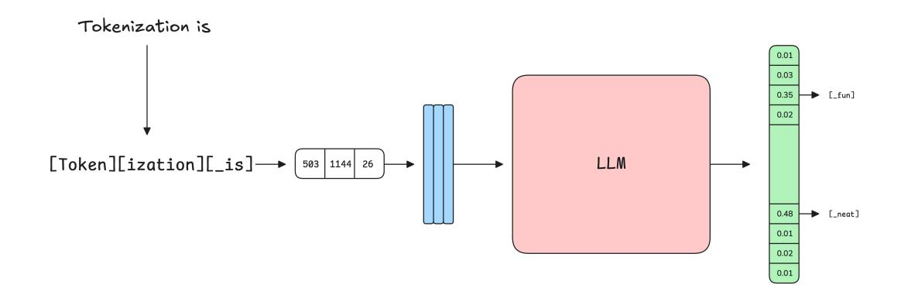

- There is a mismatch between what the user inputs and what the model processes!

### Subword Tokenization

- People read and write text
- Language models operate on tokens
- Tokens are produced by a subword tokenizer
  - Minor surface variations: [un][\_comfort][\_able] vs [un][comfort][able\_]
- Many competing goals:
  - Alignment with text/linguistic features
  - Coverage of all possible input text
  - Sequence compression
  - Parameter counts
- This is basically the "steering wheel" of LLMs

## Tokenizers Are Pretty Brittle

- This is ok in academic datasets, where data is fairly clean
- Not so true in real life, where users make tons of mistakes

<ss television<0x0A>Television<0x0A>TELEVISION

Figure: <https://huggingface.co/meta-llama>

## Tokenizers Are Pretty Brittle

**Tokenization** is at the heart of much weirdness of LLMs. Do not brush it off.

- Why can't LLM spell words? **Tokenization**.
- Why can't LLM do super simple string processing tasks like reversing a string? **Tokenization**.
- Why is LLM worse at non-English languages (e.g. Japanese)? **Tokenization**.
- Why is LLM bad at simple arithmetic? **Tokenization**.
- Why did GPT-2 have more than necessary trouble coding in Python? **Tokenization**.
- Why did my LLM abruptly halt when it sees the string "<|endoftext|>"? **Tokenization**.
- What is this weird warning I get about a "trailing whitespace"? **Tokenization**.
- Why the LLM break if I ask it about "SolidGoldMagikarp"? **Tokenization**.
- Why should I prefer to use YAML over JSON with LLMs? **Tokenization**.
- Why is LLM not actually end-to-end language modeling? **Tokenization**.
- What is the real root of suffering? **Tokenization**.

Figure: <https://twitter.com/karpathy/status/1759996551378940395>

# Origins of Tokenization

- Word-level
- Character-level
- Morpheme-level
- Needed something with total coverage, but finite vocabulary
  - Subwords are an intermediate granularity between words and characters
  - Subword vocabularies contain all characters, so any input can be represented
- Weird trivia: only 2 years between BPE and Transformers

# MaxMatch (WordPiece) Encoding

- Given a subword vocabulary, greedily find the longest matching token
- The subword vocabulary construction is not really relevant

| Step |   |   |   |   |   |   |   |
|------|---|---|---|---|---|---|---|
| 0.   | b | a | n | a | n | a | s |
| 1.   | b | a | n | a | n | a | s |
| 2.   | b | a | n | a | n | a | s |
| 3.   | b | a | n | a | n | a | s |

Figure: MaxMatch encoding of bananas with Γ = {a, b, n, s, ba, na, ban, bana}.

# Byte-Pair Encoding

- Two stages: training and inference

**Algorithm 2:** BPE Training

**Input:** Corpus  $C$  over alphabet  $\Sigma$ , Target merge size  $k$ 

**Output:** Vocabulary  $\Gamma$ , Merge list  $\mu$ 

| 1: $\Gamma = \Sigma$ , $\mu = \langle \rangle$                         | ▷ <i>The initial vocabulary and merge list, respectively.</i>                      |
|------------------------------------------------------------------------|------------------------------------------------------------------------------------|
| 2: <b>for</b> $i \in 1 \dots k$ <b>do</b>                              |                                                                                    |
| 3: $(a, b) = \arg \max_{(a, b) \in \Gamma^2} \text{COUNT}(C, a_{\_}b)$ | ▷ <i>The most frequent cooccurring pair in <math>C</math>.</i>                     |
| 4: $\text{APPEND}(\mu, (a, b))$                                        | ▷ <i>Add merge information to <math>\mu</math> (which is ordered by priority).</i> |
| 5: $\text{APPEND}(\Gamma, ab)$                                         | ▷ <i>Update the token vocabulary.</i>                                              |
| 6: $\text{APPLY}(C, (a, b))$                                           | ▷ <i>Merge all instances of <math>a_{\_}b</math> to ab in <math>C</math>.</i>      |
| 7: <b>return</b> $(\Gamma, \mu)$                                       |                                                                                    |

# Byte-Pair Encoding

---

**Algorithm 3:** BPE Tokenization**Input:** BPE Tokenizer  $\mathcal{B} = (\Gamma, \mu)$ , String  $w \in \Sigma^+$ 

**Output:** Tokenized sequence  $t \in \Gamma^+$ 

---

| 1: $t \leftarrow w$                                                             | ▷ The initial character sequence, interpreted as tokens.          |
|---------------------------------------------------------------------------------|-------------------------------------------------------------------|
| 2: $\psi \leftarrow \langle (t_i, t_{i+1}) \mid (t_i, t_{i+1}) \in \mu \rangle$ | ▷ The set of all current possible merges.                         |
| 3: <b>while</b> $\psi \neq \emptyset$ <b>do</b>                                 |                                                                   |
| 4: $(a, b) \leftarrow \arg \max_{\mu} \psi$                                     | ▷ The highest priority merge according to the ordering in $\mu$ . |
| 5: $t \leftarrow \text{APPLY}(t, (a, b))$                                       | ▷ Apply the merge and update $t$ .                                |
| 6: $\psi \leftarrow \langle (t_i, t_{i+1}) \mid (t_i, t_{i+1}) \in \mu \rangle$ | ▷ The new list of possible merges.                                |
| 7: <b>return</b> $t$                                                            |                                                                   |

---

# Byte-Pair Encoding

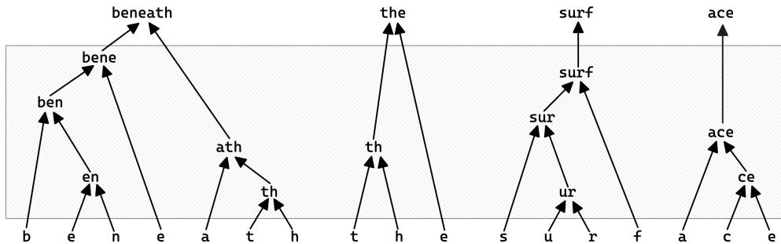


# Usage in Modern NLP

- All major GPT-style models use BPE
  - SENTENCEPIECE
  - TIKTOKEN
  - HUGGINGFACE
- BERT uses MaxMatch
- Vocabulary sizes over 200k
- Multi-lingual
- Pre-tokenization

### The Subword Lexicon Transducer

- Convert sequences of characters (text) into sequences of subwords

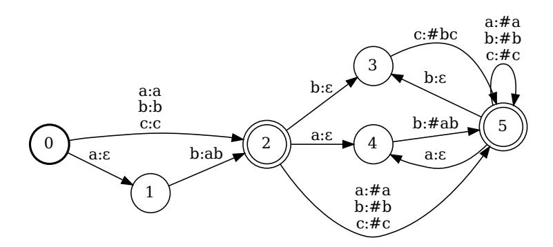

### The Subword Lattice

- Encode the input as an automaton
- Compose with the subword transducer
- Project to output labels
- MIN(PROJ(A T))

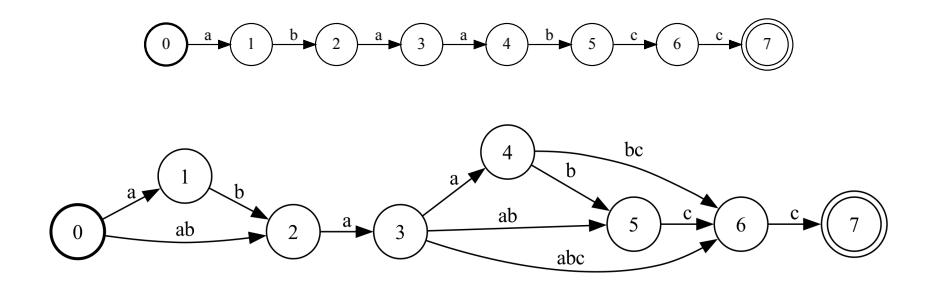

# An Aside: Sampling Tokenizations

- So far, we have considered tokenizers to be unweighted/bijective
  - What if they were weighted (e.g., stochastic tokenizers)?
- During training:
  - Acts as data augmentation
  - Adds robustness to the model
  - Makes it more likely all tokens are trained well
- During inference:
  - Acts as self-ensemble
  - Can be used for importance sampling (marginalization)

# An Aside: Sampling Tokenizations

---

**Inputs:** Word  $w \in \Sigma^+$ , (Ordered) Merges  $\mu$ 

**Output:** Tokenized sequence  $t \in \mathcal{V}^+$ 

---

```
1:  $\varphi \leftarrow \langle (w_i, w_{i+1}) | (w_i, w_{i+1}) \in \mu \wedge \text{RAND}() > p \rangle$   
2: for  $\varphi \neq \emptyset$  do  
3:    $(x, y) \leftarrow \arg \max_{\mu} \varphi \quad \triangleright$  Ordered by  $\mu$   
4:    $w \leftarrow \text{REPLACE}((x, y) \rightarrow xy, w)$   
5:    $\varphi \leftarrow \langle (w_i, w_{i+1}) | (w_i, w_{i+1}) \in \mu \wedge \text{RAND}() > p \rangle$   
6: return  $w$
```

---

Algorithm 1: BPE Inference (with dropout)

---

**BPE-Dropout**  $p = 0.1$ 

---

| to ken ization | 97.77%  |
|----------------|---------|
| to ken ization | 1.89%   |
| to ken ization | 0.25%   |
| to ken ization | 0.04%   |
| to ken ization | 0.03%   |
| to ken ization | 0.01%   |
| to ken ization | 0.01%   |
| to ken ization | < 0.01% |

---

# An Aside: Sampling Tokenizations

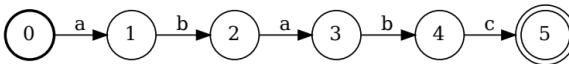

(a) An automaton  $\mathcal{A}$  representing ababc.

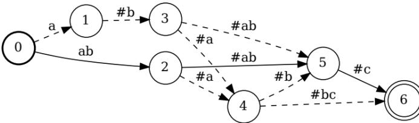

(c) A lattice,  $\mathcal{A} \circ \mathcal{T}$ , of all possible tokenizations of ababc.

### Constrained Generation

- Language models can output any text
- Sometimes we want it to output only a specified format
  - Strings that match a regex
  - JSON
  - Syntactically correct code
- What if we could attach a regex to the end of a model?
  - We can do it with a modular FST pipeline

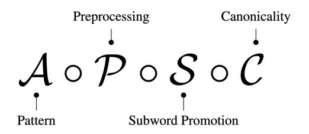

# Locally Masked Constrained Generation

- Standard autoregressive distribution is:
  - p(t<sup>i</sup> | cl) = SOFTMAX (l)<sup>i</sup>
  - p(t) = p(t<sup>1</sup> | <s>) Q|t|−1 i=<sup>1</sup> p(t<sup>i</sup>+<sup>1</sup> | <s>t1t<sup>2</sup> . . . ti)
- Define a constraint mask:

$$m_i = \begin{cases} 1 & v_i \in \Gamma \text{ can satisfy the constraint} \\ -\infty & \text{otherwise.} \end{cases}$$

- Constraint satisfication comes from the tokenization lattice
- "Is there a path from the current state to a final state after reading this token?"
- Replace with a masked distribution:
  - p ′ (ti | cl) = SOFTMAX (l ⊙ m)<sup>i</sup>
  - p ′
- (t) = p ′ (t<sup>1</sup> | <s>) Q|t|−1 i=<sup>1</sup> p ′ (t<sup>i</sup>+<sup>1</sup> | <s>t1t<sup>2</sup> . . . ti)

### Three Problems With Constrained Generation

- Mismatch between regex (character level) and LLMs (subword level)
  - Solved by the subword lexicon transducer
  - Promotes character patterns to subword patterns
- Warped distribution
  - Missing a normalization factor for p(A)
  - Solved by importance sampling
- Allows any matching tokenization
  - Throws away canonical tokenization inductive bias

# Importance Sampling and Marginalization

- Constrained generation needs a normalization factor:
  - p ′
- (t) = p(t)/z
- z = P <sup>t</sup>∈<sup>A</sup> p(t)
- Difficult to compute (exponentially many tokenizations)
- Difficult to sample with rejection sampling
- Importance Sampling:
  - Pick a proxy distribution q with the desired support
  - q should be easy to sample from
  - Compute <sup>E</sup>t∼<sup>q</sup> h p(t) q(t) i ≈ 1 N P t p(t) q(t)
- p ′ can serve as our proxy distribution

# Tokenization-Aware Constrained Generation

- • Constrained generation allows *any* matching tokenization
- • Models are trained on *canonical* tokenizations
- • During generation, models don't know they are being constrained
  - ◦ Can accidentally generate poor tokenizations
  - ◦  $[\_r][a][ce][car]$  vs  $[\_race][car]$
  - ◦ Bad downstream performance

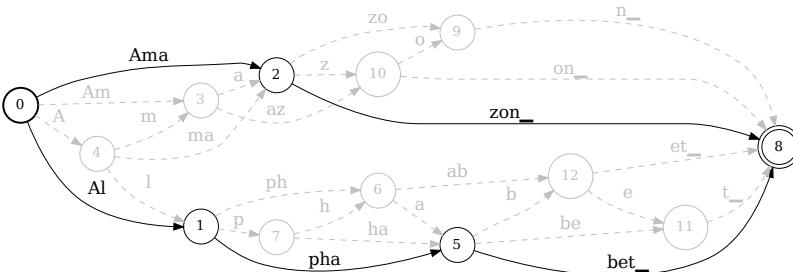

# An Example With MaxMatch

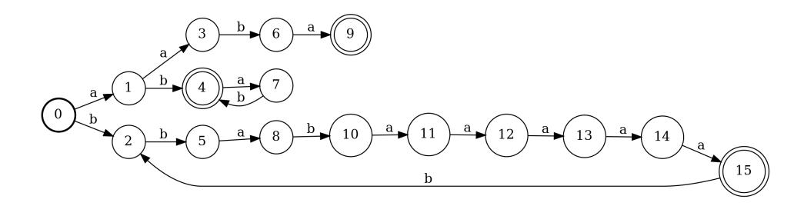

## An Example With MaxMatch

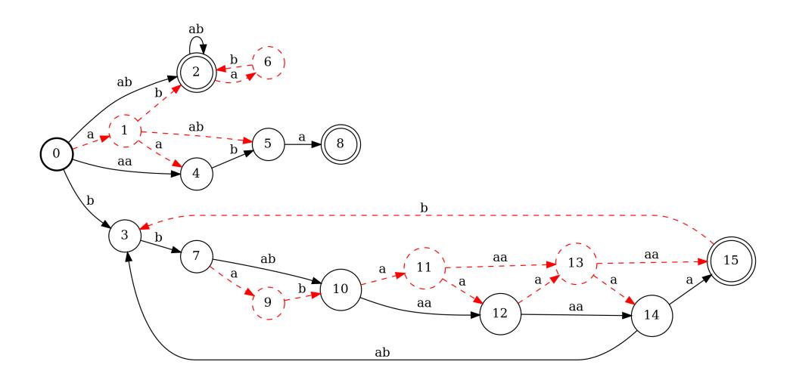

# An Example With MaxMatch

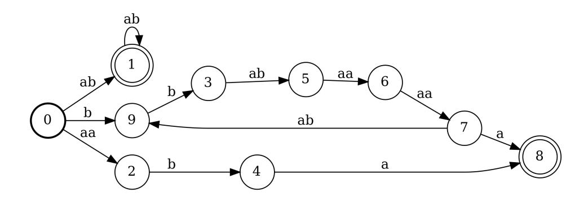

# The MaxMatch Lexicon Transducer

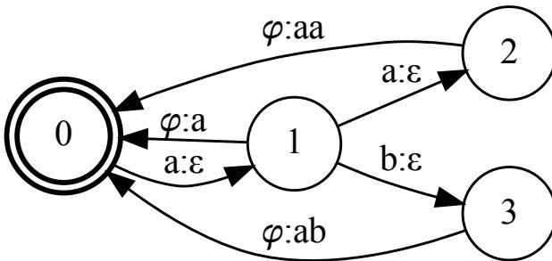

# Is Byte-Pair Encoding Regular?

- Doesn't process in left-to-right order×
  - Merges can happen in random places in the string
- Requires a notion of "priority"×
  - Some merges take precedence over others
- Recent result showed you only need a constant-lookahead window to tokenize in a streaming manner ✓
  - Berglund & van der Merwe, 2023

# An Algorithm for BPE Promotion

- Berglund, et al. 2024 give an algorithm for BPE promotion
- For each merge, iteratively check triplets of states to see if they match, then modify the states/arcs
- Runs in polynomial time and space

# BPE As Finite-State Transduction

---

**Algorithm 5:** Iterative BPE**Input:** Word  $w \in \Sigma^+$ , BPE Tokenizer  $\mathcal{B} = (\Gamma, \mu)$ 

**Output:** Tokenized sequence  $t \in \Gamma^+$ 

---

1. 1: **for**  $(a, b) \in \mu$  **do**
2. 2:      $w \leftarrow$  APPLY( $(a, b), w$ )
3. 3: **return**  $w$

---

- • We construct transducers that act as merges
- • Everything is done via finite-state automata composition

# BPE Merge Gadgets

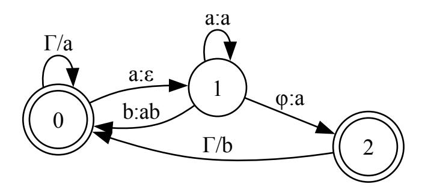

Figure: Merge gadget for the merge (a, b) → ab.

# BPE Merge Gadgets

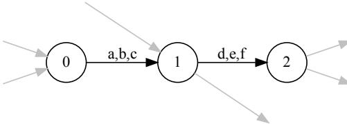

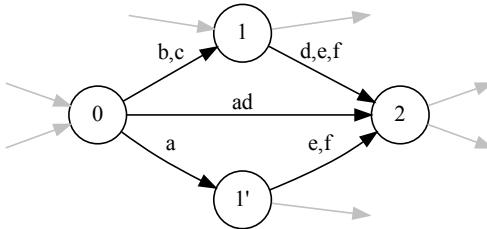

### BPE Transduction

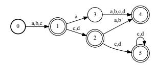

Figure: An automaton A.

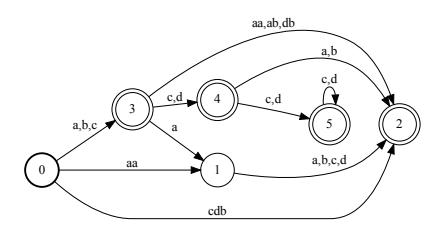

Figure: MIN(PROJ(A ◦ T))

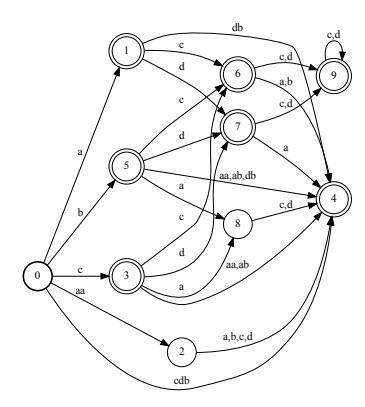

Figure: MIN(PROJ(A ◦ G(a,a) ◦ G(a,b) ◦ G(d,b) ◦ G(c,db)))

## BPE Transduction Complexity

- Naive analysis: O(<sup>3</sup> |µ| |A||µ|)
  - Prohibitively expensive even for small vocabularies
  - GEMMA3 has 260k tokens in the vocabulary
- We prove the complexity is actually polynomial

## BPE Transduction

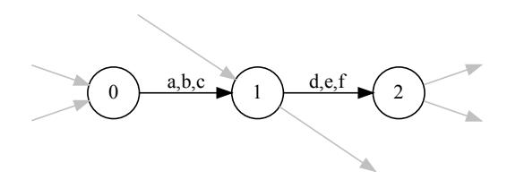

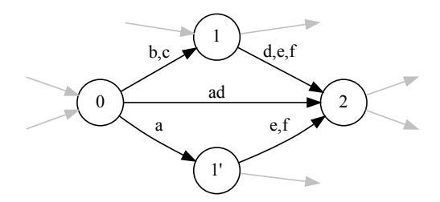

# A Very Brief Proof Sketch

- Merges act on triplets of states
  - Merge (a, b) ∈ µ
  - x, y, z ∈ A, s.t. δ(x, a) = y and δ(y, b) = z
- Merges "split" state y into y ′ , y ′′ .
  - We call these derived triplets from the triplet x, Y, z (y, y ′ , y ′′, etc ∈ Y)
- An issue is if more than one state in a derived subset can be split during a merge
  - A merge (c, d) ∈ µ that matches (x, y ′ , z) and (x, y ′′ , z) ∈ Y
  - Or (x ′ , y, z) and (x ′′ , y, z)
  - If so, we get exponential blowup
- We prove this cannot happen
  - Each derived triplet can only add one new distinct state per merge
- This bounds the runtime size at Poly(|A|, |µ|)
  - And therefore also the automaton size

### An Alternative Promotion Procedure

- Full composition is very slow
  - MIN(PROJ(A G<sup>µ</sup><sup>1</sup>
- G<sup>µ</sup><sup>2</sup>
- · · · G<sup>µ</sup><sup>k</sup> )) is inherently serial
- We are usually minimizing between each composition
- In practice, most merges are unnecessary
- What if we had a "canonical filter"?
  - ABPE = MIN(PROJ(Σ <sup>∗</sup> ◦ G<sup>µ</sup><sup>1</sup>
- G<sup>µ</sup><sup>2</sup>
- · · · G<sup>µ</sup><sup>k</sup> ))
- Accepts all canonical BPE sequences
- Slow to construct, but can be reused
- Combine with MIN(PROJ(A T)), which is fast to construct

$$\text{Min}(\text{PROJ}(\mathcal{A} \circ G_{\mu_1} \circ G_{\mu_2} \circ \cdots \circ G_{\mu_k})) \equiv \text{Min}(\text{PROJ}(\mathcal{A} \circ \mathcal{T})) \circ \mathcal{A}_{\text{BPE}}$$

# An Alternative Promotion Procedure (Speedup)

| Vocabulary Size | Full Composition (Equation 4) | Preconstructed $A_{\text{BPE}}$ (Equation 5) | Speedup |
|-----------------|-------------------------------|----------------------------------------------|---------|
| 4k              | 16.09s                        | 0.19s                                        | 85x     |
| 8k              | 43.39s                        | 0.24s                                        | 181x    |
| 16k             | 103.37s                       | 0.38s                                        | 272x    |
| 32k             | 228.57s                       | 0.45s                                        | 514x    |

Figure: Full composition vs preconstructed BPE filter composition on an edit-distance automaton with 2k states.

## A Speedup From Canonicalization

```
{
    "alias": "[a-z]{1,5}",
    "description": "[A-Z][a-z]{0-9}{\w\s,.!?}{1,3}",
    "type": "(Bug|Dark|Dragon|Electric|Fairy|Fighting|Fire|Flying|Ghost|Grass|Ground|Ice|Normal|Poison|Psychic|Rock|Steel|Stellar|Water)",
    "height_m": [0-9]{1,2}\.{0-9}{1},
    "weight_kg": [0-9]{1,3}\.{0-9}{1},
    "evolution_stage": "(Basic|Stage 1|Stage 2)",
    "legendary": "(true|false)",
    "abilities": [
        "(Overgrow|Blaze|Torrent|Shield Dust|Intimidate|Levitate|Pressure|Static)"(, "(Overgrow|Blaze|Torrent|Shield Dust|Intimidate|Levitate|Pressure|Static)"){0,6}
    ]
}
```

| Model      | Canonical tel | Spec large Rate | Ret. Time |
|------------|---------------|-----------------|-----------|
| LLAMA2-7B  | no            | 24.5%           | -         |
|            | yes           | 77.9%           | -15.7%    |
| LLAMA2-13B | no            | 26.5%           | -         |
|            | yes           | 78.9%           | -21.0%    |

# What Comes with Proving Things Are Regular?

- ● Pros:

- ○ Tokenizer equivalence testing
- ○ Tokenizer minimization
- ○ Hook into all transducer machinery

- ● Cons:

- ○ Some linguistic features are not regular
  - - Reduplication
  - - 드르렁드르렁
- ○ These can't be perfectly captured by existing tokenizers

# Pretokenizer Issues

```
"normalizer": {
  "type": "Sequence",
  "normalizers": [
    {
      "type": "Prepend",
      "prepend": "_"
    },
    {
      "type": "Replace",
      "pattern": {
        "String": " "
      },
      "content": "_"
    }
  },
  "pre_tokenizer": null,
```

```
pat_str = "|".join(
```

```
[
```

```
r"""[^\r\n\p{L}\p{N}]?[\p{Lu}\p{Lt}\p{Lm}\p{Lo}\p{M}]*[\p{Ll}]'
```

```
r"""[^\r\n\p{L}\p{N}]?[\p{Lu}\p{Lt}\p{Lm}\p{Lo}\p{M}]+[\p{Ll}]'
```

```
r"""\p{N}{1,3}""",
```

```
r"""?[^\s\p{L}\p{N}]+[\r\n/]*""",
```

```
r"""\s*[\r\n]+""",
```

```
r"""\s+(?!\S)""",
```

```
r"""\s+""",
```

```
]
```

```
)
```

```
.
```

# Unreachable Tokens

| token id | decoded to token | re-encoded  | strings for re-encoded |
|----------|------------------|-------------|------------------------|
| 3413     | " I'"            | [357, 6]    | [' I', "'"]            |
| 3914     | '\n//'           | [198, 393]  | ['\n', '//']           |
| 24091    | '\r\n//'         | [370, 393]  | ['\r\n', '//']         |
| 48235    | '\n///'          | [198, 5991] | ['\n', '///']          |
| 63100    | '\n\n//'         | [279, 393]  | ['\n\n', '//']         |
| 65447    | '\n//\n//'       | [198, 5754] | ['\n', '//\n//']       |
| 125141   | '\r\n\r\n//'     | [1414, 393] | ['\r\n\r\n', '//']     |
| 175653   | '\n\n\n//'       | [2499, 393] | ['\n\n\n', '//']       |

Figure: <https://tokencontributions.substack.com/p/unreachable-tokens-in-gpt-4o>

### Future Work

- Runtime/space-complexity analysis for CFG
- Tokenization algorithms with better properties
  - Runtime
  - Space-complexity for composition
  - Output compression
- Interaction with non-regular pretokenization
  - This precludes end-to-end finite-state pipelines
- Constrained Generation with Diffusion Language Models
  - These don't generate text from left-to-right, so automata might not be a good choice


## The Tokenization Discord

Figure: Slides + Reading List Figure: My Personal Site